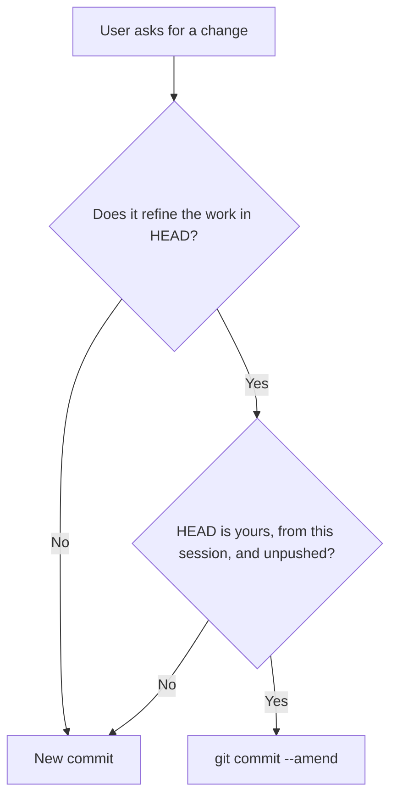

# Always commit

<!-- This skill should be converted to hooks -->

## At at the start of a session

Once per repository you are working on, add an empty commit


```text
🤖 <agent name>: Session Start: <session id>

<harness>/<model>
```

## Subequent changes

Before you end the turn, be sure to commit
```text
🤖 <agent name>: <description>

Session ID: <session id>
<harness>/<model>
```

You may also have additional instructions relating to commit message formatting - also incorporate those instructions into the message. 

## When the user refines your last change

Before committing, check whether the change is a correction or tweak to the last commit. If so, amend it.



Typical refinements: "use X instead", "rename that", a fix to something you just added.

✅ **Do this**

- Run `git log -1 --format=%B` and `git status -sb` first, to see whether HEAD is yours and whether it is pushed.
- Stage only the files or hunks you changed, then `git commit --amend`.
- Update the message if the amended commit no longer matches it.

❌ **Don't do that**

- Don't add a "Use X instead" commit on top of the commit that introduced the thing.
- Don't amend a commit that is pushed, or that someone else (or an earlier session) made.
- Don't use `git commit -a --amend`. Unrelated changes in the tree would be swept into the commit.

**Rationale:** One logical change should be one commit. A chain of tweak commits makes history noisy, and hides what was finally decided. Amending is safe here because the commit is unpushed and yours, so nobody else's history is rewritten.

## If you discover changes unrelated to your work

Leave the changes uncommited. At the end of the the turn /user-get-attention informing them of the uncommited changes. 

## If the user tells you to commit unrelated changes. 

Commit the changes in logically cohesive units at appropriate granularity. 

Use the following format in the commit message: 

```
🤖 🪎 <agent name>: <description>

Session ID: <session id>
<harness>/<model>
```