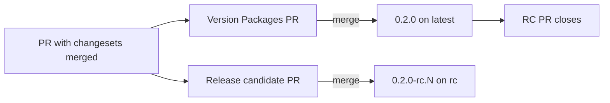

## Use Bun

The `node` APIs are banned. 

Use Bun's APIs instead.

```ts
// ✅ Do
import { file } from "bun";
const config = await file("config.json").json();

// ❌ Don't
import { readFile } from "node:fs/promises";
const config = JSON.parse(await readFile("config.json", "utf8"));
```

If needing to execute shell commands, use bun's `$` command.

```ts
// ✅ Do
import { $ } from "bun";
await $`git status --short`;

// ❌ Don't
import { execSync } from "node:child_process";
execSync("git status --short");
```

## Versioning while in 0.x

While the package is below 1.0.0, shift every changeset bump down one level.

| Change | Changeset type | Example from 0.1.0 |
|---|---|---|
| Breaking change | `minor` | 0.2.0 |
| New feature | `patch` | 0.1.1 |
| Bug fix | `patch` | 0.1.1 |

Never use `major` until we decide to release 1.0.0.

✅ **Do this**

```md
---
"thunderjar": patch
---

Add an `init` command.
```

❌ **Don't do that**

```md
---
"thunderjar": minor
---

Add an `init` command.
```

**Rationale:** Changesets applies bump types literally. It has no setting for 0.x, so a `minor` changeset for a new feature releases 0.2.0, and a `major` one releases 1.0.0. Under the 0.x convention, a minor version bump means a breaking change, so you have to choose the shifted type yourself.

## Docs are versioned

The docs site publishes the docs of every stable release, not of main.

- A docs change only goes live with a release.
  - To fix the published docs, add a patch changeset to the PR.
- Releases with identical docs share one build, and one entry in the version switcher.
- Build the whole site locally with `bun run docs:build:versions`.
  - Output goes to `.versioned-docs/dist`.

## Releases

Every release is published to npm from [release.yml](.github/workflows/release.yml). npm trusted publishing trusts only that one workflow file, so don't move publishing into another workflow.

| Release | How it's made | Version | npm tag |
|---|---|---|---|
| Stable | Merge the "Version Packages" PR | `0.2.0` | `latest` |
| Release candidate | Merge the "Release candidate" PR | `0.2.0-rc.0`, `0.2.0-rc.1`, … | `rc` |
| Preview | Comment `/preview` on an open PR (write access only) | `0.2.0-preview-abc1234` | `preview` |



- The base version (`0.2.0` above) is what the pending changesets would release. For a preview, these are the PR's changesets. With none, it's a patch bump.
- The RC PR only changes `.release/rc.json`. Versions in `package.json` and the changelog on `main` are only changed by the stable release.
- The RC PR reopens when a PR with new changesets is merged, and its number goes up from the last `-rc.N` tag.
- RCs get a git tag and a GitHub pre-release. Previews get neither, just a comment on the PR.
- `/preview` builds the PR head as it is when the workflow runs. To be sure a later push isn't built, comment `/preview <sha>`, and it fails unless that's still the head.
- Only stable tags get docs. RC tags are skipped.

The version logic is in [release-versions.ts](scripts/release-versions.ts).

**Rationale:** RCs and stable releases come from the same changesets, but RC PRs never touch `main`'s versions. This keeps the stable Version Packages PR working as before.
