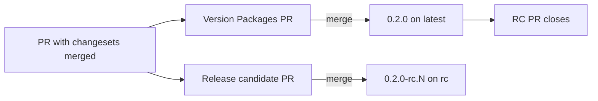

## Use Bun

The `node` APIs are banned. 

Use Bun's APIs instead.

```ts
// ✅ Do
import { file } from "bun";
const config = await file("config.json").json();

// ❌ Don't
import { readFile } from "node:fs/promises";
const config = JSON.parse(await readFile("config.json", "utf8"));
```

If needing to execute shell commands, use bun's `$` command.

```ts
// ✅ Do
import { $ } from "bun";
await $`git status --short`;

// ❌ Don't
import { execSync } from "node:child_process";
execSync("git status --short");
```

For paths and files, `src/platform/` has what Bun lacks: POSIX path functions in `path.ts`, in place of `node:path`, and file helpers in `fs.ts`, in place of `node:fs` and `node:os`. Code anywhere in the repository may import them.

```ts
// ✅ Do
import { join } from "../src/platform/path.ts";
import { makeTempDir } from "../src/platform/fs.ts";

// ❌ Don't
import { join } from "node:path";
import { mkdtemp } from "node:fs/promises";
```

**Rationale:** Bun has no path module of its own, and its file APIs don't cover everything, such as temp directories or recursive listing. One shared set of helpers saves every file from writing its own. `bun run lint` fails a `node:` import anywhere: `src/`, `scripts/` and tests alike.

## Delivery

At each step of a delivery, this project should produce a _working_ npm-publishable artifact.

All commands in the CLI should work, even if working means printing a "Not implemented" message.

That is, `npx thunderjar init` should produce code that has no import or type errors.

### Committing and tests

Don't leave code uncommitted. Always commit changes before handing back to the user.

Commit changes in sensible blocks. Use your judgement as to whether an `--amend` commit is appropriate.

When given feedback that behaviour should change:

- Write a test that detects the behaviour first, and commit it with a message starting with the 🔴 emoji, to show the test fails.
- Write the fix, and commit it with a message starting with the 🟢 emoji.

## Source layout

`src/` is in layers that only import downward. The CLI is in `src/cli/`: each command has a folder under `src/cli/commands/`, and `src/cli/program.ts` adds them to the Commander program. Read [src/AGENTS.md](src/AGENTS.md) before adding or moving a module.

## Fixture tests

Each scenario is described in [fixtureTests/AGENTS.md](fixtureTests/AGENTS.md).

`fixtureTests/` holds checked-in Thunderjar projects that the CLI is run against, the way a user would run it. Every command test runs against one of these scenarios.

**Rationale:** a test that builds its project in a temp folder can't be checked by hand. With a real project on disk, a developer can run the same command the test runs and see the same output:

```sh
bun run fixture scenario_2 run two-pairs --dry-run   # or just: bun run fixture 2 …
```

### Run against a scenario, unchanged

✅ **Do** run the command against a checked-in scenario as it is, and assert only on what the command produced: its output, its exit code, and the files or images it wrote.

❌ **Don't** generate a project or patch a scenario's files in a test. Any variation a test needs, such as an empty parameter folder or a store with a failed run, belongs in a scenario: add it to one that fits, or add a scenario.

**Rationale:** a project made or changed by a test only exists while the test runs, so nobody can run the command against it by hand.

### Scenarios don't know about their tests

✅ **Do** keep every expected result in the test. A scenario is a project and the state it starts in: its declarations, and anything already on disk, such as a checked-in run data store.

❌ **Don't** name anything in a scenario after a test, or keep expected output in it.

**Rationale:** tests of many commands share a scenario. One that holds a test's expectations can't be read as a plain project, or changed for another test without breaking the first.

### Copy only for commands that write into the project

✅ **Do** run in place, in the scenario's `fixtures/`. Only `init`, which writes into the project, works on a copy (`copyOfFixtures()` in `src/testing/cli.ts`). A real `run` runs in place too, with `--data-dir` set to a temp folder, and never in a scenario with a checked-in run data store. `remeasure` writes into that store, so it runs in place with `--data-dir` set to a temp folder holding an unmodified copy of the scenario's `runs.json`. `generate` writes only the gitignored `.thunderjar/_generated/`, so it runs in place, and its test deletes that file first.

❌ **Don't** copy a scenario for a command that only reads it, such as `plan`, `show` or a dry run.

**Rationale:** in place, a test runs exactly what `bun run fixture` runs. The copy is only there so no test changes a checked-in scenario: `git status` is clean after the full suite.

### Other rules

- **Each folder is a scenario, not a feature.** Name it `scenario_<n>_<what the project is>`, e.g. `scenario_2_typical_project`, not `run`. A scenario is a kind of project, and tests of any command can use it.
- **Each scenario has `fixtures/.thunderjar/`** (the project) and a `tsconfig.json`, so `fixtureTests/typecheck.test.ts` type-checks it too. The exceptions are a project before `init`, which has neither, and a project broken on purpose, which has no `tsconfig.json`: its declarations don't type-check, or `generate` fails. `thunderjar` resolves from every scenario through the checked-in link `fixtureTests/node_modules/thunderjar`.
- **A command's tests sit beside the command**, e.g. `build`'s are in `src/cli/commands/build/build.test.ts`. They reach a scenario through `scenario()` in `src/testing/cli.ts`. See [src/AGENTS.md](src/AGENTS.md).
- **Tests drive the CLI**, not internal functions, using `src/testing/cli.ts`. They normalise only what changes between runs (execution ID, `$TMPDIR`, durations), so expected output reads like what's printed.
- **Real-Docker tests tag their images with a throwaway prefix** and delete every image under it afterwards. They sit in `<command>.docker.test.ts` and run under `bun run test:docker` only.
- **Behaviour the CLI can't trigger** (e.g. a crash injected through a runner) stays in `src/` unit tests.

## Never refer to real agents in tests

Fixtures and `src/` unit tests never name a real agent: no real harness (claude-code, codex, …), no real model, and none of their files (`CLAUDE.md`, …). Use:

| | Name | Model ID | Behaviour |
|---|---|---|---|
| harness | `fake-harness-alpha` | | writes a buggy `isPrime.ts` with a `@ts-ignore` |
| harness | `fake-harness-beta` | | writes a correct `isPrime.ts` |
| model | `fake-model-small` | `fake-model-small-001` | |
| model | `fake-model-large` | `fake-model-large-001` | |

Both harnesses' `cli` really run, so any test case can be run for real by hand, and the two give different measures. Misbehaving agents (failing, hanging) are further versions of `fake-harness-alpha`; see `fixtureTests/scenario_3_misbehaving_agents`.

The one exception is `src/cli/commands/init/init.ts` and its test: `init` scaffolds claude-code for real users, and the test checks exactly that.

**Rationale:** tests mustn't look like they depend on, cost money with, or endorse a real product, and an obviously fake name makes it clear which agent produced what.

## Versioning while in 0.x

While the package is below 1.0.0, shift every changeset bump down one level.

| Change | Changeset type | Example from 0.1.0 |
|---|---|---|
| Breaking change | `minor` | 0.2.0 |
| New feature | `patch` | 0.1.1 |
| Bug fix | `patch` | 0.1.1 |

Never use `major` until we decide to release 1.0.0.

✅ **Do this**

```md
---
"thunderjar": patch
---

Add an `init` command.
```

❌ **Don't do that**

```md
---
"thunderjar": minor
---

Add an `init` command.
```

**Rationale:** Changesets applies bump types literally. It has no setting for 0.x, so a `minor` changeset for a new feature releases 0.2.0, and a `major` one releases 1.0.0. Under the 0.x convention, a minor version bump means a breaking change, so you have to choose the shifted type yourself.

## Docs are versioned

The docs site publishes the docs of every stable release, not of main.

- A docs change only goes live with a release.
  - To fix the published docs, add a patch changeset to the PR.
- Releases with identical docs share one build, and one entry in the version switcher.
- Build the whole site locally with `bun run docs:build:versions`.
  - Output goes to `.versioned-docs/dist`.

## Releases

Every release is published to npm from [release.yml](.github/workflows/release.yml). npm trusted publishing trusts only that one workflow file, so don't move publishing into another workflow.

| Release | How it's made | Version | npm tag |
|---|---|---|---|
| Stable | Merge the "Version Packages" PR | `0.2.0` | `latest` |
| Release candidate | Merge the "Release candidate" PR | `0.2.0-rc.0`, `0.2.0-rc.1`, … | `rc` |
| Preview | Comment `/preview` on an open PR (write access only) | `0.2.0-preview-abc1234` | `preview` |



- The base version (`0.2.0` above) is what the pending changesets would release. For a preview, these are the PR's changesets. With none, it's a patch bump.
- The RC PR only changes `.release/rc.json`. Versions in `package.json` and the changelog on `main` are only changed by the stable release.
- The RC PR reopens when a PR with new changesets is merged, and its number goes up from the last `-rc.N` tag.
- RCs get a git tag and a GitHub pre-release. Previews get neither, just a comment on the PR.
- `/preview` builds the PR head as it is when the workflow runs. To be sure a later push isn't built, comment `/preview <sha>`, and it fails unless that's still the head.
- The `/preview` comment run doesn't publish. npm rejects OIDC tokens from `issue_comment` runs, so the comment run dispatches `release.yml` on `main`, and that `workflow_dispatch` run builds and publishes. You can also start it by hand with `gh workflow run release.yml -f pr=<number>`.
- Only stable tags get docs. RC tags are skipped.

The version logic is in [release-versions.ts](scripts/release-versions.ts).

**Rationale:** RCs and stable releases come from the same changesets, but RC PRs never touch `main`'s versions. This keeps the stable Version Packages PR working as before.
