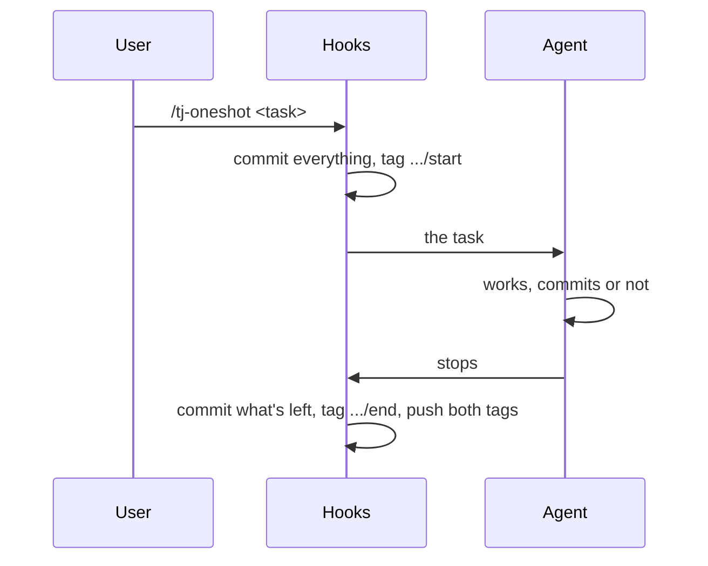

<!--
🤖
This file was created with AI

Harness: Claude Code
Model: claude-opus-5-5
Session Id: 2c687305-6347-4bf9-986d-08bb47278936
Supervising engineer: blacksheep-bot


Humans: add your notes here


-->

# Thunderjar plugin for Claude Code

`/tj-oneshot <task>` does a task in one go and records it as git tags, so it can be replayed later as a Thunderjar eval.

## Install

Requires [Bun](https://bun.sh), like the `thunderjar` CLI.

For yourself:

```sh
claude plugin marketplace add dwjohnston/thunderjar
claude plugin install thunderjar@thunderjar
```

For everyone working in a repository, run these there and commit the `.claude/settings.json` they write:

```sh
claude plugin marketplace add dwjohnston/thunderjar --scope project
claude plugin install thunderjar@thunderjar --scope project
```

## Use

```text
/tj-oneshot Add a --verbose flag to the CLI
```

`/thunderjar:tj-oneshot` works too.

## What gets recorded



- **Start**, a `UserPromptSubmit` hook, before the agent sees the prompt:
  - Commits everything in the working tree as `🎯 tj-oneshot start: <session>`, an empty commit when it's clean.
  - Tags it `thunderjar/oneshot/<session>/start`. The tag message holds the task exactly as typed, the harness and its version, the effort level, the branch and the commit before the start, as JSON.
  - If it can't record the start, e.g. outside a git repository, it blocks the prompt and says why.
- **End**, a `Stop` hook, the first time the agent finishes after the start:
  - Commits whatever the agent left uncommitted as `🏁 tj-oneshot end: <session>`, an empty commit when nothing is left.
  - Tags it `thunderjar/oneshot/<session>/end`, with the models used, the agent's own commits, the files it left uncommitted and its final message.
  - Pushes both tags to `origin`. The branch isn't pushed: the tags carry the commits with them.

Both commits skip the repository's commit hooks, so a failing lint can't lose the record. Files matched by `.gitignore` aren't recorded.

## Read a recording

Tags only come with a fetch when you ask for them:

```sh
git fetch origin 'refs/tags/thunderjar/oneshot/*:refs/tags/thunderjar/oneshot/*'
```

Then:

```sh
git tag -l 'thunderjar/oneshot/*'                                         # every recording
git tag -l --format='%(contents)' thunderjar/oneshot/<session>/start      # the prompt and details
git diff thunderjar/oneshot/<session>/start thunderjar/oneshot/<session>/end   # what the agent did
```

## Limits

- One one-shot per session. Start a new session for the next one.
- Changes outside the repository, or in ignored files, aren't recorded.
- The start tag's `model` is only known when the session has had an earlier turn. The end tag always has it.
