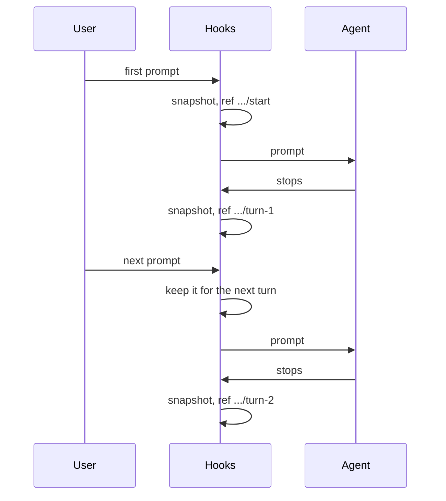

<!--
🤖
This file was created with AI

Harness: Claude Code
Model: claude-opus-5-5
Session Id: 2c687305-6347-4bf9-986d-08bb47278936
Supervising engineer: blacksheep-bot


Humans: add your notes here


-->

# Thunderjar plugin for Claude Code

Capture records every Claude Code session in a git repository: each prompt, and the code before the first turn and after every turn. Later, you can pick the sessions that would make good Thunderjar evals and replay them.

Nothing changes on your branch, your index or your working tree. The records are git refs outside `refs/heads` and `refs/tags`, so they don't show up in `git branch` or `git tag`.

## Install

Requires [Bun](https://bun.sh), like the `thunderjar` CLI.

For yourself:

```sh
claude plugin marketplace add dwjohnston/thunderjar
claude plugin install thunderjar@thunderjar
```

For everyone working in a repository, run these there and commit the `.claude/settings.json` they write:

```sh
claude plugin marketplace add dwjohnston/thunderjar --scope project
claude plugin install thunderjar@thunderjar --scope project
```

## Turn capture on

Capture is off until `THUNDERJAR_CAPTURE=1` is set. While it's off, both hooks exit straight away.

Set it for one repository, just for you, in `.claude/settings.local.json`:

```json
{
  "env": {
    "THUNDERJAR_CAPTURE": "1"
  }
}
```

Or in `~/.claude/settings.json` for every repository, or `export THUNDERJAR_CAPTURE=1` before starting `claude`.

## What gets recorded



```text
refs/thunderjar/capture/<session>/start    the first prompt, and the tree before any work
refs/thunderjar/capture/<session>/turn-1   the tree after the 1st turn
refs/thunderjar/capture/<session>/turn-2   the tree after the 2nd turn, with the prompt that started it
```

- Each ref points at an annotated tag object, whose message is a JSON record.
- The tag points at a snapshot commit of the whole working tree, untracked files included. The commit is on no branch. Its parent is `HEAD` at the time, so `git diff <ref>^ <ref>` shows what was left uncommitted.
- Files matched by `.gitignore` aren't recorded.

The `start` record holds:

- the prompt, verbatim
- `dirty`, whether the tree differed from `HEAD`, the `headAtStart` commit and the branch
- the harness, its version, the session ID, the transcript path and the permission mode

Each `turn-<n>` record holds:

- the turn number, and the prompt that started it: `null` for turn 1, whose prompt is in `start`
- `laterPrompts`, sent after the turn began. Claude Code doesn't run the `Stop` hook when you interrupt the agent, so the next prompt joins the same turn.
- `headAtStop`, the agent's commits since the previous turn, and the files left uncommitted
- `historyRewritten`, true when `headAtStart`, or the previous turn's head, is no longer an ancestor of `HEAD`, e.g. after a rebase or an amend
- the models used and the agent's last message

A turn ends whenever the main agent stops. Subagents stopping don't count.

The hooks never block a prompt or stop the agent. Errors go to `.git/thunderjar/capture.log`. Set `THUNDERJAR_CAPTURE_LOG_LEVEL=verbose` (default `none`) to also log each step there. The prompts of a later turn wait in `.git/thunderjar/<session>/pending.json` until the turn ends.

## Read the records

List every capture, with a verdict for triage:

```sh
bun "<plugin>/scripts/list.ts"
```

```text
Started           Verdict   Turns  Session                               Prompt
2026-11-16 09:03  one-shot  1      0f9c…                                 Add a --verbose flag to the CLI
```

| Verdict | Rule |
|---|---|
| `incomplete` | A `start` ref with no turns |
| `question` | The last turn's tree is the same as start's tree |
| `rewritten` | `historyRewritten` on any turn |
| `one-shot` | 1 turn |
| `few-shot` | 2–3 turns |
| `conversation` | More than 3 turns |

The first rule that applies wins. Add `--json` for the full records.

`<plugin>` is the plugin's folder, e.g. `plugins/thunderjar` in a clone of this repository. Run the scripts from inside the repository whose captures you want.

With git alone:

```sh
git for-each-ref refs/thunderjar/capture/                                   # every ref
git cat-file tag refs/thunderjar/capture/<session>/start                    # a record
git diff refs/thunderjar/capture/<session>/start refs/thunderjar/capture/<session>/turn-1   # what turn 1 did
```

## Share the records

Refs outside `refs/heads` and `refs/tags` aren't pushed or fetched unless you ask:

```sh
bun "<plugin>/scripts/push.ts"           # push every capture to origin
bun "<plugin>/scripts/push.ts" --fetch   # fetch them
```

These run `git push` or `git fetch` with `refs/thunderjar/capture/*:refs/thunderjar/capture/*`. Refs are only ever added, so neither direction needs `--force`.

## Limits

- Changes outside the repository, or in ignored files, aren't recorded.
- A snapshot copies the index and runs `git add -A` on the copy, on the first prompt and every stop. That's fast with a warm index, but it reads every changed file, so very large untracked files slow it down.
