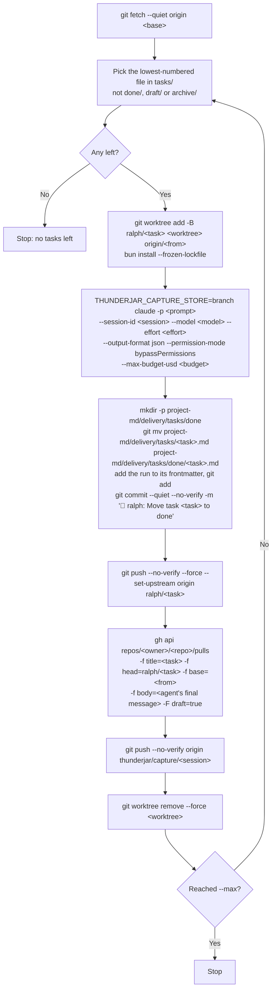

# Delivery Stories

Delivery stories are intended to be **human readable** documents that give the human reader a clear picture about the intent of story. 

They are _not_ intended to be comprehensive specs. 


## Story format

All stories have a 0000_story-name.md format. 

By default increment stories by 0100. 

Ready tasks start with frontmatter, which `ralph.ts` reads to run them:

```yaml
---
harness: claude-code   # the only harness ralph.ts runs so far
model: sonnet
effort: low            # low | medium | high
---
```

## The ralph loop

`ralph.ts` runs the ready tasks one at a time, each to its own draft PR.

```sh
bun project-md/delivery/ralph.ts --dry-run   # show the next task and its claude command
bun project-md/delivery/ralph.ts --max 3
```



Placeholders:

- `<base>`: `--base`, else the current branch, else on a detached HEAD the one origin branch at it.
- `<from>`: `<base>` for the first task of a run; after that, `ralph/<previous task>`.
  - `origin/ralph/<previous task>` is up to date without a fetch: the previous task's push updated it.
- `<worktree>`: `$TMPDIR/thunderjar-ralph/<task>`, or `/tmp/…` without `TMPDIR`.
- `<session>`: a UUID made by ralph, so the capture branch's name is known before the run.
- `<prompt>`: ralph's instructions, then the task file.
- `<owner>/<repo>`: from `git remote get-url origin`.

- Tasks stack: each PR targets the previous task's branch.
- The run in the done file's frontmatter:
  ```yaml
  ralph:
    session: "0f7a5cac-…"
    capture: "thunderjar/capture/0f7a5cac-…"
    branchedFrom: "main"
    date: "2026-11-20T10:00:00.000Z"
    costUsd: 0.42
    durationMs: 61000
    isError: false
  ```
- A task is done once its PR, which moves its file to done/, is merged. Until then, a new run of ralph runs it again.


Format 
```markdown 
# <story number>: <story name>

Short summary of the test

## Version bump type

major | minor | patch | none 

The value here should be per regular sem var semantics (ie. breaking changes = major). 
While we are in 0.x versioning the actual changeset that gets created should be a level lower than what is seen here. 

## Artifacts

What does this add to the project? 

For regular work, this is probably a command, or a variant on a command 

eg. 'Adds `--dry-run` to `build`'

## Example CLI Output 

It's very useful for the human to see example output here 

## Tests

Describe what kind of tests

Regular unit tests do not need to be specified, unless it it is unit tests only, in which case

- unit tests only

## Human interventions

If the human needs to do something, provide an API key, perform click ops etc, it gets documented here. 

```


### Example story 1

```markdown
# 1200: Init 

`thunderjar init` scaffolds the `.thunderjar/` configuration folder in a project, with empty `declareX` stubs.

## Version bump type

minor

## Artifacts
- `thunderjar init` command

## Tests 

- file creating tests 

## Human interventions

None.

```

### Example story 2
`````markdown 
# 1500: Permutations

`thunderjar plan <test case>` also prints the matrix shape, each permutation with the names of its five parameters, and the total number of container runs.

## Version bump type

minor

## Artifacts

- `thunderjar plan <test case>` takes a test case name

## Example CLI Output 

```
$ thunderjar plan is-prime-baseline
baseImage:     node20
codeState:     baseline
promptSet:     snerk, glurk
harnessModel:  claude-code@2.1.283/haiku-4-5, codex@0.9.0/gpt-luna
task:          is-prime
initialPrompt: plain, terse

Matrix shape: 1/1/2/2/2 (8 permutations × 5 iterations = 40 container runs)

 1  node20 | baseline | snerk | claude-code@2.1.283/haiku-4-5 | plain
 2  node20 | baseline | snerk | claude-code@2.1.283/haiku-4-5 | terse
 3  node20 | baseline | snerk | codex@0.9.0/gpt-luna          | plain
 4  node20 | baseline | snerk | codex@0.9.0/gpt-luna          | terse
 5  node20 | baseline | glurk | claude-code@2.1.283/haiku-4-5 | plain
 6  node20 | baseline | glurk | claude-code@2.1.283/haiku-4-5 | terse
 7  node20 | baseline | glurk | codex@0.9.0/gpt-luna          | plain
 8  node20 | baseline | glurk | codex@0.9.0/gpt-luna          | terse
```

## Tests 


- Fixture tests 
- Unit tests for comprehensive logic

## Human interventions

None.

`````