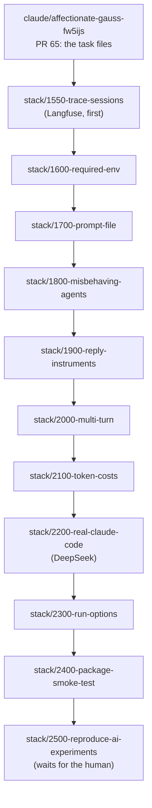

# Orchestration plan: stories 1600–2500

How to deliver the stories in `tasks/1600_*` to `tasks/2500_*`, with the implementation session itself traced in Langfuse. Written as a handover: a fresh session should be able to start from this file alone.

## The stack

One branch and one commit per story, and each PR targets the branch before it, the way `stack/0100` to `stack/1500` were done.



- Each commit holds the story's code, tests and changeset. Changesets go one level lower while in 0.x, see the root `AGENTS.md`.
- Review fixes amend that story's commit, then rebase the branches above it and `git push --force-with-lease`. That keeps one commit per story.
- Stories go in stack order, one at a time. They share the run wrapper, the harness `cli` context, `run --dry-run` and `show`, so parallel branches would conflict.

## Each story's loop

1. Implement it from its task file, following the root `AGENTS.md`, `fixtures/AGENTS.md` and the patterns already in the stack.
2. Check it: `bun run lint`, `bun run typecheck`, `bun test`, `bun run test:docker`. Compare the story's example CLI output with what the command prints.
3. Commit, push the branch, open a draft PR on the branch below it.

## Defaults for the open questions

Taken from the task files, unless the human says otherwise.

| Story | Question | Default |
|---|---|---|
| 2000 | Do turns belong to the initial prompt or the task? | The initial prompt, as written |
| 2300 | Do run options go on the base image or the harness? | The base image, as written |
| 2300 | Which options are needed? | Start with `seccomp=unconfined` and `apparmor=unconfined`, try narrower. Never `--privileged` |

## 2100 and 2200 with DeepSeek

There is no `ANTHROPIC_API_KEY`. The environment has a `DEEPSEEK_API_KEY`, and Claude Code runs against DeepSeek's Anthropic-compatible endpoint.

```bash
ANTHROPIC_BASE_URL=https://api.deepseek.com/anthropic \
ANTHROPIC_AUTH_TOKEN="$DEEPSEEK_API_KEY" \
ANTHROPIC_MODEL=deepseek-chat \
ANTHROPIC_SMALL_FAST_MODEL=deepseek-chat \
claude -p "Reply with just the word pong" --output-format json
```

- Scenario `0501` uses `claude-code@<version>/deepseek-chat`, with `requiredEnv: ["DEEPSEEK_API_KEY"]`. The base image sets `ANTHROPIC_BASE_URL`, and the `cli` maps the key to `ANTHROPIC_AUTH_TOKEN`.
- `init`'s scaffold stays on Anthropic and Haiku, since that's what users get.
- `test:agent` runs with `THUNDERJAR_AGENT_TESTS=1` and either key set.
- 2100's real result file fixture can be recorded from a DeepSeek run. The JSON shape is Claude Code's either way.
- Claude Code reports `costBasis: "unknown"` for DeepSeek, and its `total_cost_usd` is priced as if it were an Anthropic model. Record tokens always. Show cost only when the basis is known, otherwise "not reported".
- The human adds a `DEEPSEEK_API_KEY` repository secret for the on-demand workflow.

## Trace the implementation session in Langfuse

The session doing this work is traced, not Thunderjar. Thunderjar's code doesn't change for this.

Do this first, before story 1600, so every story's work is in the traces.

1. Check the network. `langfuse.com` (docs) and the Langfuse host in `LANGFUSE_BASE_URL`, e.g. `cloud.langfuse.com`, must be in the environment's allowed domains. If `curl "$LANGFUSE_BASE_URL/api/public/health"` fails, stop and ask the human to allow them.
2. Install the Langfuse skill from github.com/langfuse/skills: `bunx skills add langfuse/skills --skill langfuse`. It lands in `skills-lock.json` beside the other skills.
3. Following the skill, read Langfuse's current Claude Code integration page, starting from https://langfuse.com/llms.txt. Don't set it up from memory. At the time of planning it was expected to be a Claude Code hook that sends each turn's transcript to Langfuse, but this could not be checked, since langfuse.com was blocked.
4. Add it to the repo's `.claude/settings.json`, so it is reviewable and travels with the branch. It must do nothing when the `LANGFUSE_*` variables are unset, so other people's sessions aren't traced or broken.
5. Check it works, as the skill says: finish a turn, fetch the trace back with `langfuse-cli`, audit it against https://langfuse.com/docs/observability/best-practices, fix gaps and repeat. Subagent work should show up nested under the session.
6. Commit it on its own branch, `stack/1550-trace-sessions`, at the bottom of the stack, with a task file in the usual format.

The Langfuse keys are in the new session's environment. Don't ask for them in chat.

## 2500 waits for the human

It needs the ai-experiments repository attached to the session, a published preview release, and approval for the spend. Stop after 2400 and report.

## Environment gotchas

- The Docker daemon isn't running when a session starts. Start it before `test:docker`:

  ```bash
  (dockerd > /tmp/dockerd.log 2>&1 &)
  ```

- Claude Code hangs when started from inside a Claude Code session, with the session's environment variables inherited. Run it with a clean environment, e.g. `env -i` plus `HOME`, `PATH`, the proxy variables and `NODE_EXTRA_CA_CERTS`. Inside Thunderjar's containers this doesn't arise.
- Fetch the stack before branching: `git fetch origin stack/1500-show claude/affectionate-gauss-fw5ijs`. A fresh clone only has `main`.
- Containers reach the internet through the session's proxy, but don't trust its certificate. Node in a container fails with `SELF_SIGNED_CERT_IN_CHAIN`. Real-agent tests here have to give the container `/root/.ccr/ca-bundle.crt`, e.g. mounted and named in `NODE_EXTRA_CA_CERTS`. Keep that in the test setup, not in what `init` scaffolds.
- `deb.debian.org` is blocked, so `apt-get` fails in containers. 2300 needs `bubblewrap` from apt. Ask the human to allow `deb.debian.org` and `security.debian.org`, or install Claude Code with npm (`registry.npmjs.org` is allowed).
- Docker Hub rate-limits anonymous pulls (`429 Too Many Requests`). Reuse images already pulled, such as `node:20-slim`, rather than pulling new ones.
