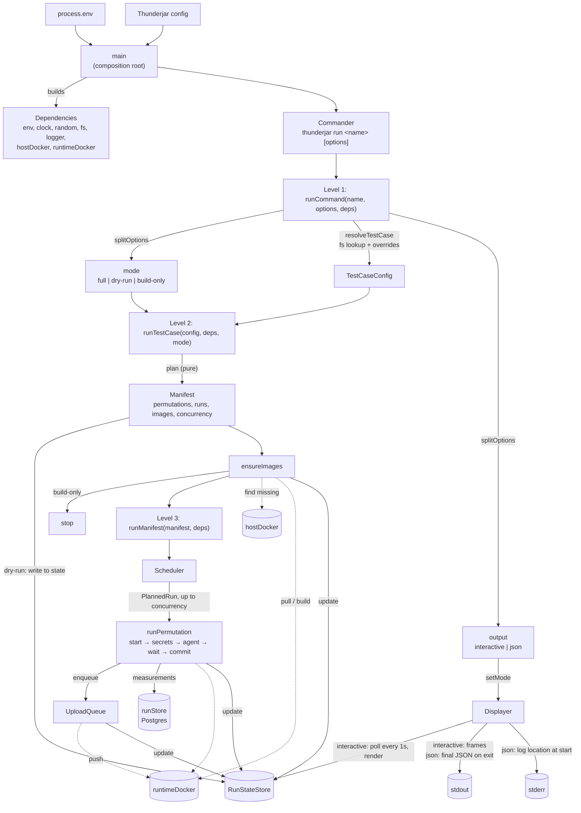
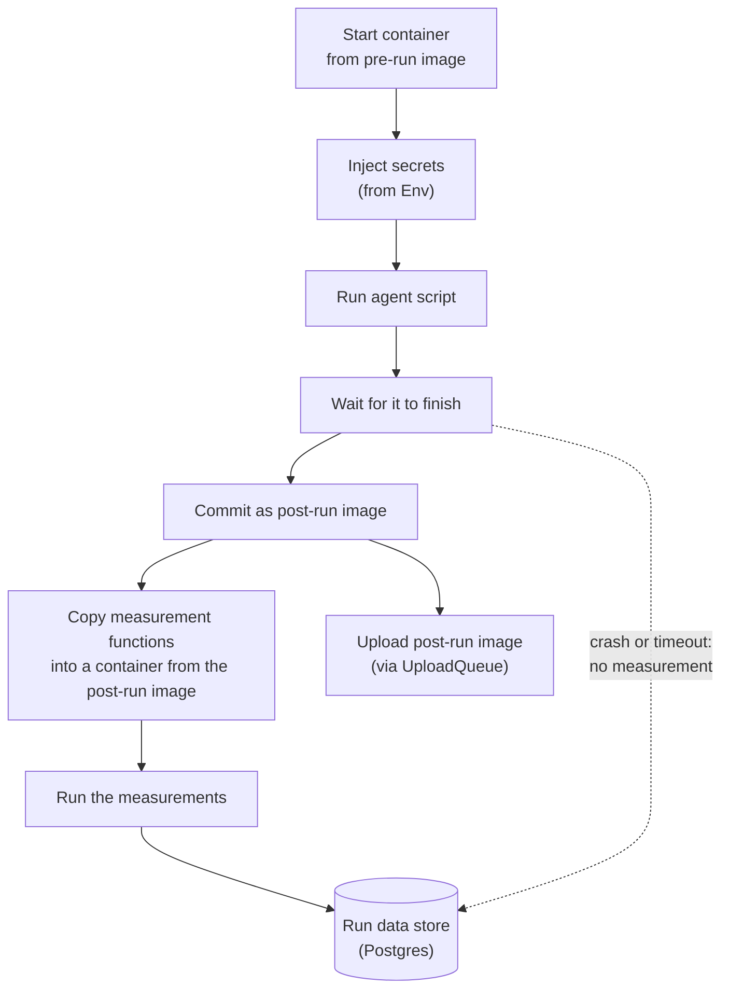

# Thunderjar `run` architecture: session notes

Items are marked **Decided**, **Suggested** (not yet agreed) or **Open**.

## Overview



## Level 1: `runCommand`

**Decided**

```ts
runCommand(testCaseName: string, options: RunOptions, deps: Dependencies)
```

**Decided**: level 1 looks up the test case on the filesystem and splits the options into three kinds:

- **Overrides** (`--iterations`, `--harness-model`) are merged into `TestCaseConfig`.
- **Mode** (`--dry-run`, `--build-only`) is passed to level 2 and never enters the config.
- **Output** (`--json`) sets the displayer's mode and goes no further down.

```ts
type RunOptions = {
  iterations?: number;
  harnessModel?: string;
  dryRun?: boolean;
  buildOnly?: boolean;
  json?: boolean;
}

type RunMode = "full" | "dry-run" | "build-only";
type OutputFormat = "interactive" | "json";
```

**Decided**: level 1 owns the displayer. Lower levels only write to the state.

```ts
async function runCommand(testCaseName: string, options: RunOptions, deps: Dependencies) {
  const { overrides, mode, output } = splitOptions(options);
  const { displayer } = deps;

  displayer.setMode(output);
  displayer.start();
  try {
    const testCaseConfig = await resolveTestCase(testCaseName, overrides, deps);
    return await runTestCase(testCaseConfig, deps, mode);
  } finally {
    displayer.stop(); // interactive: final frame; json: write the result to stdout
  }
}
```

## Level 2: `runTestCase`

**Decided**

```ts
runTestCase(testCaseConfig: TestCaseConfig, deps: Dependencies, mode: RunMode)
```

```ts
async function runTestCase(config: TestCaseConfig, deps: Dependencies, mode: RunMode = "full") {
  const manifest = plan(config, { concurrency: deps.env.concurrency });
  deps.state.update((s) => ({ ...s, manifest }));
  if (mode === "dry-run") return; // the displayer shows it
  await ensureImages(manifest, deps);
  if (mode === "build-only") return;
  return runManifest(manifest, deps);
}
```


### Planner: `plan`

**Decided**: it calculates every permutation for a test case.

**Decided**: `plan` is a pure function of the resolved config and the concurrency value.

```ts
function plan(config: TestCaseConfig, settings: { concurrency: number }): Manifest;
```

## Level 3: `runManifest`

**Decided**

```ts
runManifest(manifest: Manifest, deps: Dependencies)
```

**Decided** body:

```ts
async function runManifest(manifest: Manifest, deps: Dependencies) {
  const uploads = createUploadQueue(deps.runtimeDocker);
  const scheduler = createScheduler({
    clock: deps.clock,
    isBackedUp: () => uploads.backlog() > deps.env.uploadBacklogCap,
    settings: { cacheWarmupMs: 5_000, backpressurePollMs: 1_000 },
  });

  const records = await scheduler.run(manifest, (run) => runPermutation(run, deps, uploads));
  await uploads.drain();
  return records;
}
```

The scheduler runs the work itself. It knows a slot is free because it's the one awaiting each task. `isBackedUp` is the backpressure check: workers wait before starting a new run while too many committed images are still waiting to upload.

### Manifest

**Decided**: the manifest lists the permutations and the image each one needs.

**Suggested**: it needs to capture:

- **Execution ID**: a ULID for this execution of the test case
- **Test case name**
- **Concurrency**: the most containers running at once
- **For each permutation**:
  - its **permutation hash**, which maps one-to-one to a pre-run image
  - each parameter's value, apply function string and **parameter hash**, in layer order: base image, code state, prompt set, harness model, initial prompt
  - the pre-run image reference
- **For each run**:
  - its **run ID**: `<execution id>-<permutation hash>-i<iteration number>`
  - its permutation hash and iteration number

**Decided**: "needs building" stays out of the manifest. The manifest lists every image the runs need, and `ensureImages` works out which ones are missing. That keeps `plan` pure. The trade-off is that `--dry-run` shows which images are needed, not which ones would actually be built.

### Image builder: `ensureImages`

**Decided**: build the pre-run images if they don't already exist.

**Decided**: the host checks which images already exist on the remote, and the runtime pulls or builds whatever is missing.

```ts
function ensureImages(
  manifest: Manifest,
  deps: Pick<Dependencies, "hostDocker" | "runtimeDocker" | "logger" | "state">,
): Promise<void>;
```

### Concurrency

**Decided**: the concurrency limit is part of the manifest. Its value still comes from an environment variable, read through `Env`.

**Suggested**: level 2 passes the value into `plan`, so `plan` stays pure and everything below the manifest reads it from `manifest.concurrency`.

### Per-run lifecycle: `runPermutation`

**Decided**



**Decided**: once the container is committed as a post-run image, the measurement functions are copied in and run inside it, and their results go to the run data store, a Postgres database.

**Decided**: measuring runs in a throwaway container started from the post-run image, so the uploaded image is exactly what the agent left behind. Upload and measurement start in parallel from the commit.

**Decided**: the upload goes through `UploadQueue` rather than pushing inline, so the run slot frees up right away.

```ts
function runPermutation(
  run: PlannedRun,
  deps: Pick<Dependencies, "runtimeDocker" | "runStore" | "env" | "clock" | "logger" | "state">,
  uploads: UploadQueue,
): Promise<RunRecord>;
```

From earlier sessions: a crash or timeout is a distinct run-level status, and cost, tokens and wall-clock time are recorded on every run.

**Decided**: the runtime machine connects to the Postgres database.

**Decided**: runs that crash or time out aren't measured, but they're still recorded in the run data store.

**Open**:

- If a measurement fails, is that a run status, or just a missing metric?

### Scheduler

**Decided**: the scheduler runs each task itself, with one worker per concurrency slot, and each worker starts its next run only when the current one finishes.

**Suggested** behaviours:

- **Prompt-cache grouping**: iterations of the same permutation run close together, and the first gets a few seconds to write the cache before the rest start. Anthropic's default cache TTL is 5 minutes, refreshed on each hit.
- **Backpressure**: committed images waiting to push take up disk, so new runs pause when the upload backlog passes `uploadBacklogCap`.

Caveats:

- **`runPermutation` must never throw.** It returns a `RunRecord` with a crashed status instead. If it threw, that worker would die and `Promise.all` would reject early, while other workers kept running containers nobody was waiting for.
- **Workers can sit idle during warm-up.** If the next run belongs to a permutation that's still warming up, the worker waits rather than skipping ahead to a different permutation. That's simpler but wastes slots. **Open**: whether to pick the next run that's ready instead.

### Upload queue

**Suggested**: a separate queue with its own concurrency limit.

```ts
interface UploadQueue {
  enqueue(image: CommittedImage): void;
  backlog(): number;
  drain(): Promise<void>;
}
```

## Application state and displayer

**Decided**: lower levels only write to the run state, and an injected displayer shows it, either polling it each second (interactive) or printing JSON on exit (`--json`).

```ts
// lower levels: write to the state, never print
deps.state.update((s) => setRunStatus(s, run.runId, "running"));

// level 1: drive the displayer
deps.displayer.setMode(output); // "interactive" | "json"
deps.displayer.start();         // interactive: start polling; json: print where the logs are
try {
  await runTestCase(testCaseConfig, deps, mode);
} finally {
  deps.displayer.stop();        // interactive: final frame; json: result to stdout
}

// tests: assert on state, and render state separately
expect(deps.state.get().runs[runId].status).toBe("timedOut");
expect(renderState(finalState, now)).toBe(expectedText);
```

**Decided**: `--dry-run` goes through the displayer too, so there's no `printManifest`, and `--dry-run --json` prints the manifest as JSON.

**Open**:

- What goes in the JSON output: the final `RunState`, the `RunRecord[]`, or a dedicated result shape?
- Where do the logs live, and is the path in `Env` or in the Thunderjar config?

## Composition root and Dependencies

**Decided**: pure DI with no framework. `main` is the only place that reads `process.env` or builds real adapters. The ambient non-determinism rules apply everywhere else.

**Decided**: runtime and machine settings, including secrets and the concurrency limit, live in `Env`.

**Decided**: `main` builds every service up front. Constructing a Docker service doesn't connect or authenticate, so dry runs pay nothing for it.

### Two Docker services

**Decided**: there are two instances of the same `DockerService`: `hostDocker` and `runtimeDocker`. The split exists because some operations should run only locally, such as inspecting which images live on the remote.

**Decided**: `main` reads the Thunderjar config to decide where `runtimeDocker` points.

- **Host**: the machine where you type `thunderjar run`.
- **Runtime**: where the containers actually run, such as a rented server.

**Suggested**: since they share an interface, these are two instances of one port, not two ports. The composition root decides what each one points at. For a fully local run, both can be the same daemon. In tests, both are a `FakeDockerService`, and a test can check which one each operation went to.

**Suggested** split of operations, to confirm:

| Operation | Host | Runtime |
| --- | --- | --- |
| Inspect which images exist on the remote or registry | ✓ | |
| Build missing pre-run images | | ✓ |
| Pull pre-run images | | ✓ |
| Start the container, inject secrets, run the agent | | ✓ |
| Commit the image | | ✓ |
| Push the committed image | | ✓ |

**Suggested**: there's no separate image registry service. Registry operations are methods on `DockerService`. That changes only if uploads go somewhere that isn't a Docker registry.

Required services, all built once in `main` and passed in as `Dependencies`:

- `env`: settings read from `process.env` (concurrency, upload backlog cap, log path, secrets)
- `clock`: time and timers
- `random`: randomness
- `fs`: filesystem
- `hostDocker`: Docker on the local machine
- `runtimeDocker`: Docker where containers run, with its target set by the Thunderjar config
- `logger`: writes logs to `env.logPath`
- `state`: the run state store
- `stdout`, `stderr`: output streams
- `displayer`: shows the state, interactive or JSON
- `runStore`: the run data store, a Postgres database holding run records and measurements, reached from the runtime machine
