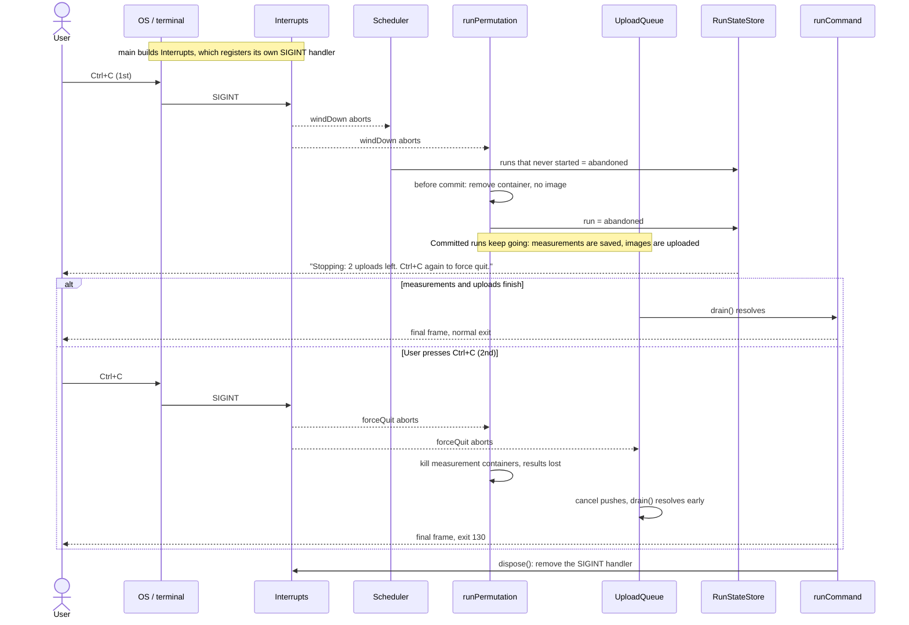
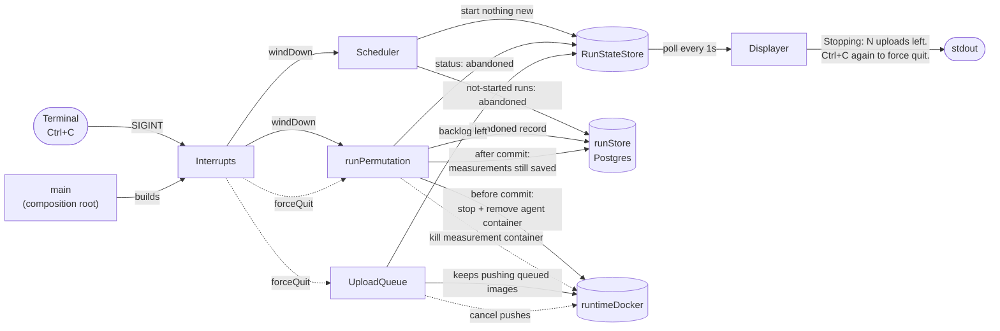

# Thunderjar: Ctrl+C flow

Nov 27, 2026 · @David Johnston

A first class `InterruptsService`  is provided.

This service is responsible for receiving SIGINTs and using these to emit Abort signals. \
\
There are two AbortSignals:

- windDown - the first ctrl+C
- forceQuit - the second ctrl+C

\
Future state: Presumably other parts of the application can emit a panic to also do graceful shut downs.

It's upto the other parts of the application to use these abort signals to gracefully (or ungracefully, in the case of the `forceQuit`)  finish their work.

## Interface

Interrupts turns each Ctrl+C into the next signal. It keeps the AbortControllers to itself, so other code can only read the signals.

```ts
interface Interrupts {
  windDown: AbortSignal;  // 1st Ctrl+C: finish what has started, start nothing new
  forceQuit: AbortSignal; // 2nd Ctrl+C: stop everything now
}
```

---

The sections below show the interactions as it relates to the `thunderjar run` command.

## Sequence



## Service interactions

Solid arrows are the 1st Ctrl+C; dashed arrows are the 2nd.


