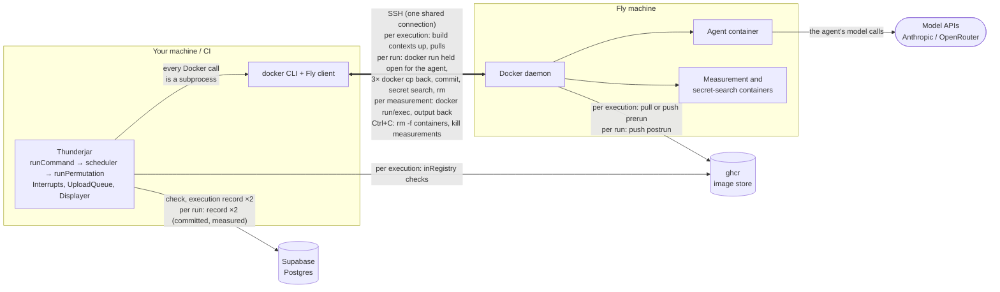
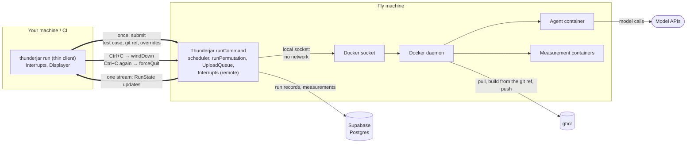

<!--
🤖
This file was created with AI

Harness: Claude Code
Session Id: session_01LCLeLjgpo4Xt5XwzGG2TNX
Supervising engineer: David Johnston

Humans: add your notes here
-->

# Remote architecture: network calls

Who calls whom when `thunderjar run` uses a remote runtime (Fly), and how often. Edge labels give the frequency: per execution, per run, per measurement.

Runner mode (`runtime.runner`, `thunderjar attach`) is being removed, so neither diagram has it.

## 1. As described in #327: your machine drives everything

- **The hot path is the SSH hop.**
  - One container run is about 8 round trips from your machine, plus 1 or 2 per measurement.
- **Interrupts**
  - 1st Ctrl+C: `docker rm -f` over SSH.
  - 2nd Ctrl+C: kills the local `docker` processes for measurements and pushes.
    - Ending the client is meant to make the daemon cancel the push. Not verified.
- **Your machine is a single point of failure.**
  - If it disconnects, every call in flight fails, the runs crash, and the execution is recorded `failed`.
- **The code differs from the architecture plan here.**
  - The plan has "the runtime machine connects to the Postgres database" as decided, but `runNext` connects from your machine.

## 2. Idealised: runNext runs on the Fly machine, your machine only watches

- **There is one connection.**
  - Your machine sends one submission, receives one stream of state, and forwards each signal.
  - Every Docker call is local to the Fly machine.
- **#327 is unchanged.**
  - The thin client's Interrupts forwards each press, and the remote Interrupts aborts `windDown` or `forceQuit`.
- **Postgres is reached from the runtime machine**, as the architecture plan decides.
- **Images are built from a git ref.**
  - No build contexts are uploaded from your machine.
  - This assumes every code state can be built from a commit.
- **This is what the runner was for**, rebuilt on `runNext` instead of the old path.
- **Open question: what happens when your machine disconnects?**
  - Does the execution wind down, or carry on?
  - If it carries on, following it again (`run --follow <id>`) replaces `attach`.
