# Fixture test patterns from PR #25

[PR #25](https://github.com/dwjohnston/thunderjar/pull/25) (branch `ralph-2026-10-17`) was an unmonitored Ralph loop session of 139 commits, over three days. Two ideas in it are worth keeping:

- **Fixture tests**
  - Checked-in Thunderjar projects that the CLI runs against, plus a `fixture` script to run any command against them by hand.
  - e.g.
    ```sh
    bun run fixture 2 run two-pairs --dry-run
    bun run fixture 1 build example
    ```
- **Scenarios**
  - Each fixture project is a scenario: a kind of project and its starting state. A command's tests run against a scenario, and the scenario knows nothing about its tests.

## Key commits

Each arrow shows how many commits later the next key point lands, and the time elapsed.

```mermaid
flowchart TD
    S["780903c · 14 Oct 11:31 UTC<br/>PR's first commit"] -->|"32 commits · 2d 10h 56m"| A
    A["fa62bdd · 16 Oct 22:27 UTC<br/>Fixture tests for run, against a checked-in project"] -->|"1 commit · 57m"| B
    B["deccebb<br/>fixture:run script"] -->|"1 commit · 17m"| C
    C["bea690c<br/>Reorganise into scenarios; bun run fixture"] -->|"6 commits · 2h 03m"| C2
    C2["6fabd64<br/>Add thunderjar build: first build tests, with a recording fake Docker<br/>and the first real-Docker test, run in CI with test:docker"] -->|"3 commits · 2h 01m"| D
    D["544d59e<br/>Scenario catalogue in fixtureTests/AGENTS.md"] -->|"5 commits · 3h 05m"| E1
    E1["0993e6e<br/>One folder per command"] -->|"3 commits · 2h 18m"| E2
    E2["822a898<br/>Build tests move beside the build command"] -->|"4 commits · 1h 26m"| P
    P["4dceed3 · 17 Oct 10:37 UTC<br/>End of PR #24: Ralph loop set up and test strategy split into tasks<br/>Unmonitored from here"] -->|"1 commit · 3m"| F
    F["eef5fe6<br/>Testing philosophy written down"] -->|"11 commits · 33m"| G
    G["d7704bd → 1beb543 · 17 Oct 11:32 UTC<br/>🧪 series: every command's tests move to scenarios<br/>15 commits over 18m"] -->|"57 commits · 2h 14m"| T
    T["cb935ba · 17 Oct 13:46 UTC<br/>PR's last commit"]
```



From the first fixture test to the end of the 🧪 series took 49 commits and about 13 hours.

1. [fa62bdd](https://github.com/dwjohnston/thunderjar/commit/fa62bdd583a84050068eb96ebb9f7b747b0127bb): Add fixture tests for `thunderjar run` against a checked-in project
   - Where it starts. `fixtureTests/run/fixtures/` is a real `.thunderjar/` project, and the tests run the CLI against it.
   - The aim was stated from the start: "a developer can cd in and see the same output by hand."
   - Execution IDs, temp paths and durations are replaced with fixed placeholders so the output stays the same between runs.
2. [deccebb](https://github.com/dwjohnston/thunderjar/commit/deccebb1d1cb330144872723ac677a5991d8a789): Add a `fixture:run` script
   - A one-line addition to package.json that runs the CLI from inside the fixture project.
3. [bea690c](https://github.com/dwjohnston/thunderjar/commit/bea690c27f022c0afbe25f7885f8bb64742cf118): Reorganise fixtureTests into scenarios, with fake agents only
   - The key commit. Each folder is now a kind of project rather than a feature, e.g. `scenario_2_typical_project`.
   - `bun run fixture <scenario> <args>` replaces `fixture:run`.
   - No scenario uses a real agent. Two fake agents produce different results, so their measurements differ.
   - One checked-in `node_modules/thunderjar` link serves every scenario.
4. [544d59e](https://github.com/dwjohnston/thunderjar/commit/544d59e506db3599767a42e05c4f4998d3511421): Describe each fixture scenario in fixtureTests/AGENTS.md
   - A catalogue of the scenarios: what they all share, then what each one contains.
5. [0993e6e](https://github.com/dwjohnston/thunderjar/commit/0993e6e45cdfdeea5b23e94259c892af412af6c5) and [822a898](https://github.com/dwjohnston/thunderjar/commit/822a8986864639931d3641ce3ae49d3758da4532): one folder per command, then build tests moved beside the build command
   - A command's tests now live next to the command and run against a scenario, e.g. `src/commands/build/`.
   - The CLI runner, the fake Docker and a `scenario()` helper move to `src/testing/cli.ts`.
6. [eef5fe6](https://github.com/dwjohnston/thunderjar/commit/eef5fe69a1ecd0c53ed55ee9f21f0ff5c7be1f72): Describe the scenario testing philosophy in the AGENTS.md files
   - A command's tests run against a checked-in scenario, unchanged, and only check what the command produced.
   - Scenarios know nothing about the tests that use them.
   - Only `init` and a real `run` work on a copy.
7. The 🧪 "Move the … tests to scenarios" series
   - [d7704bd](https://github.com/dwjohnston/thunderjar/commit/d7704bd) build
   - [ae12a8c](https://github.com/dwjohnston/thunderjar/commit/ae12a8c824e60d4d9919ed94688223e853164421) plan
   - [7190590](https://github.com/dwjohnston/thunderjar/commit/7190590) run --dry-run
   - [84d6843](https://github.com/dwjohnston/thunderjar/commit/84d684388aa8d3afa0cc123f8e4885969b40aa68) generate
   - [e159820](https://github.com/dwjohnston/thunderjar/commit/e15982023f0a2b70ff97aa3bd96e0abfae4c6c9f) init
   - [7d1f6a2](https://github.com/dwjohnston/thunderjar/commit/7d1f6a23bfa737f450832856a1e570d366b76778) executions and show
   - [a28b80f](https://github.com/dwjohnston/thunderjar/commit/a28b80f81afa554428f042688177b7c70acff59b) configuration errors
   - [1beb543](https://github.com/dwjohnston/thunderjar/commit/1beb54300b20b8fdede8e7b2c2625c48c53d3977) declarations typecheck
   - ae12a8c shows a related habit: variations that tests used to patch into a project became permanent parts of a scenario.

The core of the pattern is commits 1, 3 and 6.

## Worth preserving: real git or not

The "Real git or not" section of [fixtureTests/AGENTS.md on the `permutations` branch](https://github.com/dwjohnston/thunderjar/blob/permutations/fixtureTests/AGENTS.md) is a good approach. It splits scenarios by how their code states and prompt sets get their files.

| Scenario | Code states | Prompt sets |
|---|---|---|
| 1 minimal initial setup | 📁 copied files | 📁 copied files |
| 2 typical project | 📁 copied files | 📁 copied files |
| 3 misbehaving agents | 📁 copied files | 📁 copied files |
| 4 git project | 🌿 **real git** | 🌿 **real git** |

- 📁 **Copied files**
  - The parameter copies files kept beside its declaration. It reads no commits, so it builds anywhere, and editing one of those files changes its hash.
  - e.g.
    ```ts
    applyParameter: (_config, ctx) => `COPY ${ctx.dir}/files/ /workspace/\nRUN npm ci`,
    ```
- 🌿 **Real git**
  - The parameter reads real commits of the thunderjar repository itself, so CI checks out with full history.
  - Scenario 4's project was committed twice in this repository, and each code state checks out one of those commits.
  - The worktree's copy of the prompt file has moved on from both commits, so tests can show a prompt file is read at its commit, not from the worktree.
  - Each pinned commit is tagged `fixture-scenario-4-<name>`, so it stays reachable if the branch is squash-merged.
  - Rule: add a new tagged commit for a new state, and never amend, squash or rebase away a pinned commit.

Most scenarios use copied files, so they build in place and show hashing directly. Only one scenario covers real git.

Commits:

- [65bcb92](https://github.com/dwjohnston/thunderjar/commit/65bcb92) and [5f52f9e](https://github.com/dwjohnston/thunderjar/commit/5f52f9e)
  - Scenario 4's project, at the two commits its code states check out.
- [8333403](https://github.com/dwjohnston/thunderjar/commit/8333403)
  - Add scenario 4: code states and prompt sets that read real git.

⚠️ The tags no longer protect these commits. On 31 Oct, `fixture-scenario-4-first` and `-second` were recreated pointing at new commits (523984c and 952687d). The scenario 4 declarations still pin 65bcb92 and 5f52f9e, so those stay reachable only while the `permutations` or `ralph-2026-10-17` branch exists.

## Where the rules are written down

There's no list of test types. The rules are spread across three files:

- [AGENTS.md](https://github.com/dwjohnston/thunderjar/blob/ralph-2026-10-17/AGENTS.md)
  - The "Fixture tests" section. Its rule "Copy only for commands that write into the project" sorts commands by what they may write: `init` works on a copy, `generate` writes in place, `run` and `remeasure` use `--data-dir`, everything else only reads.
  - Also covers real-Docker tests and says behaviour the CLI can't trigger stays in unit tests.
- [fixtureTests/AGENTS.md](https://github.com/dwjohnston/thunderjar/blob/ralph-2026-10-17/fixtureTests/AGENTS.md)
  - A catalogue of the 11 scenarios, not of test types.
- [src/AGENTS.md](https://github.com/dwjohnston/thunderjar/blob/ralph-2026-10-17/src/AGENTS.md)
  - Where tests live and what the helpers in `src/testing/` are for.

## Test types

The test types we'd expect, and how far the branch got with each.

1. **Real file-creating tests**: ✅ exist
   - `init` runs on a copy of scenarios 1, 6 and 7.
   - `generate` runs in place, since it only writes a gitignored folder. The test deletes that folder first.
2. **Config in, check stdout**: ✅ exist, and are the majority
   - `plan`, `show`, `executions`, `run --dry-run`, `build --dry-run`, configuration errors, typecheck errors.
3. **`build` creates an image**: ✅ exist, in two forms
   - `build.test.ts` uses a fake Docker that records the commands it's given and never builds anything.
   - `build.docker.test.ts` uses real Docker under a throwaway image prefix. It only runs with `bun run test:docker`.
4. **`run` operates on an existing image**: ⚠️ only partly
   - The real-Docker run tests build the prerun image themselves first. No test starts from an image that already exists.
   - The non-Docker `run` tests never moved to scenarios. They still generate a project in the test and run on the host instead of in Docker. src/AGENTS.md marks that approach "NOT ENDORSED".
   - The real-Docker run tests are still in `fixtureTests/scenario_2…/` and `scenario_3…/`, not beside the command.
5. **`measure` / `remeasure` creates data from an existing image**: ✅ for `remeasure`
   - There's no `measure` command. Measuring happens inside `run`.
   - `remeasure` runs against scenario 8, which has a checked-in run store and saved snapshots of each run's output files. The fake Docker serves those files as if they came from the run's image, and results are written to a temp `--data-dir`. Nothing runs in a container.
   - The cleanest example of this type.
6. **Unit tests**: ✅ exist
   - In the non-command folders under `src/`.
   - Crash-injection tests stay here too, since the CLI can't trigger a crash.

Also left over: [fixtureTests/scenario_2_typical_project/run.test.ts](https://github.com/dwjohnston/thunderjar/blob/ralph-2026-10-17/fixtureTests/scenario_2_typical_project/run.test.ts) repeats the `--dry-run` tests that now live in `src/commands/run/run.test.ts`.
