# Fixture test patterns from PR #25

[PR #25](https://github.com/dwjohnston/thunderjar/pull/25) (branch `ralph-2026-10-17`) was an unmonitored Ralph loop session of 139 commits, over three days. Two ideas in it are worth keeping:

- **Fixture tests**
  - Checked-in Thunderjar projects that the CLI runs against, plus a `fixture` script to run any command against them by hand.
  - e.g.
    ```sh
    bun run fixture 2 run two-pairs --dry-run
    bun run fixture 1 build example
    ```
- **Scenarios**
  - Each fixture project is a scenario: a kind of project and its starting state. A command's tests run against a scenario, and the scenario knows nothing about its tests.

## Key commits

Each arrow shows how many commits later the next key point lands, and the time elapsed.

```mermaid
flowchart TD
    S["780903c · 14 Oct 11:31 UTC<br/>PR's first commit"] -->|"32 commits · 2d 10h 56m"| A
    A["fa62bdd · 16 Oct 22:27 UTC<br/>Fixture tests for run, against a checked-in project"] -->|"1 commit · 57m"| B
    B["deccebb<br/>fixture:run script"] -->|"1 commit · 17m"| C
    C["bea690c<br/>Reorganise into scenarios; bun run fixture"] -->|"6 commits · 2h 03m"| C2
    C2["6fabd64<br/>Add thunderjar build: first build tests, with a recording fake Docker<br/>and the first real-Docker test, run in CI with test:docker"] -->|"3 commits · 2h 01m"| D
    D["544d59e<br/>Scenario catalogue in fixtureTests/AGENTS.md"] -->|"5 commits · 3h 05m"| E1
    E1["0993e6e<br/>One folder per command"] -->|"3 commits · 2h 18m"| E2
    E2["822a898<br/>Build tests move beside the build command"] -->|"4 commits · 1h 26m"| P
    P["4dceed3 · 17 Oct 10:37 UTC<br/>End of PR #24: Ralph loop set up and test strategy split into tasks<br/>Unmonitored from here"] -->|"1 commit · 3m"| F
    F["eef5fe6<br/>Testing philosophy written down"] -->|"11 commits · 33m"| G
    G["d7704bd → 1beb543 · 17 Oct 11:32 UTC<br/>🧪 series: every command's tests move to scenarios<br/>15 commits over 18m"] -->|"57 commits · 2h 14m"| T
    T["cb935ba · 17 Oct 13:46 UTC<br/>PR's last commit"]
```



From the first fixture test to the end of the 🧪 series took 49 commits and about 13 hours.

1. [fa62bdd](https://github.com/dwjohnston/thunderjar/commit/fa62bdd583a84050068eb96ebb9f7b747b0127bb): Add fixture tests for `thunderjar run` against a checked-in project
   - Where it starts. `fixtureTests/run/fixtures/` is a real `.thunderjar/` project, and the tests run the CLI against it.
   - The aim was stated from the start: "a developer can cd in and see the same output by hand."
   - Execution IDs, temp paths and durations are replaced with fixed placeholders so the output stays the same between runs.
2. [deccebb](https://github.com/dwjohnston/thunderjar/commit/deccebb1d1cb330144872723ac677a5991d8a789): Add a `fixture:run` script
   - A one-line addition to package.json that runs the CLI from inside the fixture project.
3. [bea690c](https://github.com/dwjohnston/thunderjar/commit/bea690c27f022c0afbe25f7885f8bb64742cf118): Reorganise fixtureTests into scenarios, with fake agents only
   - The key commit. Each folder is now a kind of project rather than a feature, e.g. `scenario_2_typical_project`.
   - `bun run fixture <scenario> <args>` replaces `fixture:run`.
   - No scenario uses a real agent. Two fake agents produce different results, so their measurements differ.
   - One checked-in `node_modules/thunderjar` link serves every scenario.
4. [544d59e](https://github.com/dwjohnston/thunderjar/commit/544d59e506db3599767a42e05c4f4998d3511421): Describe each fixture scenario in fixtureTests/AGENTS.md
   - A catalogue of the scenarios: what they all share, then what each one contains.
5. [0993e6e](https://github.com/dwjohnston/thunderjar/commit/0993e6e45cdfdeea5b23e94259c892af412af6c5) and [822a898](https://github.com/dwjohnston/thunderjar/commit/822a8986864639931d3641ce3ae49d3758da4532): one folder per command, then build tests moved beside the build command
   - A command's tests now live next to the command and run against a scenario, e.g. `src/commands/build/`.
   - The CLI runner, the fake Docker and a `scenario()` helper move to `src/testing/cli.ts`.
6. [eef5fe6](https://github.com/dwjohnston/thunderjar/commit/eef5fe69a1ecd0c53ed55ee9f21f0ff5c7be1f72): Describe the scenario testing philosophy in the AGENTS.md files
   - A command's tests run against a checked-in scenario, unchanged, and only check what the command produced.
   - Scenarios know nothing about the tests that use them.
   - Only `init` and a real `run` work on a copy.
7. The 🧪 "Move the … tests to scenarios" series
   - [d7704bd](https://github.com/dwjohnston/thunderjar/commit/d7704bd) build
   - [ae12a8c](https://github.com/dwjohnston/thunderjar/commit/ae12a8c824e60d4d9919ed94688223e853164421) plan
   - [7190590](https://github.com/dwjohnston/thunderjar/commit/7190590) run --dry-run
   - [84d6843](https://github.com/dwjohnston/thunderjar/commit/84d684388aa8d3afa0cc123f8e4885969b40aa68) generate
   - [e159820](https://github.com/dwjohnston/thunderjar/commit/e15982023f0a2b70ff97aa3bd96e0abfae4c6c9f) init
   - [7d1f6a2](https://github.com/dwjohnston/thunderjar/commit/7d1f6a23bfa737f450832856a1e570d366b76778) executions and show
   - [a28b80f](https://github.com/dwjohnston/thunderjar/commit/a28b80f81afa554428f042688177b7c70acff59b) configuration errors
   - [1beb543](https://github.com/dwjohnston/thunderjar/commit/1beb54300b20b8fdede8e7b2c2625c48c53d3977) declarations typecheck
   - ae12a8c shows a related habit: variations that tests used to patch into a project became permanent parts of a scenario.

The core of the pattern is commits 1, 3 and 6.

## Features in order

Each range runs from the feature's first commit to its last, and the link shows the combined diff.

### Before the Ralph loop (PR #24)

| # | Feature | Commits | Count | Finished |
|---|---|---|---|---|
| 1 | `thunderjar init`, and a library entry point | [780903c…575d53c](https://github.com/dwjohnston/thunderjar/compare/e5010f24dca35b3cb4f93ba4d518b30263855216...575d53c99cff6dcd2e0cf777ec13e36633222e46) | 3 | 14 Oct 11:31 |
| 2 | `generate` and `plan`, with typed declarations and a config loader | [96e7946…f35a3da](https://github.com/dwjohnston/thunderjar/compare/575d53c99cff6dcd2e0cf777ec13e36633222e46...f35a3da74c9acfc514821346f0d217271a31cfdc) | 2 | 15 Oct 08:47 |
| 3 | Repository layout enforced by generated oxlint rules | [8fbf1ff…dea8010](https://github.com/dwjohnston/thunderjar/compare/f35a3da74c9acfc514821346f0d217271a31cfdc...dea80103d26ba0afbb450814fa697f98675cf2e4) | 2 | 15 Oct 09:01 |
| 4 | Clear configuration errors from `plan` and `generate`, plus a note on annotated tags | [b3d09c4…b93051c](https://github.com/dwjohnston/thunderjar/compare/dea80103d26ba0afbb450814fa697f98675cf2e4...b93051c43e5ab088961136143dbe0f9f54aaf3c4) | 2 | 15 Oct 09:39 |
| 5 | Matrix shape, permutations and content hashes in `plan` | [9851f50…e8bbd10](https://github.com/dwjohnston/thunderjar/compare/b93051c43e5ab088961136143dbe0f9f54aaf3c4...e8bbd1081b613f4e31298c12ce8934e21f21a636) | 3 | 15 Oct 09:47 |
| 6 | `thunderjar run <test case> --dry-run`, with ULID execution IDs | [2636f76…95a7e0e](https://github.com/dwjohnston/thunderjar/compare/e8bbd1081b613f4e31298c12ce8934e21f21a636...95a7e0edc6288dabc946cf40f45aa95a417dc9be) | 3 | 15 Oct 09:53 |
| 7 | `thunderjar run <test case>` on the host | [0a7076b…b989a4b](https://github.com/dwjohnston/thunderjar/compare/95a7e0edc6288dabc946cf40f45aa95a417dc9be...b989a4b4e4c2307415878a086090e2c27ab2c50d) | 2 | 15 Oct 10:07 |
| 8 | A run data store, and `thunderjar executions` | [690efa7…de91d68](https://github.com/dwjohnston/thunderjar/compare/b989a4b4e4c2307415878a086090e2c27ab2c50d...de91d6895537b1fd957ffdedded62bd0bb07e35c) | 3 | 15 Oct 10:27 |
| 9 | Measurements taken on each container run | [b007653…a3e2a70](https://github.com/dwjohnston/thunderjar/compare/de91d6895537b1fd957ffdedded62bd0bb07e35c...a3e2a7068781661557463a587c8077ad1387003c) | 3 | 15 Oct 10:56 |
| 10 | `grep` and `templateTest` instruments | [2089355…d48b115](https://github.com/dwjohnston/thunderjar/compare/a3e2a7068781661557463a587c8077ad1387003c...d48b1154961a7c6fe86455b26cc59f7210c7c5ca) | 2 | 15 Oct 11:22 |
| 11 | `thunderjar show`, and a reason for a skipped measure | [8c8d3b2…3d64208](https://github.com/dwjohnston/thunderjar/compare/d48b1154961a7c6fe86455b26cc59f7210c7c5ca...3d642081f4dc28ca00b69fcc71136592106fca81) | 3 | 15 Oct 14:13 |
| 12 | Aggregation results per permutation, shown by `show` | [ec85bd3…3fd9c98](https://github.com/dwjohnston/thunderjar/compare/3d642081f4dc28ca00b69fcc71136592106fca81...3fd9c98f53c249741ef7a2447da2b7122e5ca16e) | 4 | 15 Oct 22:19 |
| 13 | Fixture tests for `run`, against a checked-in project | [fa62bdd…deccebb](https://github.com/dwjohnston/thunderjar/compare/3fd9c98f53c249741ef7a2447da2b7122e5ca16e...deccebb1d1cb330144872723ac677a5991d8a789) | 2 | 16 Oct 23:25 |
| 14 | Fixture scenarios, with fake agents | [bea690c…bd8958d](https://github.com/dwjohnston/thunderjar/compare/deccebb1d1cb330144872723ac677a5991d8a789...bd8958d7f2bccba238f0d81745d86d3d6ccd4bce) | 4 | 17 Oct 00:25 |
| 15 | `thunderjar build <test case>` | [28eba43…6fabd64](https://github.com/dwjohnston/thunderjar/compare/bd8958d7f2bccba238f0d81745d86d3d6ccd4bce...6fabd645fcf450c9b2e0ea58c453c2ca016981a8) | 3 | 17 Oct 01:46 |
| 16 | A parameter's `applyParameter` decides what applying it does | [b59de5b…9e481a8](https://github.com/dwjohnston/thunderjar/compare/6fabd645fcf450c9b2e0ea58c453c2ca016981a8...9e481a8482cbc9aed510869b88147ede96050e93) | 2 | 17 Oct 03:40 |
| 17 | Scenario catalogue in fixtureTests/AGENTS.md | [544d59e](https://github.com/dwjohnston/thunderjar/commit/544d59e506db3599767a42e05c4f4998d3511421) | 1 | 17 Oct 03:47 |
| 18 | Scenario 4: code states and prompt sets that read real git | [65bcb92…8333403](https://github.com/dwjohnston/thunderjar/compare/544d59e506db3599767a42e05c4f4998d3511421...833340355a5583ddf92cf7e494b5e73e2aadebb6) | 3 | 17 Oct 03:52 |
| 19 | Restructure src/ into layers, one folder per command | [7661ac6…bd6ddc6](https://github.com/dwjohnston/thunderjar/compare/833340355a5583ddf92cf7e494b5e73e2aadebb6...bd6ddc64fac64a4d0ec9ef00c8033b57184cfd7a) | 4 | 17 Oct 09:00 |
| 20 | Build tests move beside the build command | [822a898](https://github.com/dwjohnston/thunderjar/commit/822a8986864639931d3641ce3ae49d3758da4532) | 1 | 17 Oct 09:10 |
| 21 | Ralph loop set up, and the test strategy split into tasks | [d520f68…4dceed3](https://github.com/dwjohnston/thunderjar/compare/822a8986864639931d3641ce3ae49d3758da4532...4dceed3093f6e742a0981a98981ad9cf4f7dd3b0) | 4 | 17 Oct 10:37 |

### Ralph loop (unmonitored)

| # | Feature | Commits | Count | Finished |
|---|---|---|---|---|
| 22 | Testing philosophy in the AGENTS.md files, with the user's corrections | [eef5fe6…682017d](https://github.com/dwjohnston/thunderjar/compare/4dceed3093f6e742a0981a98981ad9cf4f7dd3b0...682017d6c174c88b8de8486d5ca8ccc516bde974) | 3 | 17 Oct 10:46 |
| 23 | `--image-prefix <name>` on `build`, `run` and `plan` | [42c6163…b619c8b](https://github.com/dwjohnston/thunderjar/compare/682017d6c174c88b8de8486d5ca8ccc516bde974...b619c8be4612d2ac5ed8b74a52b7f4d97935b810) | 2 | 17 Oct 10:51 |
| 24 | `thunderjar build <test case> --dry-run` | [1814eff…bb3aa95](https://github.com/dwjohnston/thunderjar/compare/b619c8be4612d2ac5ed8b74a52b7f4d97935b810...bb3aa95b77fb358d6df1afd2768ebd2176728214) | 3 | 17 Oct 10:54 |
| 25 | `run` builds missing prerun images, then runs each iteration in a container | [eb62b82…14a416a](https://github.com/dwjohnston/thunderjar/compare/bb3aa95b77fb358d6df1afd2768ebd2176728214...14a416a2c43b970dd818922a1758c1f87f169447) | 3 | 17 Oct 11:09 |
| 26 | 🧪 series: each command's tests move to scenarios | [d7704bd…d30d3fa](https://github.com/dwjohnston/thunderjar/compare/14a416a2c43b970dd818922a1758c1f87f169447...d30d3fac9f3a48693c0b2737c35052942e84bf9c) | 16 | 17 Oct 11:32 |
| 27 | Chores: tasks 13 and 14 skipped, and the loop sleeps on overage | [c7e4779…1f1d7f6](https://github.com/dwjohnston/thunderjar/compare/d30d3fac9f3a48693c0b2737c35052942e84bf9c...1f1d7f656df3d21ac290fc3d14d2a62c13ee9e0c) | 5 | 17 Oct 12:02 |
| 28 | Usage for no command or an unknown one | [935bac2…4c98586](https://github.com/dwjohnston/thunderjar/compare/1f1d7f656df3d21ac290fc3d14d2a62c13ee9e0c...4c9858643a854e18aae513a783c12fbc793624de) | 3 | 17 Oct 12:04 |
| 29 | `--data-dir <dir>` on `run`, `executions` and `show` | [ca38c9a…5e4747a](https://github.com/dwjohnston/thunderjar/compare/4c9858643a854e18aae513a783c12fbc793624de...5e4747a29a4205c24a431796dbdf788401cf73f7) | 4 | 17 Oct 12:08 |
| 30 | Switch to the ralph2 loop, and fix lint | [a517c2e…ca46b3f](https://github.com/dwjohnston/thunderjar/compare/5e4747a29a4205c24a431796dbdf788401cf73f7...ca46b3f0ca2f483bc97903f72c0fbfccf5400bcc) | 6 | 17 Oct 12:36 |
| 31 | `measureStatus`: a recorded measure is missing, stale or current | [efa5b41…f14f8b9](https://github.com/dwjohnston/thunderjar/compare/ca46b3f0ca2f483bc97903f72c0fbfccf5400bcc...f14f8b91f51af88afb57d914cfcb6abdfe1792f0) | 3 | 17 Oct 12:41 |
| 32 | `planRemeasure`: the measurements each container run needs | [a7e5a8d…53df109](https://github.com/dwjohnston/thunderjar/compare/f14f8b91f51af88afb57d914cfcb6abdfe1792f0...53df10999a66e0c4abb57f07ffbb948b1529c6b7) | 3 | 17 Oct 12:47 |
| 33 | Execution summaries in `planRemeasure` | [bf689b0…3016f0c](https://github.com/dwjohnston/thunderjar/compare/53df10999a66e0c4abb57f07ffbb948b1529c6b7...3016f0c1dc12e89b3228fdc7ec416a71c759ca14) | 3 | 17 Oct 12:53 |
| 34 | `show` marks a stale measure in the container run view | [c94992a…ac67f5d](https://github.com/dwjohnston/thunderjar/compare/3016f0c1dc12e89b3228fdc7ec416a71c759ca14...ac67f5dbd83f6092339b4d21be6522e7c1f12497) | 4 | 17 Oct 12:59 |
| 35 | `show` marks a stale value in the execution view | [e9c440f…b847042](https://github.com/dwjohnston/thunderjar/compare/ac67f5dbd83f6092339b4d21be6522e7c1f12497...b847042faf00635deca0e4353c71fd17cb25e4eb) | 3 | 17 Oct 13:04 |
| 36 | `thunderjar remeasure` entry point, not yet implemented | [b85ee3a…5c622ab](https://github.com/dwjohnston/thunderjar/compare/b847042faf00635deca0e4353c71fd17cb25e4eb...5c622ab510327a058e51e1f7c98ae6b9731c3a7b) | 4 | 17 Oct 13:10 |
| 37 | `remeasure` reports an execution's plan | [860ce99…099578b](https://github.com/dwjohnston/thunderjar/compare/5c622ab510327a058e51e1f7c98ae6b9731c3a7b...099578b0c600dfc61f20ec59f8db4779f606710b) | 3 | 17 Oct 13:14 |
| 38 | `remeasure` reports a test case | [b44b586…3062445](https://github.com/dwjohnston/thunderjar/compare/099578b0c600dfc61f20ec59f8db4779f606710b...3062445329988a23c75840ee886c47bd55ec2ac2) | 3 | 17 Oct 13:17 |
| 39 | `remeasure` recomputes aggregation results | [90ab020…64951b7](https://github.com/dwjohnston/thunderjar/compare/3062445329988a23c75840ee886c47bd55ec2ac2...64951b7b3b2af7d99212b4b12daabae3e24a2c02) | 4 | 17 Oct 13:23 |
| 40 | The fake Docker serves a saved postrun workspace | [38c8906…0d96ccf](https://github.com/dwjohnston/thunderjar/compare/64951b7b3b2af7d99212b4b12daabae3e24a2c02...0d96ccf9595ab43f1c90e8dcf035da24ffb5858d) | 4 | 17 Oct 13:37 |
| 41 | `remeasure` takes and stores only the planned measurements, plus a final clean-up | [09d3940…cb935ba](https://github.com/dwjohnston/thunderjar/compare/0d96ccf9595ab43f1c90e8dcf035da24ffb5858d...cb935bab65590c3a7b0d7904ad3801bcc0f03a3f) | 4 | 17 Oct 13:46 |

## Worth preserving: real git or not

The "Real git or not" section of [fixtureTests/AGENTS.md on the `permutations` branch](https://github.com/dwjohnston/thunderjar/blob/permutations/fixtureTests/AGENTS.md) is a good approach. It splits scenarios by how their code states and prompt sets get their files.

| Scenario | Code states | Prompt sets |
|---|---|---|
| 1 minimal initial setup | 📁 copied files | 📁 copied files |
| 2 typical project | 📁 copied files | 📁 copied files |
| 3 misbehaving agents | 📁 copied files | 📁 copied files |
| 4 git project | 🌿 **real git** | 🌿 **real git** |

- 📁 **Copied files**
  - The parameter copies files kept beside its declaration. It reads no commits, so it builds anywhere, and editing one of those files changes its hash.
  - e.g.
    ```ts
    applyParameter: (_config, ctx) => `COPY ${ctx.dir}/files/ /workspace/\nRUN npm ci`,
    ```
- 🌿 **Real git**
  - The parameter reads real commits of the thunderjar repository itself, so CI checks out with full history.
  - Scenario 4's project was committed twice in this repository, and each code state checks out one of those commits.
  - The worktree's copy of the prompt file has moved on from both commits, so tests can show a prompt file is read at its commit, not from the worktree.
  - Each pinned commit is tagged `fixture-scenario-4-<name>`, so it stays reachable if the branch is squash-merged.
  - Rule: add a new tagged commit for a new state, and never amend, squash or rebase away a pinned commit.

Most scenarios use copied files, so they build in place and show hashing directly. Only one scenario covers real git.

Commits:

- [65bcb92](https://github.com/dwjohnston/thunderjar/commit/65bcb92) and [5f52f9e](https://github.com/dwjohnston/thunderjar/commit/5f52f9e)
  - Scenario 4's project, at the two commits its code states check out.
- [8333403](https://github.com/dwjohnston/thunderjar/commit/8333403)
  - Add scenario 4: code states and prompt sets that read real git.

⚠️ The tags no longer protect these commits. On 31 Oct, `fixture-scenario-4-first` and `-second` were recreated pointing at new commits (523984c and 952687d). The scenario 4 declarations still pin 65bcb92 and 5f52f9e, so those stay reachable only while the `permutations` or `ralph-2026-10-17` branch exists.

## Where the rules are written down

There's no list of test types. The rules are spread across three files:

- [AGENTS.md](https://github.com/dwjohnston/thunderjar/blob/ralph-2026-10-17/AGENTS.md)
  - The "Fixture tests" section. Its rule "Copy only for commands that write into the project" sorts commands by what they may write: `init` works on a copy, `generate` writes in place, `run` and `remeasure` use `--data-dir`, everything else only reads.
  - Also covers real-Docker tests and says behaviour the CLI can't trigger stays in unit tests.
- [fixtureTests/AGENTS.md](https://github.com/dwjohnston/thunderjar/blob/ralph-2026-10-17/fixtureTests/AGENTS.md)
  - A catalogue of the 11 scenarios, not of test types.
- [src/AGENTS.md](https://github.com/dwjohnston/thunderjar/blob/ralph-2026-10-17/src/AGENTS.md)
  - Where tests live and what the helpers in `src/testing/` are for.

## Test types

The test types we'd expect, and how far the branch got with each.

1. **Real file-creating tests**: ✅ exist
   - `init` runs on a copy of scenarios 1, 6 and 7.
   - `generate` runs in place, since it only writes a gitignored folder. The test deletes that folder first.
2. **Config in, check stdout**: ✅ exist, and are the majority
   - `plan`, `show`, `executions`, `run --dry-run`, `build --dry-run`, configuration errors, typecheck errors.
3. **`build` creates an image**: ✅ exist, in two forms
   - `build.test.ts` uses a fake Docker that records the commands it's given and never builds anything.
   - `build.docker.test.ts` uses real Docker under a throwaway image prefix. It only runs with `bun run test:docker`.
4. **`run` operates on an existing image**: ⚠️ only partly
   - The real-Docker run tests build the prerun image themselves first. No test starts from an image that already exists.
   - The non-Docker `run` tests never moved to scenarios. They still generate a project in the test and run on the host instead of in Docker. src/AGENTS.md marks that approach "NOT ENDORSED".
   - The real-Docker run tests are still in `fixtureTests/scenario_2…/` and `scenario_3…/`, not beside the command.
5. **`measure` / `remeasure` creates data from an existing image**: ✅ for `remeasure`
   - There's no `measure` command. Measuring happens inside `run`.
   - `remeasure` runs against scenario 8, which has a checked-in run store and saved snapshots of each run's output files. The fake Docker serves those files as if they came from the run's image, and results are written to a temp `--data-dir`. Nothing runs in a container.
   - The cleanest example of this type.
6. **Unit tests**: ✅ exist
   - In the non-command folders under `src/`.
   - Crash-injection tests stay here too, since the CLI can't trigger a crash.

Also left over: [fixtureTests/scenario_2_typical_project/run.test.ts](https://github.com/dwjohnston/thunderjar/blob/ralph-2026-10-17/fixtureTests/scenario_2_typical_project/run.test.ts) repeats the `--dry-run` tests that now live in `src/commands/run/run.test.ts`.
