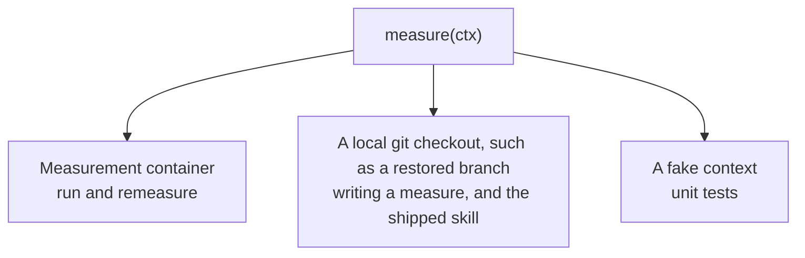

# Measure functions: an alternative to `templateTest`

A proposal to replace instrument-plus-config measurements, and `templateTest` in particular, with a plain `measure(ctx)` function. The context hands the author the facts about a run they'd otherwise dig out themselves: commits, changed files, what the agent printed.

Status: proposal. Nothing in the PRDs has changed yet.

## What's wrong with `templateTest`

As specified in [060](../prd/060-experiment-parameters.md#templatetest) and as built in [d48b115](https://github.com/dwjohnston/thunderjar/commit/d48b1154961a7c6fe86455b26cc59f7210c7c5ca):

```ts
// measurements/isPrimeTemplateTest.ts
export default declareMeasurement({
  instrument: "templateTest",
  config: { subject: "**/isPrime.ts", template: "./isPrime.test.template.ts" },
  aggregate: ["sum"],
});
```

```ts
// measurements/isPrime.test.template.ts — not runnable as-is
import { {{defaultExport}} } from "{{subjectPath}}";
test("17 is prime", () => expect({{defaultExport}}(17)).toBe(true));
```

- **The template isn't code.** It has `{{placeholders}}` in it, so it doesn't type-check, the editor can't help, and it can't be run on its own while writing it.
- **The binding rules are magic.** The subject must have exactly one export. A default export needs a generated `*.templateTest.bind.ts` module to re-export it under a name. None of this is visible from the measurement file.
- **It only fits JavaScript modules.** It reads exports with `Bun.Transpiler`. A bash or Python code state can't use it.
- **It assumes Bun is in the image.** It runs `bun test` inside the measurement container. The base image in [062](../prd/062-code-state.md#how-the-code-gets-into-the-image) is `node:20-bookworm`, which has no Bun.
- **It scrapes human-readable output.** Pass and fail counts come from regexes over `bun test`'s console output, which can change between Bun versions.
- **It writes into the workspace.** The rendered test and bind module land beside the subject. In a shared measurement container, a later `grep` over `**/*.ts` can count them, so results can depend on measurement order.

The other two instruments have a quieter problem: they look at the end state, not at what the agent did.

- `fileCreated` with `**/isPrime.ts` is true if the file *exists*, including when the code state already had it.
- `grep` over `**/*.ts` counts every match in the tree, including the code state's own files and `node_modules`, not the ones the agent added.

## Proposal

A measurement is a function. Thunderjar calls it with a context that already knows the useful facts about the run.

```ts
// measurements/isPrimeTsExists.ts
export default declareMeasurement({
  measure: (ctx) =>
    ctx.changes.some((c) => c.status === "added" && c.path.endsWith("isPrime.ts")),
  aggregate: ["rate"],
});
```

- **Return the value.** `true`, `3`, `{ passed: 4, failed: 1 }`. Thunderjar wraps it as `measured`.
- **Return `ctx.skip(reason)`** when there's nothing to judge. It becomes `skipped`, with the reason `show` already displays.
- **Throw** when the measure itself breaks. It becomes `erroredWhileMeasuring`.
- **`aggregate` is typed from the return type.** Returning a boolean and asking for `"mean"` is still a type error, as in [085](../prd/085-experiment-results.md#how-a-measures-values-combine).

Nothing stops a measure running anything it likes through `ctx.exec`. The facts are there so it rarely has to.

## The context

```ts
interface MeasureContext {
  // What the agent was asked
  initialPrompt: string;

  // What the agent did, from git. Paths are relative to workdir.
  baseCommit: string;                     // the code state's commit
  commits: Commit[];                      // baseCommit..HEAD, oldest first
  changes: FileChange[];                  // end state vs baseCommit: committed, uncommitted and untracked
  diff(pathspec?: string): Promise<string>; // unified diff vs baseCommit, same scope as changes

  // What the harness process did
  run: {
    exitCode: number;
    durationMs: number;
    stdout: string;
    stderr: string;
    finalMessage?: string;                // the agent's last message, if the harness can say
    resultFile: string;                   // raw contents of the file `cli` wrote
  };

  // Reading and acting in the measurement container
  workdir: string;
  readFile(path: string): Promise<string | undefined>;
  glob(pattern: string): Promise<string[]>;
  exec(command: string, options?: { cwd?: string; env?: Record<string, string> }): Promise<ExecResult>;
  writeFile(path: string, contents: string): Promise<void>;
  copyIn(file: string, destination?: string): Promise<string>; // a declared file into the container

  skip(reason: string): Skipped;
}

type Commit = { hash: string; message: string; files: FileChange[] };

type FileChange = {
  path: string;
  status: "added" | "modified" | "deleted" | "renamed";
  from?: string; // for renames
};
```

The bottom half is today's [measurement context](../prd/060-experiment-parameters.md#measurement-context), plus `copyIn`. The top half is new.

The context deliberately leaves out the run's parameters: model, prompt set, harness. A measure that could see them could judge two permutations differently, and then they wouldn't be comparable.

## The three measurements, rewritten

### `isPrimeTsExists`

Shown above. It now means *created*: a file the code state already had doesn't count.

### `tsIgnoreCount`

Counts the `@ts-ignore` lines the agent added, not every one in the tree.

```ts
import { addedLines } from "thunderjar";

export default declareMeasurement({
  measure: async (ctx) =>
    addedLines(await ctx.diff("*.ts")).filter((line) => line.includes("@ts-ignore")).length,
  aggregate: ["mean", "max"],
});
```

### `isPrimeTests`, replacing `isPrimeTemplateTest`

The template becomes an ordinary test file. It finds the agent's file through an environment variable instead of a placeholder, so it's valid TypeScript and runs on its own.

```ts
// measurements/isPrime.check.ts — a real test file
import { expect, test } from "bun:test";

const mod = await import(Bun.env.SUBJECT!);
const isPrime: (n: number) => boolean = mod.isPrime ?? mod.default;

test("17 is prime", () => expect(isPrime(17)).toBe(true));
test("1 is not prime", () => expect(isPrime(1)).toBe(false));
```

```ts
// measurements/isPrimeTests.ts
import { countTests } from "thunderjar";

export default declareMeasurement({
  files: ["./isPrime.check.ts"],
  measure: async (ctx) => {
    const subject = ctx.changes.find((c) => c.status === "added" && c.path.endsWith("isPrime.ts"));
    if (!subject) return ctx.skip("the agent created no isPrime.ts");

    const check = await ctx.copyIn("./isPrime.check.ts");
    await ctx.exec(`bun test ${check} --reporter=junit --reporter-outfile=/tmp/junit.xml`, {
      env: { SUBJECT: `${ctx.workdir}/${subject.path}` },
    });
    return countTests(await ctx.readFile("/tmp/junit.xml")); // { passed, failed }
  },
  aggregate: ["sum"],
});
```

- **The binding is two visible lines** in the test file, `mod.isPrime ?? mod.default`, which the author can change.
- **The test runner is the author's choice.** A Node image runs `node --test`; a Python project runs `pytest --junitxml`.
- **JUnit XML replaces regex scraping.** Bun, Vitest, Jest, pytest and Go all emit it, so `countTests` is one parser for every runner.
- **Nothing is written into the workspace.** `copyIn` puts the file in a scratch folder outside `workdir` unless given a destination.

Checked against Bun 1.4.4: run against an `isPrime.ts` whose default export reports 1 as prime, the check file gives 3 passed and 1 failed, with no bind module.

You can run the check locally while writing it:

```bash
SUBJECT=./src/isPrime.ts bun test ./measurements/isPrime.check.ts
```

## Where the facts come from

### Git: commits and changes

The code state's commit is already known, and `/workspace` is checked out detached at it with no remote ([062](../prd/062-code-state.md#how-the-code-gets-into-the-image)).

- **`commits`** is `git log --reverse <base>..HEAD`.
- **`changes`** stages the end state into a throwaway index and diffs it against the base: `GIT_INDEX_FILE=… git add -A`, then `git diff --cached --name-status -M <base>`.
  - It covers committed, uncommitted and untracked files in one list.
  - The agent amending or squashing its own commits doesn't change it.
  - Gitignored files, such as `node_modules`, are left out.
- **Restore needs the same two things.** It fetches the commits on top of the base and adds a Thunderjar commit for uncommitted changes ([090](../prd/090-restore-purge.md)). One implementation serves both.
- **They're computed once, before any measure runs.** A measure that writes files can't change what the next one sees.

### stdout and the agent's last message

Nothing captures the harness's stdout today, so this needs a change.

- **The execution wrapper tees stdout and stderr** to `/thunderjar/stdout.log` and `/thunderjar/stderr.log`, written before commit like `run.json` ([080](../prd/080-docker-execution.md#the-execution-wrapper)).
- **For Claude Code, stdout is the result file.** Its `cli` redirects stdout into `ctx.resultPath`, so `stdout.log` would be empty. What a measure wants is the agent's words, not the JSON around them.
- **So the harness can also supply `collectFinalMessage(raw)`,** beside `collectTokenCosts` ([087](../prd/087-collecting-token-costs.md#normalising-collecttokencosts)). Claude Code's JSON has it in its `result` field. A harness that doesn't supply one leaves `finalMessage` undefined.

## What happens to instruments

- **`instrument` and `config` go away.** One way to write a measurement is easier to document, to type, and for the shipped skill to generate.
- **The built-ins become helpers** you call inside `measure`: `addedLines`, `countTests`, and whatever else proves common.
- **"Measuring instrument" retires as a term**, or comes to mean a helper. That touches [030](../prd/030-terminology.md).

## Testing a measure

The same function runs against three implementations of the context.



The local one is what the [shipped skill](../prd/045-shipped-skills.md#helping-with-measurements) needs for step 3, checking a proposed measurement against the files the session left behind. The session's repository and the commit it started from are enough to build it.

## Trade-offs

- **The hash has to cover code, not config.** See the open question below.
- **Reports can't describe a measurement from its config.** `show` can't print "grep `@ts-ignore` in `**/*.ts`" any more, only the name. An optional `description` field would cover it.
- **A measure can be non-deterministic,** for example by reading the clock or the network. That was already possible through `exec`. The shipped skill should steer away from it.

## Open questions

- **What the content hash covers.** Today it's `instrument`, `config` and bundled files, but not `aggregate` ([085](../prd/085-experiment-results.md#name-is-identity-hash-is-version)).
  - Likely: bundle the measurement file with `Bun.build`, so local imports and helpers are included, and hash that plus the files in `files`.
  - The catch: `aggregate` is in the same file, so editing it would re-measure. Re-measuring costs image pulls, not tokens, so this may be acceptable.
- **Isolation between measures.** `copyIn` to a scratch folder covers the common case. A measure that writes into the workspace, for example to use the project's own Vitest, could still affect a later measure. A fresh measurement container per measure would remove the question, at the cost of more container starts.
- **A command to run one measure** against a container run or a local checkout while writing it, such as `thunderjar measure <task>/<measurement> --against <container run | dir>`. Not in the planned command list.
- **When `.git` is gone.** If the agent deletes `/workspace/.git`, the git facts can't be computed. Probably: they throw, so a measure that uses them is `erroredWhileMeasuring`.

## PRDs this would change

- [060](../prd/060-experiment-parameters.md): the instruments section, `templateTest`, and the measurement context.
- [066](../prd/066-task.md) and [051](../prd/051-configuration-folder-structure.md): the task measurement examples and folder listings.
- [085](../prd/085-experiment-results.md): the content hash, and the `aggregate` examples.
- [080](../prd/080-docker-execution.md): the execution wrapper captures stdout and stderr.
- [064](../prd/064-harness.md) and [087](../prd/087-collecting-token-costs.md): the optional `collectFinalMessage`.
- [045](../prd/045-shipped-skills.md): the skill writes `measure` functions, and the check file instead of a template.
- [030](../prd/030-terminology.md): "measuring instrument".
- [120](../prd/120-test-boundaries.md): layer 1 tests helpers and contexts, not instruments.
