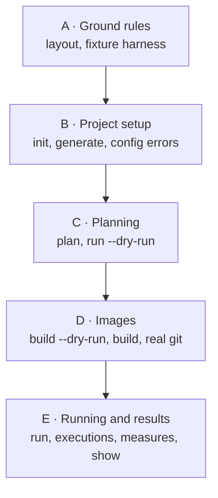

# Planned reapplication of PR #24/#25, rows 1–24

A proposed order for reapplying rows 1–24 of the [features table](./fixture-test-patterns.md#features-in-order) onto `main`.

The original order built the commands first and the fixture tests afterwards, then spent about 30 commits moving tests to scenarios. This order sets up the fixture harness first, so every command is tested against a scenario from the start.

`main` already has `init`, `generate` and `plan` as Commander stubs under `src/cli/commands/`. The steps below fill them in using that layout, not the PR's `src/commands/`.

Each step names the scenario it adds and the test type it uses, from [Test types](./fixture-test-patterns.md#test-types):

1. Real files created
2. Config in, check stdout
3. Build an image
4. Run on an image
5. Make data from an image
6. Unit test

## Proposed order

### A. Ground rules

1. **Layout and lint rules**
   - The generated oxlint rules, with the layer order already in place, so nothing has to be restructured later. A layer is added to the layout when its first module arrives.
   - From rows 3 and 19.
2. **Fixture harness**
   - The `fixtureTests/` folder, `bun run fixture <n> <command>`, and `src/testing/cli.ts`: run the CLI in a scenario and replace the parts that change between runs (IDs, temp paths, durations) with placeholders.
   - The checked-in `node_modules/thunderjar` link, the scenario type-check test, and the rules in AGENTS.md and fixtureTests/AGENTS.md.
   - No scenarios yet. Step 3 adds the first.
   - From rows 13, 14, 17 and 22.

### B. Project setup

3. **`scenario_0_empty_project` and `init`**
   - Scenario 0 is an empty folder. `init` is tested on a copy of it, checking the files it creates. Type 1.
   - Also adds the library entry point, so a scaffolded project resolves `thunderjar`.
   - From row 1.
4. **`scenario_1_minimal_initial_setup`, `generate` and typed declarations**
   - Scenario 1 is what `init` scaffolds, with the agent swapped for `fake-harness-alpha`. Running `init` on scenario 0 should produce it, apart from the agent swap.
   - `generate` writes `_generated/` in place. Type 1.
   - Adds the config loader, and type-check tests against scenario 1, plus a scenario with type errors. Type 2.
   - From row 2.
5. **Configuration errors**
   - Scenarios with broken declarations, a broken harness family, and empty parameter folders. Asserts on stderr and the exit code. Type 2.
   - From row 4.

### C. Planning

6. **`scenario_2_typical_project` and the matrix in `plan`**
   - Scenario 2 has both fake agents, two prompt sets and two wordings of the task.
   - `plan` prints permutations and content hashes. Type 2.
   - From row 5.
7. **`run --dry-run`, with ULID execution IDs**
   - Prints each permutation's prerun image, and each iteration's postrun image and harness command. Type 2.
   - From row 6.

### D. Images

8. **`applyParameter`**
   - Each parameter decides what applying it does. The Dockerfile is rendered from those fragments.
   - From row 16, and the Dockerfile half of row 15.
9. **`--image-prefix` and `build --dry-run`**
   - `build --dry-run` prints each prerun Dockerfile and builds nothing. `plan` shows whether each image exists, using the fake Docker. Type 2.
   - `--image-prefix` is in place before the first real-Docker test needs it.
   - From rows 23, 24 and 15.
10. **`build`**
    - The fake-Docker tests, plus `build.docker.test.ts` against real Docker under a throwaway prefix, run by `test:docker` in CI. Type 3.
    - From rows 15 and 20.
11. **`scenario_4_git_project`**
    - Code states and prompt sets that read real commits of this repository, pinned by tags. Type 3.
    - Replaces the seed repository (28eba43) rather than adding it first.
    - From row 18.

### E. Running and results

12. **`run`**
    - Runs each iteration and writes the run data store. Type 4.
    - From row 7.
13. **The run data store and `executions`**
    - `scenario_8_recorded_executions` has a run data store checked in, which `executions` lists. Type 2.
    - From row 8.
14. **Measurements and instruments**
    - Measures taken on each container run, plus the `grep` and `templateTest` instruments. Unit tests for the instruments. Types 4 and 6.
    - From rows 9 and 10.
15. **`show` and aggregation results**
    - Against scenario 8's store. Type 2.
    - From rows 11 and 12.

## Not carried over

- Row 21, the Ralph loop setup.
- Row 19's restructure, and row 20's move of build tests next to `build`.
  - Not needed: the layout from step 1 puts each file in its final place from the start.
- The seed repository, and the project-generating test helpers (`fixture-project.ts`, `seed-repo.ts`).
  - The PR later marked these "NOT ENDORSED".

## Open questions

1. **Scenario 0 and JS projects**
   - `init` behaves differently when the project already has a `package.json`: it skips creating its own nested one.
   - Should that case be its own scenario next to scenario 0, as scenarios 6 and 7 were in the PR?
2. **`run` on the host or in Docker**
   - Row 7 runs agents on the host. Row 25, outside this range, moved them into containers.
   - Should step 12 go straight to containers?
3. **`--data-dir`**
   - It arrived in row 29, but a real `run` test needs it to run in place without writing a store into the scenario.
   - Should it come forward into step 12?
4. **Scenario numbering**
   - Number scenarios in the order they're added, i.e. 0, 1, 2, 4, 8 become 0–4?
   - Or keep the PR's numbers, so its docs and commits still line up?
