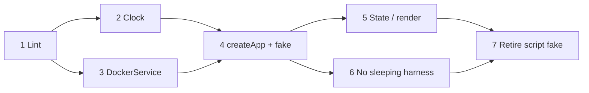

<!--
🤖
This file was created with AI

Harness: Claude Code
Session Id: session_01LCLeLkAqHnuJNpBkHKNoDC
Supervising engineer: David Johnston

Drafted from the "No Ambient Non-Determinism" spec.

Humans: add your notes here
-->

# Migrating to no ambient non-determinism

How we get from today's test setup to the spec: Docker behind a service, an injected clock, fake agents that never sleep, and CLI tests that assert on state.

<details>
<summary><strong>Where we are</strong></summary>

- `src/docker/docker.ts` is ~25 free functions, each shelling out through `Bun.$` to `runtime.command`.
- `src/testing/fakeDocker.ts` is a separate script, a stand-in `docker` binary (~660 lines). It keeps state in a folder and really runs container scripts on the host.
- `thunderjar()` in `src/testing/cli.ts` spawns the real CLI as a subprocess, with `THUNDERJAR_DOCKER` pointing at the fake.
- Time is read ambiently: `Date.now()` in `runExecution.ts` and `runner.ts`, `Bun.sleep` in `run.ts` and `runner.ts`, `setInterval` in `liveRows.ts`.
- Fixture `0204` has `fake-sleeper` running `sleep 300`. Timeout tests wait out real seconds, because fake timers can't reach the subprocess.
- 22 non-test files read `process.env` / `Bun.env`.

</details>

<details>
<summary><strong>Target shape</strong></summary>

```ts
const clock = new FakeClock();
const docker = new FakeDockerService({ clock, images: ["thunderjar-prerun:ded54607"] });
const app = createApp({ clock, ids: new FakeIds(), docker, io: new FakeIo(), env: { cwd: scenario("0204"), variables: {} } });

const exit = app.cli(["run", "misbehaving"]);
await clock.advance(2_000);
expect(app.state().containers[0]).toMatchObject({ status: "timedOut" });
```

- `createApp(services)` is the only composition root. `src/cli/index.ts` builds the real services and calls it.
- `app.state()` returns the command's state model. Commands write state, a renderer turns state into stdout.

</details>

<details>
<summary><strong>The <code>DockerService</code> interface</strong></summary>

Every call Thunderjar makes to the Docker CLI today, by the function that makes it. Most live in `src/docker/`; three places call Docker themselves, listed in the notes. `runtime` is `docker` itself, or `docker --context <name>` for a remote runtime; functions without one always run against the local `docker`.

`DockerService` is these functions as methods, with `runtime` bound when the service is built (`cliDockerService(runtime)`), so no method takes it. The names drop their suffixes: `buildImage` → `build`, `readContainerFile` → `readFile`, and so on.

**Images**

| Function, as it is now | What Thunderjar uses it for | Docker command |
| --- | --- | --- |
| `buildImage(contextDir: string, image: string, options: BuildOptions = {}, runtime = localRuntime()): Promise<void>` | Building prerun images (`build`, `run`), the runner image, and the probe image that checks a runtime | `docker build [--secret id=…,env=…] [--ssh default] -t <image> <contextDir>`, with `DOCKER_BUILDKIT=1` |
| `imagesIn(repository: string, runtime = localRuntime()): Promise<Set<string>>` | Which prerun images are already built, so `plan` and `run` skip them; which images `purge` can delete | `docker image ls --format {{.Repository}}:{{.Tag}} <repository>` |
| `removeLocalImage(image: string): Promise<LocalRemoval>` | `purge` deleting a postrun image from the local daemon | `docker image rm <image>` |

**Registry**

| Function, as it is now | What Thunderjar uses it for | Docker command |
| --- | --- | --- |
| `checkLogin(host: string): Promise<void>` | Before pushing to the image store: failing early if Docker isn't logged in to its registry | `docker login <host>`, with no input, so it only succeeds on saved credentials |
| `login(host: string, username: string, password: string): Promise<void>` | The runner, on a remote runtime, logging in to the image store with the credentials it was given | `docker login <host> --username <username> --password-stdin` |
| `pushImage(image: string, reference: string, runtime = localRuntime()): Promise<void>` | Pushing prerun and postrun images to the image store; the probe image | `docker tag <image> <reference>`, then `docker push --quiet <reference>` |
| `pullImage(reference: string, runtime: DockerRuntime): Promise<void>` | Pulling a prerun image from the image store onto a remote runtime; the probe image | `docker pull --quiet <reference>` |
| `inRegistry(reference: string): Promise<boolean>` | Whether the image store already has an image, so it isn't built or pushed again | `docker manifest inspect <reference>` |

**Containers**

| Function, as it is now | What Thunderjar uses it for | Docker command |
| --- | --- | --- |
| `runContainer(image: string, name: string, script: string, { env, runOptions, setEnv, secretEnv, … }, runtime): Promise<…>` | Running the agent in its container, attached, until it exits or times out; the secret search's container | `docker run --name <name> --pull <policy> -e … --entrypoint sh <image> -c <script>`. On timeout, `docker kill <name>`, up to 3 times |
| `commitContainer(name: string, image: string, like: string, runtime = localRuntime(), kept: Record<string, string> = {}): Promise<void>` | Saving the agent's container as the postrun image, with the prerun image's entrypoint and its environment minus secrets | `docker image inspect --format … <like>`, `docker container inspect --format … <name>`, then `docker commit --change … <name> <image>` |
| `removeContainer(name: string, runtime = localRuntime()): Promise<void>` | Removing a container once its run, secret search, shell or capture sample is done | `docker rm --force <name>` |
| `removeContainersNamed(prefix: string, runtime = localRuntime()): Promise<string[]>` | Cleaning up every container of an execution, e.g. after Ctrl-C, or `attach` stopping one on the runtime | `docker ps --all --filter name=<prefix> --format {{.Names}}`, then `docker rm --force <names…>` |
| `startDetached(image: string, name: string, runOptions: string[], runtime: DockerRuntime): Promise<void>` | Starting the runner's container on a remote runtime, to run the execution there | `docker run --detach --name <name> --pull missing <runOptions…> <image>` |
| `stopContainer(name: string, graceSeconds: number, runtime: DockerRuntime): Promise<void>` | Stopping the runner, so it records the execution as failed and removes its containers | `docker stop --time <graceSeconds> <name>` |
| `containerState(name: string, runtime: DockerRuntime): Promise<ContainerState \| undefined>` | Whether the runner is still running, and its exit code once it isn't | `docker inspect --format {{.State.Running}} {{.State.ExitCode}} <name>` |
| `endStateBundle(record: ContainerRunRecord, runtime: DockerRuntime): Promise<Uint8Array>` (in `src/execution/checkout.ts`) | `checkout --branch`: a git bundle of the agent's end state, from the postrun image | `docker run --rm --pull <policy> -e GIT_AUTHOR_DATE=… --entrypoint sh <postrunImage> -c <bundle script>`, reading stdout |

**Container files and output**

| Function, as it is now | What Thunderjar uses it for | Docker command |
| --- | --- | --- |
| `readContainerFile(name: string, path: string, runtime = localRuntime()): Promise<string \| undefined>` | Reading what the agent left: its result file, `run.json`, replies; the runner's events and log; secret search results | `docker cp <name>:<path> <host temp dir>/file`, then reading that file |
| `writeContainerFile(name: string, path: string, text: string, runtime: DockerRuntime): Promise<void>` | Handing the runner its submission: the plan and everything it needs | `docker exec --interactive <name> sh -c 'cat > <path>.part && mv <path>.part <path>'`, the text on stdin |
| `followLogs(name: string, runtime: DockerRuntime, onLine: (line: string) => void, signal?: AbortSignal): Promise<number>` | `run` and `attach` showing the runner's events as they happen | `docker logs --follow <name>` |
| `stderrTail(name: string, runtime: DockerRuntime, lines = 20): Promise<string>` | Why the runner failed, when it exits without recording | `docker logs --tail <lines> <name>` |

**Interactive**

| Function, as it is now | What Thunderjar uses it for | Docker command |
| --- | --- | --- |
| `openShellSession(image: string, name: string, runtime: DockerRuntime, env: string[] = []): Promise<ShellSession>` | Measurements' commands, run one after another in one container from the postrun image (`run`, `remeasure`); `checkout --shell` | `docker run --rm --interactive --name <name> --pull <policy> -e … --entrypoint sh <image> -c <session script>`, commands sent over stdin |

**Daemon**

| Function, as it is now | What Thunderjar uses it for | Docker command |
| --- | --- | --- |
| `diskUsage(runtime = localRuntime()): Promise<string[]>` | Logging the runtime's disk usage before and after an execution | `docker system df --format {{.Type}}: {{.Size}} ({{.Reclaimable}} reclaimable)` |
| `daemonId(runtime: DockerRuntime): Promise<string \| undefined>` | Nothing: exported, but no caller | `docker info --format {{.ID}}` |

Notes:

- **Not in the table, though the earlier draft of the interface had them:** `imageEnv`, `tag`, `exec` and `kill` are steps inside `commitContainer`, `pushImage`, `writeContainerFile` and `runContainer`, not functions of their own. The service keeps them inside its methods, so the fake records the method, e.g. `docker.killed` from `run`'s timeout.
- **`daemonId`:** delete it in phase 3 rather than carry it into the interface.
- **Docker calls outside `src/docker/`,** which phase 3 moves into the service:
  - `endStateBundle` in `src/execution/checkout.ts`: its `docker run`, as `runForOutput(image, command, env)`. The git logic stays in `checkout.ts`.
  - `openShell` in `src/execution/checkout.ts`: `checkout --shell`'s `docker run -it`, with the terminal inherited. A method of its own, e.g. `attachShell`.
  - `src/cli/commands/capture/sampleRepoImage.ts`: `docker image inspect`, `docker run -d … sleep infinity`, `docker exec`, `docker rm --force`, for `capture`'s sample repository. All but the first map onto existing methods.
- **`readContainerFile`'s temp folder,** `TMPDIR` and `crypto.randomUUID()` stay inside `cliDockerService`. The fake reads its in-memory filesystem.
- **`runContainer`'s options** become one `RunSpec` object.
- **Pure helpers** (`reasonOf`, `buildFailureReason`, `scrubbedEnvChanges`, `locate`, `splitReference`) stay free functions. They read nothing ambient.
- **Not the Docker CLI:** `src/docker/registry.ts` talks to registries over HTTP with `fetch`, for `purge`, after reading credentials through Docker's credential helper. It needs the same treatment, as its own service.

### `FakeDockerService`

In-memory, no subprocess, driven by the clock it's given.

- Images and containers in maps. Container filesystems are a `Map<path, string>`, seeded from the image's `COPY <<'EOF'` heredocs, as the script fake does today.
- Scripted behaviour per harness image, all on the fake clock:
  - `onStart(image, fn)`: delay or fail container start.
  - `onExec(image, fn)`: the agent. Default resolves `{ exitCode: 0 }` at once.
  - `onMeasure(name, fn)`: a measurement's result.
- `kill` aborts the `signal` passed to the pending `onExec`.
- Records: `commands`, `killed`, `pushed`, `runningContainers()`.

</details>

<details>
<summary><strong>The <code>Clock</code> and <code>FakeClock</code></strong></summary>

As the spec's interface, plus `sleep(ms, { signal })` so a hung agent can be cancelled. `FakeClock.advance(ms)` fires due timers in order and drains microtasks between each.

</details>

<details>
<summary><strong><code>Io</code> and <code>FakeIo</code></strong></summary>

Everything between the command and whoever ran it, as one service: the three streams, and being asked to stop.

```ts
interface Io {
  stdout: Output; // write(text), isTTY, columns
  stderr: Output;
  stdin: Input;   // readLine(), readAll(), isTTY
  /** Ctrl-C, or the process being asked to stop. Returns a function that stops listening. */
  onStop(handler: (signal: "SIGINT" | "SIGTERM") => void): () => void;
}
```

- **One service, three streams.** They're used together: `confirm.ts` writes a question and reads the answer, and a Ctrl-C handler writes a message before the command ends. But each stream stays its own, with its own `isTTY`: with `run x --json > out.json`, stdout is piped and stderr is still a terminal.
- **The exit code isn't in it.** `app.cli()` returns it. Commands return a number rather than call `process.exit`, and `src/cli/index.ts` is the only place that exits.
- **`processIo()`** is the real one, over `process.stdout`, `process.stderr`, `process.stdin` and `process.on`.

`FakeIo` is the one object a test needs:

```ts
const io = new FakeIo();                                    // both streams captured as text
const io = new FakeIo({ stdout: "terminal", columns: 120 }); // stdout is a terminal

io.stdout.text();     // everything written, as written
io.stdout.screen();   // on a terminal: the lines showing now, cursor escapes applied
io.stdin.type("y\n"); // answers a prompt
io.interrupt();       // Ctrl-C: calls the onStop handlers with "SIGINT"
io.terminate();       // "SIGTERM"
```

A test of Ctrl-C reads as what the person did:

```ts
const exit = app.cli(["attach", "00000000000000000000000001"]);
await clock.advance(5_000);
io.interrupt();

expect(await exit).toBe(130);
expect(io.stderr.text()).toContain("Detached (SIGINT): execution 00000000000000000000000001 carries on, on the runtime.");
```

</details>

<details>
<summary><strong><code>Env</code>: what the command was started with</strong></summary>

The facts fixed before the command runs, as one plain object. It has no methods, so there's no fake: a test writes the values.

```ts
type Env = {
  /** The folder the command was run in. */
  cwd: string;
  /** The environment variables. */
  variables: Record<string, string | undefined>;
  /** Where Thunderjar's own files are installed. By default, the repository, which suits tests. */
  thunderjarDir?: string;
};
```

```ts
// src/cli/index.ts, the only place that reads the real ones
const app = createApp({ …, env: { cwd: process.cwd(), variables: process.env, thunderjarDir: import.meta.dir } });
process.exit(await app.cli(process.argv.slice(2)));

// a test
const app = createApp({ …, env: { cwd: scenario("0202"), variables: { ANTHROPIC_API_KEY: "test-key" } } });
```

- **`argv` isn't in it.** The arguments are what `app.cli(args)` takes, so one app can run several commands in a test.
- **`variables: {}` means none are set,** not "inherit mine". A test that needs a key says so, and a developer's own environment can't change a result.
- **Not part of `Io`.** `Io` has behaviour, and a fake. This is data.

</details>

<details>
<summary><strong>Fake agents never sleep</strong></summary>

Delays move out of fixtures into tests.

| Today | After |
| --- | --- |
| `fake-sleeper` harness runs `sleep 300` | The harness is a no-op. The test says `onExec("fake-sleeper", ({ clock, signal }) => clock.sleep(Infinity, { signal }))` |
| `slow-start` file in the fake's state folder | `onStart("fake-silent", ({ clock }) => clock.sleep(3_000))` |
| `slow` builds take a real second | `onBuild(image, fn)` on the fake clock |

A lint check over `fixtures/**/harnessModels/**` bans `sleep` in a harness's command.

</details>

<details>
<summary><strong>Phases</strong></summary>

Each phase lands green, on its own PR.

### 1. Lint first

Add `no-restricted-globals` / `no-restricted-properties` rules for every banned API, each message naming its replacement. Generate a per-file allowlist of today's offenders into `.oxlintrc.json`, so the rule passes now and the list only shrinks.

✅ New code can't add ambient reads from day one.

### 2. `Clock`

- Add `src/time/clock.ts` (`Clock`, `systemClock`) and `src/testing/fakeClock.ts`, with `FakeClock`'s own unit tests.
- Thread a clock through `runExecution`, `runner.ts`, `run.ts` and `liveRows.ts`. `liveRows` already takes `now`, so it's the template.
- Logger timestamps come from the clock.

### 3. `DockerService` over the real CLI

- Define the interface. Turn `docker.ts` into `cliDockerService(runtime)`, the methods wrapping today's functions unchanged.
- Callers take a `DockerService` parameter instead of importing free functions. Mechanical, file by file.
- Nothing about tests changes yet. The subprocess fake still sits behind `THUNDERJAR_DOCKER`.

### 4. `createApp` and in-process tests

- Add `createApp({ clock, ids, docker, io, env, fs? })`. `src/cli/index.ts` becomes the composition root and the only reader of `process.env`, `process.cwd()` and `process.argv`.
- Add `FakeDockerService`. Add a contract suite, `docker.contract.ts`, run against the fake in `bun test` and against real Docker in `*.docker.test.ts`.
- Give `thunderjar()` an in-process mode that uses `createApp`. Move command tests over one command at a time, starting with `build`, then `run`.

### 5. State, then rendering

- Per command, extract a state model (`app.state()`), and a pure `render(state, now)`.
- Command tests assert on state. A separate `*.render.test.ts` per command asserts on stdout from hand-built states.
- Start with `run`, where the timeline matters most.

### 6. Remove the sleeping harness

- Rewrite the `0204` timeout tests as timeline tests, like the spec's example.
- Make `fake-sleeper` a no-op and add the fixture lint.
- Remove `slow`, `slow-start` and real-time waiting from the script fake.

### 7. Retire the subprocess fake

Once no test uses it, delete `src/testing/fakeDocker.ts` and `THUNDERJAR_DOCKER`. Real-Docker coverage stays in `*.docker.test.ts` and the contract suite.

</details>

<details>
<summary><strong>Order and risk</strong></summary>



- **Biggest change:** phase 3, touching every Docker caller. It's mechanical and needs no test changes, so do it in one sweep.
- **Biggest risk:** the in-memory fake drifting from real Docker. The contract suite is the guard, so it lands with the fake, not after.
- **Quick win:** phase 6 can come straight after `run` moves in-process. That removes the slow, flaky timeout tests first.

</details>

<details>
<summary><strong>Example: a rendering test</strong></summary>

Phase 5 splits each command in two. The command writes a **state model**. A pure `render(state, now)` turns it into what the terminal shows. A `*.render.test.ts` builds states by hand and asserts on the text. No Docker, no clock, no CLI.

### The state

What `run` knows at any moment, and nothing about how it's shown.

```ts
// src/cli/commands/run/runState.ts
export type ContainerRunState =
  | { status: "queued" }
  | { status: "running"; step: "agent" | "measuring"; since: number }
  | { status: "done"; ms: number; cost?: number; measures: Record<string, unknown> }
  | { status: "timedOut"; ms: number };

export type RunState = {
  executionId: string;
  builds: { image: string; status: "building" | "built" | "failed" }[];
  containers: { label: string; iteration: [number, number]; run: ContainerRunState }[];
  recordedIn?: string;
};
```

### The renderer

Pure: same state and `now`, same lines. Two modes, as today: lines rewritten in place on a terminal, lines appended when piped.

```ts
// src/cli/commands/run/renderRun.ts
export type RenderOptions = { now: number; terminal: boolean; paint?: Paint };

export function renderRun(state: RunState, { now, terminal, paint = plain }: RenderOptions): string[] {
  const total = state.containers.length;
  return [
    `Execution ${state.executionId}`,
    ...state.builds.map(({ image, status }) => `Building ${image} ... ${BUILD_WORD[status]}`),
    ...state.containers.flatMap(({ label, iteration, run }, i) => {
      const head = ` ${ordinal(i + 1, total)}  iteration ${iteration.join("/")}  ${label}  ...`;
      switch (run.status) {
        case "queued":
          return terminal ? [`${head} queued`] : [];
        case "running":
          return terminal ? [`${head} ${run.step} ${paint.dim(elapsed(now - run.since))}`] : [];
        case "done":
          return [`${head} done (${duration(run.ms)}${run.cost ? `, ${dollars(run.cost)}` : ""})`, `      ${showMeasures(run.measures, paint)}`];
        case "timedOut":
          return [`${head} ${paint.red(`timed out after ${duration(run.ms)}`)}`];
      }
    }),
    ...(state.recordedIn ? [`Recorded in ${state.recordedIn}`] : []),
  ];
}
```

### The test

```ts
// src/cli/commands/run/renderRun.render.test.ts
import { describe, expect, test } from "bun:test";
import { renderRun } from "./renderRun.ts";
import type { RunState } from "./runState.ts";

const T0 = 1_700_000_000_000;

const midRun: RunState = {
  executionId: "01JD0000000000000000000000",
  builds: [{ image: "thunderjar-prerun:ded54607", status: "built" }],
  containers: [
    {
      label: "fake-harness-alpha | plain",
      iteration: [1, 1],
      run: { status: "done", ms: 4_200, cost: 0.061, measures: { compiles: true, tests: { passed: 4, failed: 1 } } },
    },
    { label: "fake-harness-beta | plain", iteration: [1, 1], run: { status: "running", step: "agent", since: T0 } },
    { label: "fake-sleeper | plain", iteration: [1, 1], run: { status: "queued" } },
  ],
};

describe("renderRun", () => {
  test("on a terminal, a running container counts up from when its step started", () => {
    expect(renderRun(midRun, { now: T0 + 12_000, terminal: true })).toEqual([
      "Execution 01JD0000000000000000000000",
      "Building thunderjar-prerun:ded54607 ... done",
      " 1/3  iteration 1/1  fake-harness-alpha | plain  ... done (4.2s, $0.061)",
      "      compiles: true   tests: {passed: 4, failed: 1}",
      " 2/3  iteration 1/1  fake-harness-beta | plain  ... agent 12s",
      " 3/3  iteration 1/1  fake-sleeper | plain  ... queued",
    ]);
  });

  test("piped, only finished containers are written, so nothing needs rewriting", () => {
    expect(renderRun(midRun, { now: T0 + 12_000, terminal: false })).toEqual([
      "Execution 01JD0000000000000000000000",
      "Building thunderjar-prerun:ded54607 ... done",
      " 1/3  iteration 1/1  fake-harness-alpha | plain  ... done (4.2s, $0.061)",
      "      compiles: true   tests: {passed: 4, failed: 1}",
    ]);
  });

  test("a timed-out container says so, with how long it was given", () => {
    const state: RunState = {
      ...midRun,
      containers: [{ label: "fake-sleeper | plain", iteration: [1, 1], run: { status: "timedOut", ms: 2_000 } }],
      recordedIn: "<DATA>/runs.sqlite",
    };

    expect(renderRun(state, { now: T0, terminal: false }).slice(-2)).toEqual([
      " 1/1  iteration 1/1  fake-sleeper | plain  ... timed out after 2.0s",
      "Recorded in <DATA>/runs.sqlite",
    ]);
  });
});
```

What this buys:

- **Time is an argument.** "12s" comes from `now - since`, not from waiting 12 seconds.
- **Every display state is one object literal away.** Timeouts, half-finished executions and failed builds need no fixture that misbehaves on cue.
- **Terminal vs piped is a flag**, not a TTY the test has to fake.

### Where it sits next to the command test

The two tests split the work. Neither repeats the other.

```ts
// run.test.ts: the command produces the right state
const exit = app.cli(["run", "misbehaving"]);
await clock.advance(2_000);
expect(app.state().containers[0]?.run).toEqual({ status: "timedOut", ms: 2_000 });

// renderRun.render.test.ts: that state looks right
expect(renderRun(timedOutState, { now, terminal: false })).toContain(" 1/1  iteration 1/1  fake-sleeper | plain  ... timed out after 2.0s");
```

`LiveRows` stays, but shrinks to plumbing: on each tick it calls `renderRun(app.state(), { now: clock.now(), terminal: true })` and diffs against the lines last drawn. Its own tests (`liveRows.test.ts`) keep covering the cursor escapes and wrapping.

</details>

<details>
<summary><strong>Open questions</strong></summary>

- **Filesystem.** The spec bans direct `Bun.file`. Today's file-creating tests copy scenarios to `fixtures/.tmp`, and that works. Proposal: leave the filesystem real for now, and revisit after phase 7.
- **`git` and other subprocesses.** `src/capture/git.ts`, `prerunBuilds.ts` and others call `Bun.$` for things other than Docker. Proposal: a `GitService` later, following the same pattern.
- **Remote runtimes.** Should `--context` runtimes be separate `DockerService` instances, or one service holding several? Proposal: one instance per runtime, built at the composition root.

</details>

<details>
<summary><strong>Where <code>run</code>'s output goes</strong></summary>

`--json` is mainly for agents. An agent sees a command's output only once it ends, and pays for every line in context. So with `--json`, `renderRun` isn't used at all: no progress on either stream.

| | stdout | stderr |
| --- | --- | --- |
| no flag | `renderRun` (live rows on a terminal) | warnings, errors |
| `--json` | `runJson`, once, at the end | `Execution <id>, logging to <log file>`, then warnings, errors |

</details>

<details>
<summary><strong>Example: a glue test</strong></summary>

The command tests cover the logic, on state. The render tests cover the look, on hand-built states. Neither checks that they're wired together:

- the renderer is fed the app's live state, not a stale copy;
- the redraw tick runs off the injected clock;
- a terminal gets rows rewritten in place, a pipe gets appended lines;
- the last frame is flushed before exit.

Sparingly: only for commands whose wiring has something to get wrong, like `run`'s live rows and `--json`. Through `createApp`, asserting on what the user sees.

```ts
test("run, on a terminal: rows count up on the clock, and the timeout is the last frame", async () => {
  // Applies cursor moves and clears, so the test reads the screen, not escape codes.
  const io = new FakeIo({ stdout: "terminal", stderr: "terminal", columns: 120 });
  const { app, clock, docker } = sleeperRun(io);

  const exit = app.cli(SLEEPER);

  await clock.advance(1_200);
  expect(io.stdout.screen().at(-1)).toBe(" 1/1  iteration 1/1  fake-sleeper | plain  ... agent 1s");

  await clock.advance(800);
  expect(await exit).toBe(1);
  expect(io.stdout.screen()).toEqual([
    "Execution 00000000000000000000000001",
    " 1/1  iteration 1/1  fake-sleeper | plain  ... timed out after 2.0s",
    "Recorded in <DATA>/runs.sqlite",
  ]);
  expect(io.stderr.screen()).toEqual([]);
  expect(docker.killed).toEqual(["thunderjar-run-00000000000000000000000001-1"]);
});
```

What it pins, that no other test does:

- **`agent 1s` at 1.2s:** the tick is on the fake clock, and reads live state.
- **The final screen:** the running row was rewritten in place, not left above the timeout line.
- **Exit code and `docker.killed`:** the command, state and Docker sides agree on the same ending.

What it leaves out on purpose: measures, costs, several containers. Those belong to the state and render tests.

`FakeIo` is described under "`Io`" above. A stream set to `"terminal"` has `isTTY: true`, keeps a line buffer and applies the two escapes `LiveRows` writes (`\x1b[nF`, `\x1b[J`), so `screen()` is what's showing.

</details>

<details>
<summary><strong>With <code>--json</code></strong></summary>

`runJson(state)` is the renderer for `--json`, over the same state, pure like `renderRun`. Its own tests take hand-built states. The glue tests check that only it writes to stdout, and that stderr gets one line.

### The glue tests

```ts
test("run --json: stdout is the JSON alone, written once at the end; stderr is one line, the execution and where it logs", async () => {
  const io = new FakeIo();
  const { app, clock } = sleeperRun(io);

  const exit = app.cli([...SLEEPER, "--json"]);

  await clock.advance(1_200);
  expect(io.stdout.text()).toBe("");
  expect(io.stderr.text()).toBe("Execution 00000000000000000000000001, logging to .thunderjar/logs/2026-01-01T00-00-00.000Z-run.log\n");

  await clock.advance(800);
  expect(await exit).toBe(1);
  expect(JSON.parse(io.stdout.text())).toEqual(runJson(app.state()));
  expect(io.stderr.text()).toBe("Execution 00000000000000000000000001, logging to .thunderjar/logs/2026-01-01T00-00-00.000Z-run.log\n");
});

test("run --json --log-file: the line names the file the agent chose", async () => {
  const io = new FakeIo();
  const { app, clock } = sleeperRun(io);

  const exit = app.cli([...SLEEPER, "--json", "--log-file", "run.log"]);
  await clock.advance(2_000);
  await exit;

  expect(io.stderr.text()).toBe("Execution 00000000000000000000000001, logging to run.log\n");
});
```

- **`stdout` is empty mid-run:** nothing leaks onto it, so `| jq` never sees a stray line.
- **`toEqual(runJson(app.state()))`:** it's the final state that's serialised. It survives changes to the JSON's shape, and fails only if the wiring breaks.
- **The stderr line is there at 1.2s:** written at the start, so an agent running `run` in the background can read the log straight away.
- **The same stderr at the end:** no progress, and no timeout line. The timeout is in the JSON, and in the log.

### Asserting the literal JSON

The point is for a person reading the test to see the shape of the JSON: every field, nested as a script receives it. `toEqual(runJson(app.state()))` hides that behind a function call. So, in addition, assert the exact text, written out in full.

That's only practical because nothing in it is ambient:

- **Timestamps** come from the `FakeClock`, started at `START`.
- **IDs** come from `FakeIds`. The spec's rule covers `ulid()` as much as `Date.now()`.
- **Paths** are what the test passed: `--data-dir <DATA>`.

```ts
test("run --json prints the recorded execution, exactly", async () => {
  const io = new FakeIo();
  const { app, clock } = sleeperRun(io);

  const exit = app.cli([...SLEEPER, "--json"]);
  await clock.advance(2_000);

  expect(await exit).toBe(1);
  expect(io.stdout.text()).toBe(`{
  "execution": {
    "executionId": "00000000000000000000000001",
    "testCase": "misbehaving",
    "task": "is-prime",
    "startedAt": "2026-01-01T00:00:00.000Z",
    "finishedAt": "2026-01-01T00:00:02.000Z",
    "status": "failed",
    "matrix": {
      "shape": [
        1,
        1,
        1,
        1,
        1
      ],
      "permutations": 1,
      "iterations": 1
    },
    "overrides": {
      "harnessModel": [
        "fake-sleeper/fake-model-small-001"
      ]
    }
  },
  "recordedIn": "<DATA>/runs.sqlite",
  "containerRuns": [
    {
      "executionId": "00000000000000000000000001",
      "testCase": "misbehaving",
      "task": "is-prime",
      "permutation": 1,
      "permutationHash": "ded54607…",
      "iteration": 1,
      "postrunImage": "thunderjar-postrun:00000000000000000000000001-1",
      "ranAt": "2026-01-01T00:00:00.000Z",
      "harnessModel": {
        "harness": "fake-sleeper",
        "version": "1.0.0",
        "modelId": "fake-model-small-001"
      },
      "execution": {
        "startedAt": 1767225600000,
        "finishedAt": 1767225602000,
        "exitCode": null,
        "timedOut": true,
        "timeoutSeconds": 2
      },
      "harnessResult": null,
      "result": {}
    }
  ]
}
`);
});
```

The values above are illustrative: real hashes, `parameters` and the harness's version get filled in from the first green run.

Keep it beside the glue tests, not instead of them:

- **The glue tests** keep `toEqual(runJson(app.state()))`. They survive changes to the JSON's shape, and fail only if the wiring breaks.
- **This test** is documentation that can't go stale. A reader learns the shape from it, and it fails when the shape changes, which is a breaking change for scripts and deserves a changeset.

Because it's there for readers:

- ✅ **Do** write the whole document out, as `toBe` on the text. Not `toMatchObject`, not a snapshot file, not a partial match.
- ✅ **Do** pick a scenario whose JSON is short but has every top-level field. Here, one container run.
- ❌ **Don't** build the expected value from helpers or constants. A reader would have to chase them to see the shape.

</details>

<details>
<summary><strong>Before and after: a <code>build</code> test</strong></summary>

### Today

From `src/cli/commands/build/build.test.ts`. A subprocess runs the CLI against the script fake, and the test asserts on stdout and on the Docker command lines the fake recorded.

```ts
test("builds only the missing prerun images, in plan's order, then counts them", async () => {
  await using docker = await fakeDocker({
    images: ["thunderjar-prerun:ded54607", "thunderjar-prerun:62ee2f93"],
  });

  const { stdout, stderr, exitCode } = await thunderjar(scenario("0202"), ["build", "is-prime-baseline"], { env: docker.env });

  expect(stderr).toBe("");
  expect(exitCode).toBe(0);
  const built = ["602318c8", "e4f0784f", "35965dab", "0438baeb", "3b9c542f", "3a7b72ac"];
  expect(stdout).toBe(`${built.map((hash) => `Building thunderjar-prerun:${hash} ... done\n`).join("")}6 built, 2 already present\n`);
  expect(await commandsOf(docker)).toEqual([
    "docker image ls --format {{.Repository}}:{{.Tag}} thunderjar-prerun",
    ...built.map((hash) => `docker build -t thunderjar-prerun:${hash} <CONTEXT>`),
  ]);
});
```

One test checks three things at once: what was decided, how it looks, and which Docker commands ran. `<CONTEXT>` is there because the build folder's name is random.

### After: two tests, one job each

**1. The command test, on state.** What `build` decided and did. No stdout.

```ts
// src/cli/commands/build/build.test.ts
test("builds only the missing prerun images, in plan's order", async () => {
  const docker = new FakeDockerService({ clock: new FakeClock(), images: ["thunderjar-prerun:ded54607", "thunderjar-prerun:62ee2f93"] });
  const app = createApp({ docker, io: new FakeIo(), env: { cwd: scenario("0202"), variables: {} } });

  expect(await app.cli(["build", "is-prime-baseline"])).toBe(0);

  expect(app.state()).toEqual({
    images: [
      { image: "thunderjar-prerun:ded54607", status: "present" },
      { image: "thunderjar-prerun:602318c8", status: "built", ms: 0 },
      { image: "thunderjar-prerun:e4f0784f", status: "built", ms: 0 },
      { image: "thunderjar-prerun:35965dab", status: "built", ms: 0 },
      { image: "thunderjar-prerun:62ee2f93", status: "present" },
      { image: "thunderjar-prerun:0438baeb", status: "built", ms: 0 },
      { image: "thunderjar-prerun:3b9c542f", status: "built", ms: 0 },
      { image: "thunderjar-prerun:3a7b72ac", status: "built", ms: 0 },
    ],
  });
  expect(docker.built).toEqual([
    "thunderjar-prerun:602318c8",
    "thunderjar-prerun:e4f0784f",
    "thunderjar-prerun:35965dab",
    "thunderjar-prerun:0438baeb",
    "thunderjar-prerun:3b9c542f",
    "thunderjar-prerun:3a7b72ac",
  ]);
});
```

- **The state lists every image, in plan's order,** present ones included. Today's stdout drops those, so "in plan's order" could only be checked for the built ones.
- **`docker.built`, not command lines.** The fake records method calls, so there's no `docker build -t … <CONTEXT>` to normalise. Which flags `docker build` gets is `cliDockerService`'s business, covered by the contract suite.
- **No `image ls` line.** Asking what's present is how `build` decides, not an outcome. If it matters, it's `docker.calls`, but the state already shows the decision.
- `new FakeIo()` captures stdout and stderr as text. Nothing here reads them.

**1b. The command test, mid-build.** What `build` is doing while it builds: the same state, read before it's done.

```ts
// src/cli/commands/build/build.test.ts
test("while building: one image at a time, in plan's order, each counting from when it started", async () => {
  const clock = new FakeClock();
  const docker = new FakeDockerService({ clock, images: ["thunderjar-prerun:ded54607", "thunderjar-prerun:62ee2f93"] });
  // Every build takes 10s.
  docker.onBuild(() => clock.sleep(10_000));
  const app = createApp({ clock, docker, io: new FakeIo(), env: { cwd: scenario("0202"), variables: {} } });

  const exit = app.cli(["build", "is-prime-baseline"]);

  // 15s: the first missing image is built, the second is half-way, the rest wait.
  await clock.advance(15_000);
  expect(app.state()).toEqual({
    images: [
      { image: "thunderjar-prerun:ded54607", status: "present" },
      { image: "thunderjar-prerun:602318c8", status: "built", ms: 10_000 },
      { image: "thunderjar-prerun:e4f0784f", status: "building", since: 10_000 },
      { image: "thunderjar-prerun:35965dab", status: "queued" },
      { image: "thunderjar-prerun:62ee2f93", status: "present" },
      { image: "thunderjar-prerun:0438baeb", status: "queued" },
      { image: "thunderjar-prerun:3b9c542f", status: "queued" },
      { image: "thunderjar-prerun:3a7b72ac", status: "queued" },
    ],
  });
  expect(docker.building()).toEqual(["thunderjar-prerun:e4f0784f"]);

  // 60s: all six built.
  await clock.advance(45_000);
  expect(await exit).toBe(0);
  expect(app.state().images.filter(({ status }) => status === "built")).toHaveLength(6);
});
```

- **`since` and `ms` are exact,** from the fake clock. The render test turns `since: 10_000` at `now: 15_000` into `Building thunderjar-prerun:e4f0784f ... 5s`.
- **`docker.building()`** says only one build is in flight: today's default build concurrency is 1. A test with `build.concurrency: 3` in its config would expect three.
- **`queued` is new to the state.** The earlier example's state only had `present` and `built`, because it was read once `build` had finished.

**2. The render test, on hand-built state.** How it looks. No Docker, no scenario.

```ts
// src/cli/commands/build/renderBuild.render.test.ts
test("a line per image built, then a count of built and already present", () => {
  const state: BuildState = {
    images: [
      { image: "thunderjar-prerun:aaaaaaaa", status: "present" },
      { image: "thunderjar-prerun:bbbbbbbb", status: "built" },
      { image: "thunderjar-prerun:cccccccc", status: "built" },
    ],
  };

  expect(renderBuild(state, { terminal: false })).toEqual([
    "Building thunderjar-prerun:bbbbbbbb ... done",
    "Building thunderjar-prerun:cccccccc ... done",
    "2 built, 1 already present",
  ]);
});
```

Small states, so a failed build, or nothing to build, is one more object literal, not one more scenario.

No glue test for `build`. Glue tests are kept for commands whose wiring has something to get wrong, like `run`'s live rows on the clock and its `--json` streams. `build` prints a few lines once it's done; the state and render tests cover it.

### What changed

| | Today | After |
| --- | --- | --- |
| How the CLI runs | A subprocess, `THUNDERJAR_DOCKER` pointing at the script fake | In-process, `createApp` |
| Docker | Script fake, state in a folder | `FakeDockerService`, in memory |
| What's asserted about Docker | Command lines, with `<CONTEXT>` normalised | Method calls: `docker.built` |
| Decision and display | One test | A state test and a render test. A glue test only where the wiring is worth one |
| `createApp` needs | | `env.cwd`: the filesystem stays real for now (see Open questions) |

</details>

<details>
<summary><strong>Before and after: a <code>run</code> timeout test</strong></summary>

### Today

From `src/cli/commands/run/run.test.ts`. The behaviour lives in fixture `0204`'s harnesses, as shell scripts the script fake really runs: `fake-sleeper` runs `sleep 300`, `fake-crasher` exits 1, `fake-silent` writes `isPrime.ts` and no result file. The slow start is a fake option, `slowStart`, in real seconds.

```ts
test("the timeout runs from when the agent starts: a container slower to start than the timeout still ends cleanly, and the one that hangs still times out", async () => {
  // fake-silent's container takes 3s to start, past its 2s timeout; its agent then takes no time.
  await using docker = await fakeDocker({ slowStart: { "-3-1": 3 } });
  const data = dataDir();

  const { stdout, stderr, exitCode } = await thunderjar(scenario("0204"), ["run", "misbehaving", "--data-dir", data], { env: docker.env });

  expect(stderr).toBe("");
  expect(exitCode).toBe(1);
  expect(stdout).toContain(`
 1/3  iteration 1/1  fake-sleeper | plain  ... timed out after <duration>
      isPrimeTsExists: false
 2/3  iteration 1/1  fake-crasher | plain  ... exited 1 (<duration>)
      isPrimeTsExists: false
 3/3  iteration 1/1  fake-silent | plain  ... done, no result file (<duration>)
      isPrimeTsExists: true
`);
  const [sleeper, , silent] = (await readStore(data)).containerRuns as [ContainerRunRecord, ContainerRunRecord, ContainerRunRecord];
  expect(sleeper.execution).toMatchObject({ exitCode: null, timedOut: true, timeoutSeconds: 2 });
  expect(silent.execution).toMatchObject({ exitCode: 0, timedOut: false });
  expect(silent.execution.failedToStart).toBeUndefined();
  expect(await docker.containers()).toEqual([]);
}, 30_000);
```

What's wrong with it:

- **It takes 5 real seconds,** 2 waiting out the sleeper, 3 for the slow start, and needs a 30s test timeout to be safe on a slow CI machine.
- **`<duration>`.** Real time makes durations vary, so the test can't say the timeout was 2.0s, only that there was one.
- **The test's subject is invisible.** "Takes 3s to start" is a comment over `"-3-1": 3`. "Hangs" and "crashes" are in three harness files in the fixture.
- **It checks the end, not the timeline.** The claim is about *when* the timeout runs from, but nothing looks at the moment the silent container passes 2s without being killed.

### After

The fixture's three harnesses become no-ops (phase 6). Each agent's behaviour is written in the test, on the fake clock. The agent's `files` is its container's in-memory filesystem, which the `fileCreated` instrument reads through the fake.

```ts
// src/cli/commands/run/run.test.ts
test("the timeout runs from when the agent starts: a container slower to start than the timeout still ends cleanly, and the one that hangs still times out", async () => {
  const clock = new FakeClock();
  const docker = new FakeDockerService({ clock });
  const IS_PRIME = "export const isPrime = (n: number) => n > 1;\n";
  // Hangs, before doing anything.
  docker.onExec("fake-sleeper", ({ clock, signal }) => clock.sleep(Infinity, { signal }));
  // Says why on stderr, leaves a result file, exits 1. No isPrime.ts.
  docker.onExec("fake-crasher", ({ files, stderr }) => {
    files.set("/thunderjar/result.json", '{"error":"crashed"}');
    stderr("fake-crasher: no space left on device");
    return { exitCode: 1 };
  });
  // Its container takes 3s to start, past the 2s timeout. Then it does its work at once, with no result file.
  docker.onStart("fake-silent", ({ clock }) => clock.sleep(3_000));
  docker.onExec("fake-silent", ({ files }) => {
    files.set("/workspace/isPrime.ts", IS_PRIME);
    return { exitCode: 0 };
  });
  const app = createApp({ clock, docker, io: new FakeIo(), env: { cwd: scenario("0204"), variables: {} } });
  const runs = () => app.state().containers.map(({ label, run }) => ({ label, ...run }));

  const exit = app.cli(["run", "misbehaving", "--data-dir", "<DATA>"]);

  // 2s: the sleeper is killed at its timeout. The crasher has run. The silent container is starting.
  await clock.advance(2_000);
  expect(runs()).toEqual([
    { label: "fake-sleeper | plain", status: "timedOut", ms: 2_000, measures: { isPrimeTsExists: false } },
    { label: "fake-crasher | plain", status: "exited", exitCode: 1, ms: 0, measures: { isPrimeTsExists: false } },
    { label: "fake-silent | plain", status: "starting", since: 2_000 },
  ]);

  // 4.9s: the silent container has been starting for 2.9s, past the 2s timeout, and isn't killed.
  await clock.advance(2_900);
  expect(runs()[2]).toEqual({ label: "fake-silent | plain", status: "starting", since: 2_000 });

  // 5s: it starts, and its agent finishes at once.
  await clock.advance(100);
  expect(await exit).toBe(1);
  expect(runs()[2]).toEqual({ label: "fake-silent | plain", status: "done", resultFile: false, ms: 0, measures: { isPrimeTsExists: true } });
  expect(docker.killed).toEqual(["thunderjar-run-<id>-1"]);
  expect(docker.runningContainers()).toEqual([]);
});
```

What changed:

- **It runs in milliseconds,** and needs no test timeout of its own.
- **Exact times.** `ms: 2_000`, not `<duration>`. A timeout that drifted to 2.5s would fail.
- **The timeline is the test.** The assertion at 4.9s is the claim itself: past the timeout, still starting, not killed. Today's test can only infer that from the ending.
- **Everything the test depends on is in the test.** Hanging, crashing, the slow start and the file the agent writes are each a few lines above where they're asserted.
- **`docker.killed`** says the sleeper was the only container killed, which today's test can't say at all.

### And its render test

How the same three runs look, from the states the command test asserts, built by hand. No clock to advance, no Docker, no scenario.

```ts
// src/cli/commands/run/renderRun.render.test.ts
const misbehaving = (silent: ContainerRunState): RunState => ({
  executionId: "00000000000000000000000001",
  builds: [],
  containers: [
    { label: "fake-sleeper | plain", iteration: [1, 1], run: { status: "timedOut", ms: 2_000, measures: { isPrimeTsExists: false } } },
    { label: "fake-crasher | plain", iteration: [1, 1], run: { status: "exited", exitCode: 1, ms: 0, measures: { isPrimeTsExists: false } } },
    { label: "fake-silent | plain", iteration: [1, 1], run: silent },
  ],
});

test("on a terminal, a container still starting past its agent's timeout counts up, and says it's starting", () => {
  const state = misbehaving({ status: "starting", since: 2_000 });

  expect(renderRun(state, { now: 4_900, terminal: true })).toEqual([
    "Execution 00000000000000000000000001",
    " 1/3  iteration 1/1  fake-sleeper | plain  ... timed out after 2.0s",
    "      isPrimeTsExists: false",
    " 2/3  iteration 1/1  fake-crasher | plain  ... exited 1 (0ms)",
    "      isPrimeTsExists: false",
    " 3/3  iteration 1/1  fake-silent | plain  ... starting 2s",
  ]);
});

test("timed out, exited non-zero, and done without a result file each say so, with their measures under them", () => {
  const state = misbehaving({ status: "done", resultFile: false, ms: 0, measures: { isPrimeTsExists: true } });

  expect(renderRun(state, { now: 5_000, terminal: false })).toEqual([
    "Execution 00000000000000000000000001",
    " 1/3  iteration 1/1  fake-sleeper | plain  ... timed out after 2.0s",
    "      isPrimeTsExists: false",
    " 2/3  iteration 1/1  fake-crasher | plain  ... exited 1 (0ms)",
    "      isPrimeTsExists: false",
    " 3/3  iteration 1/1  fake-silent | plain  ... done, no result file (0ms)",
    "      isPrimeTsExists: true",
  ]);
});
```

- **Today's `toContain` block, exactly,** with `<duration>` replaced by real values, because `ms` is in the state.
- **`starting 2s` at 4.9s** is the 4.9s moment of the command test, as the user would see it. Today nothing shows it, or checks it.
- **Piped, a still-running container has no line,** so the second test uses the finished state.

Left to another test:

- **What's recorded.** Today's `readStore(data)` assertions become one test of the state-to-record mapping. The store stays a real SQLite file for now.

Assumptions, to settle when `FakeDockerService` is built:

- **Concurrency 1,** as today's default, so the containers run one after another and the times add up as shown.
- **Agents act on the container's files.** `onExec` gets the container's `files`, and the fake's shell session answers measurement commands, e.g. `fileCreated`'s, from them.
- **The run state grows two statuses,** `starting` and `exited`, beyond those in the rendering example. `ms` for the crasher and the silent agent is 0 because their fake agents take no time.
- **`<id>`** stands in for the execution ID. With `FakeIds` it's a literal, as in the glue tests.

</details>

<details>
<summary><strong>Everything else that's ambient</strong></summary>

Every source of non-determinism in `src/` today, outside `src/gauntlet/` and `src/testing/`, by the service it would move behind. Paths are under `src/`.

| Service | Current sources of non-determinism |
| --- | --- |
| `Clock` | • `Date.now()`: container and build timings, timeouts and kill retries in `docker/docker.ts` (18 uses) and `docker/shellSession.ts`; execution start and end in `execution/runExecution.ts`; the runner in `execution/runner.ts`; `execution/secretSearch.ts`; purge's age cut-offs in `execution/purge.ts`, `capture/purge.ts`<br>• `new Date()`: recorded timestamps (`startedAt`, `ranAt`, `measuredAt`) in `execution/runExecution.ts`, `execution/measure.ts`; the log file's name in `cli/program.ts`; capture's timestamps in `capture/capture.ts`, `capture/files.ts`; "3 days ago" in `cli/format.ts`<br>• `Bun.sleep`: polling the runner in `execution/onRuntime.ts`; retries in `docker/docker.ts`, `store/runDataStore.ts`, `execution/runner.ts`; `cli/commands/run/run.ts`, `cli/commands/runner/runner.ts`<br>• `setTimeout`: start and run timeouts in `docker/docker.ts`, `docker/shellSession.ts`<br>• `setInterval`: the once-a-second redraw in `cli/liveRows.ts`, `cli/waitingLine.ts`<br>• pino's own timestamps in `log/logger.ts` |
| `Ids` | • `ulid()`: execution IDs, in `cli/commands/run/run.ts`. Reads `Date.now()` and `crypto.getRandomValues()` in `execution/ulid.ts`<br>• `crypto.randomUUID()`: names of temp folders and build contexts in `docker/docker.ts`, `execution/prerunBuilds.ts`, `execution/runnerImage.ts`, `execution/runtimeProbe.ts`, `execution/checkout.ts`, `capture/git.ts`, `measureTesting/measure.ts` |
| `DockerService` | • `` $`docker …` `` and `Bun.spawn([docker, …])`: `docker/docker.ts`, `docker/shellSession.ts`, `docker/localImages.ts`<br>• The same, outside `src/docker/`: `execution/checkout.ts` (the bundle, `checkout --shell`), `cli/commands/capture/sampleRepoImage.ts`<br>• What Docker itself varies: how long builds and containers take, image IDs, what's already built or pulled |
| `Env` | • `Bun.env` in 19 files: required and secret variables (`config/requiredEnv.ts`, `execution/secretSearch.ts`); the environment passed to every Docker subprocess (`docker/docker.ts`, 7 uses); `TMPDIR`; the data directory and database URL (`cli/dataDir.ts`, `cli/commands/db/db.ts`); the runner (`execution/runner.ts`, `execution/onRuntime.ts`); runtime hooks; capture<br>• `process.env`: `NO_COLOR` and friends in `cli/colour.ts`<br>• `.env()` options that read it at definition: `--log-file`, `--log-level` in `cli/program.ts`<br>• `process.cwd()` in 20 files: every command, to find the project's `.thunderjar/`<br>• `import.meta.dir`: Thunderjar's own files, in `execution/runnerImage.ts`, `cli/commands/view/view.ts` |
| None: `app.cli(args)` takes the arguments | • `process.argv` in `cli/index.ts` |
| `Fs` | • `Bun.file()` in 16 files: the project's config and measurements (`config/loader.ts`, `config/measurements.ts`); files hashed into image tags (`execution/hashPermutations.ts`); the runner and its image; `init`; capture; instruments; a file's `stat()` to find the git root<br>• `Bun.write()` in 11 files: `init`, `generate`, build contexts (`execution/prerunBuilds.ts`, `execution/runnerImage.ts`, `execution/runtimeProbe.ts`), capture's hooks and sessions, the runner's log, `checkout`<br>• `Bun.Glob` in 8 files: finding parameters and test cases (`config/folders.ts`, `config/testCase.ts`); hashing; the `filesChanged` instrument. Order of results isn't guaranteed<br>• `` $`mkdir -p` ``, `` $`rm -rf` ``, `` $`rm -f` ``, `` $`cp -RL` ``: temp folders and build contexts<br>• `TMPDIR` or `/tmp` as the place for them<br>• `pino.destination()`: the log file, in `log/logger.ts` |
| `Loader` | • `await import()` of the project's TypeScript: declarations in `config/loader.ts`; capture's config in `capture/files.ts`; `cli/commands/init/scaffold.ts`. Bun caches each import for the life of the process<br>• User code that runs on load, or later as a callback: a parameter's `resolve`, `applyParameter`, a measurement's `run` |
| `Git` | • `` $`git …` ``: `git init` in `cli/commands/init/init.ts`; rev-parse, fetch from a bundle and branch in `execution/checkout.ts`<br>• `Bun.spawnSync(["git", …])`: everything capture reads about the repository, in `capture/git.ts`<br>• What git itself varies: the user's git config, commit hashes that depend on dates and author |
| `HarnessAdapters` | • `Bun.spawnSync([harness, "--version"])`: the installed harness's version, in `capture/adapters.ts`<br>• `Bun.which()`: whether a harness is installed at all, in `cli/commands/capture/capture.ts`<br>• The harness's own variables, e.g. `CLAUDECODE`, `AI_AGENT`: already passed in as `env`, not read ambiently |
| `RuntimeHooks` | • `Bun.spawn(command)`: the runtime's `beforeExecution` and `afterExecution` commands from the project's config, in `execution/runtimeHooks.ts` |
| `HostExec` | • `` $`sh -c <command>` ``: `ctx.exec`, the commands a parameter's `resolve` runs on the host, in `execution/hashPermutations.ts`; the same for testing a measurement, in `measureTesting/measure.ts` |
| `ThunderjarPackage` | • `` $`bun run build` ``, `` $`npm pack` ``: packing Thunderjar itself for `capture`'s sample repository, in `cli/commands/capture/sampleRepoImage.ts` |
| `ImageRegistry` | • `fetch()`: deleting images from a registry, in `docker/registry.ts`<br>• `` $`docker-credential-<helper> get` `` and `~/.docker/config.json`: the credentials it sends<br>• `Bun.spawn([...deleteCommand, reference])`: the image store's `deleteCommand`, for an image the registry won't delete itself, in `cli/commands/purge/purge.ts` |
| `ViewServer` | • `Bun.serve()`: `view`'s local server, in `cli/commands/view/view.ts`, and the port it gets |
| `RunDataStore` | • `bun:sqlite`: the runs file, in `store/runDataStore.ts`, created on first write<br>• `Bun.SQL`: a shared Postgres database, by URL from the environment. A failed query is retried after a `Bun.sleep` |
| `Io` | • `process.stdout`, `process.stderr`: `cli/output.ts`, `cli/textOutput.ts`, `cli/waitingLine.ts`<br>• `isTTY` and `columns`: whether to colour, redraw in place, or ask before purging, in `cli/colour.ts`, `cli/waitingLine.ts`, `cli/commands/run/runDisplay.ts`, `cli/commands/purge/`<br>• `textToStderr()`: module state, set by `--json`, in `cli/textOutput.ts`<br>• `process.stdin`, `Bun.stdin`: the y/n prompt in `cli/confirm.ts`, used by purge; the harness's event, read by `cli/commands/capture/hook.ts`<br>• `stdio: "inherit"`: `checkout --shell` hands the terminal to Docker, in `execution/checkout.ts`<br>• `process.on("SIGINT" / "SIGTERM")`: Ctrl-C clean-up in `cli/commands/run/run.ts`, `attach`, `runner` |
| None: `app.cli()` returns the exit code | • `process.exit()` in 13 files: every command ends itself, and `cli/configErrors.ts`. Only `src/cli/index.ts` exits, with what `app.cli()` returned |

Services are named for what Thunderjar asks of them, not how they do it. There's no `Process` service: "run a subprocess" is how `HarnessAdapters` finds a version and how `RuntimeHooks` runs a hook, and a test wants to say "Codex 0.169.0 is installed", not "`codex --version` printed `codex-cli 0.169.0`". The real implementations can share one private helper over `Bun.spawn`.

### In what order

- **With the clock and Docker (phases 2–4):** `Ids`, `Env`, `Io`, exit codes. `createApp` can't be in-process without them: `process.exit` would end the test runner, and `process.env` would leak between tests.
- **Next:** the database, as an in-memory `RunDataStore`. Every `run` test writes one today.
- **Then:** `Git`, and the small ones that run a subprocess: `HarnessAdapters`, `RuntimeHooks`, `HostExec`, `ImageRegistry`. Each follows `DockerService`'s pattern: an interface, a real one over `Bun.$`, a fake that records calls.
- **Last, if at all:** `Fs` and `Loader`. Tests copy scenarios to `fixtures/.tmp` today, and that works. `Loader` is the hard one: config files are TypeScript, and Bun has no way to import a file from memory.

### Lint

Phase 1's list of banned APIs is this table's second column. Each rule's message names the service in the first.

</details>