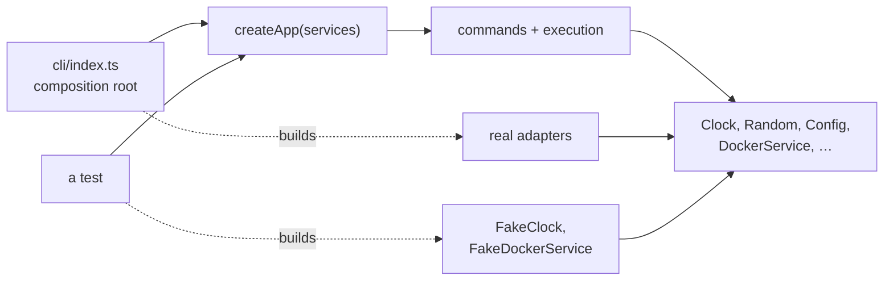

<!--
🤖
This file was created with AI

Harness: Claude Code
Model: claude-fable-5-2
Session Id: 4d38cd95-9bae-4941-89de-037db3cff49d
Supervising engineer: David Johnston

Humans: add your notes here

-->

# Getting to "no ambient non-determinism"

How to move Thunderjar to the spec, in steps that each merge on their own.

## 1. Where we are

1. **Tests run the CLI in a second process.**
   - `thunderjar()` in the test harness spawns `bun src/cli/index.ts` per call.
   - Nothing in the test's process can reach the code under test, so no fake clock can either.
2. **The fake Docker is a third process.**
   - A 664-line stand-in for the `docker` binary, with its state in a folder.
   - It really runs each fake harness's script on the host.
3. **Delays are real.**
   - `fake-sleeper` runs `sleep 300`.
   - The fake Docker's `slow` and `slow-start` files really wait.
   - The run tests wait out real timeouts, which is why they're the slowest files.
4. **The Docker module holds policy as well as plumbing.**
   - `runContainer` spawns `docker run`, and also owns the agent timeout, the start timeout, the kill retries and a 5s wait for output.
   - It reads time 18 times and sets 6 timers.
5. **Ambient reads are spread across `src/`.**
   - Outside tests, roughly: time in 14 files, timers in 9, randomness in 8, environment in 11, the current directory in 14, processes in 20.
6. **There's no composition root.**
   - The entry point builds the program, and each command reaches for what it needs.

## 2. Where we're going



- One process per test: the test, the CLI, the fake Docker and the clock.
- A test calls the CLI with real-looking arguments, and asserts on state.
  - e.g.
    ```ts
    const clock = new FakeClock();
    const docker = new FakeDockerService({ clock, images: ["thunderjar-prerun:ded54607"] });
    const app = createTestApp({ clock, docker, scenario: "0204" });

    const exit = app.cli(["run", "misbehaving"]);
    await clock.advance(2_000);
    expect(app.state().containers[0]).toMatchObject({ harness: "fake-sleeper", status: "timedOut" });
    ```
- Kept from today:
  - Seeding the fake with images.
  - Real CLI arguments.
  - Scenarios as the projects under test.

## 3. The Docker service: proposed functions

One service per daemon. The local one and a remote runtime's are two instances, so no call takes a `runtime` argument, as every function does today.

The service is plumbing only. It never times anything, retries or sleeps: that moves to the core, on the clock (step 4.4).

| # | Group | Function | Returns | Replaces |
|---|---|---|---|---|
| 1 | Daemon | `daemonId()` | ID, or undefined | `daemonId` |
| 2 | | `diskUsage()` | lines | `diskUsage` |
| 3 | Images | `build(contextDir, image, options)` | | `buildImage` |
| 4 | | `listImages(repository)` | set of images | `imagesIn` |
| 5 | | `inspectImage(image)` | entrypoint, command, env | inline `image inspect` |
| 6 | | `removeImage(image)` | deleted, absent or failed | `removeLocalImage` |
| 7 | Registry | `checkLogin(host)` | | `checkLogin` |
| 8 | | `login(host, username, password)` | | `login` |
| 9 | | `push(image, reference)` | | `pushImage` |
| 10 | | `pull(reference)` | | `pullImage` |
| 11 | | `inRegistry(reference)` | boolean | `inRegistry` |
| 12 | Containers | `run(image, name, script, options)` | a `RunningContainer`, below | the spawn in `runContainer` |
| 13 | | `kill(name)` | | inline `kill` |
| 14 | | `stop(name, graceSeconds)` | | `stopContainer` |
| 15 | | `remove(name)` | | `removeContainer` |
| 16 | | `removeNamed(prefix)` | names removed | `removeContainersNamed` |
| 17 | | `state(name)` | running, exit code | `containerState` |
| 18 | | `envNames(name)` | names | inline `container inspect` |
| 19 | | `commit(name, image, changes)` | | `commitContainer` |
| 20 | Files | `readFile(name, path)` | text, or undefined | `readContainerFile` |
| 21 | | `writeFile(name, path, text)` | | `writeContainerFile` |
| 22 | Long-lived | `startDetached(image, name, runOptions)` | | `startDetached` |
| 23 | | `exec(name, script, stdin?)` | stdout, stderr, exit code | inline `exec` |
| 24 | | `followLogs(name, onLine, signal)` | exit code | `followLogs` |
| 25 | | `stderrTail(name, lines)` | text | `stderrTail` |
| 26 | Shells | `openShell(image, name, env)` | a `ShellSession` | `openShellSession` |
| 27 | | `attachShell(image, options)` | exit code | the spawn in `checkout` |

`run` is the one that changes shape. It starts the container and reports, without deciding anything:

```ts
type RunningContainer = {
  /** Resolves when the script prints its start marker. */
  started: Promise<void>;
  /** Resolves when `docker run` exits. */
  exited: Promise<{ exitCode: number; stderr: string }>;
  /** Stops waiting on a `docker run` that can't be killed. */
  abandon(): void;
};
```

- Pure helpers stay plain functions, not on the service.
  - e.g. `scrubbedEnvChanges`, `buildFailureReason`, `reasonOf`.
- The error classes stay as they are.
- The registry's HTTP client is its own port, later (step 4.8).

## 4. The steps

Each step is one PR, or a short run of them, and leaves the suite green.

### 4.1 Lint ratchet

1. Add the banned-API rules to the generator behind `lint:generate`.
2. Give it an allowlist: every file that breaks a rule today.
3. From here, new code can't add an ambient read, and each later step shrinks the list.
4. Lint fails if a listed file no longer breaks a rule, so the list can't go stale.

What oxlint 1.88 can do, checked:

| Ban | Rule | Works |
|---|---|---|
| `Date.now`, `Math.random`, `Bun.env`, `process.env`, `Bun.sleep` | `no-restricted-properties` | Yes |
| `setTimeout`, `setInterval` | `no-restricted-globals` | Yes |
| `$` and `spawn` imported from Bun | `no-restricted-imports` with import names | To check |
| `new Date()` with no arguments | needs `no-restricted-syntax` | No: a small script in `bun run lint` instead |

### 4.2 Composition root, clock and random

1. Add a layer for the interfaces, below every layer that uses them.
   - `Clock`, `Random`, later `Config` and the rest.
   - Real implementations beside them, in the one folder lint leaves alone.
2. `FakeClock` goes in the testing layer.
   - `advance(ms)` fires due timers in order, letting promises settle between each.
3. `createApp(services)` builds the program. The entry point becomes the composition root.
   - e.g.
     ```ts
     const app = createApp({ clock: systemClock, random: cryptoRandom, docker, env: Bun.env, cwd: process.cwd() });
     process.exitCode = await app.cli(process.argv.slice(2));
     ```
4. Thread the clock and random to their in-process users first: the live rows, the waiting line, timings, ULIDs.
   - These already take a ticker in places, so it's small.

### 4.3 `DockerService`, real adapter only

1. Write the interface from section 3.
2. `RealDockerService` wraps today's functions. No behaviour changes.
3. Every caller takes the service instead of importing a function.
4. Tests don't change: the real adapter still runs the fake Docker CLI.

Mechanical, and the largest diff. Worth doing alone.

### 4.4 Move timing out of the adapter

1. The agent timeout, start timeout, kill retries and output wait move into the execution layer.
   - Built on `run`, `kill`, `remove` and the clock.
2. Unit-test them with `FakeClock` and a ten-line stub of the service.
   - e.g. "can't be killed after three tries, 2s apart: abandoned, reported as timed out".
3. The slow cases in the Docker module's tests are deleted as these replace them.
4. `THUNDERJAR_START_TIMEOUT_SECONDS` becomes a field of the config object.

### 4.5 `FakeDockerService` and its contract tests

1. In memory: images, containers, each container's files and env, pushed references, logins.
2. Seeded as today's fake is.
   - e.g. `new FakeDockerService({ clock, images: [...], logins: [...] })`
3. Scripted per harness. With no script, a container starts and exits 0 at once.
   - e.g.
     ```ts
     docker.onStart("fake-silent", ({ clock }) => clock.sleep(3_000));
     docker.onExec("fake-crasher", async ({ files }) => {
       files.write("/thunderjar/result.json", "{}");
       return { exitCode: 1 };
     });
     docker.failing("thunderjar-prerun:f64ca35b");
     ```
4. It records what it was asked: `killed`, `pushed`, `runningContainers()`, and the calls in order.
5. One contract suite runs against both adapters.
   - Against the fake in `bun test`.
   - Against real Docker as a `.docker.test.ts`.
   - It covers what both must agree on: a build makes an image, a commit keeps files, reading a missing file gives undefined, killing a stopped container fails the same way.

### 4.6 In-process CLI tests, starting with the timeouts

1. `createTestApp` wires the fakes and a scenario, and returns `cli(args)` and `state()`.
2. `state()` comes from what already exists.
   - `run`: a reducer over the runner's events gives the container list and each status.
   - Other commands: the result object they already build for `--json`.
3. Migrate the three misbehaving-agents tests first. They're the motivating case.
4. Then delete the real delays:
   - `sleep 300` from `fake-sleeper`.
   - `slow` and `slow-start` from the fake Docker CLI.
5. Add a test that fails if any fixture harness script sleeps.

### 4.7 Migrate the rest, and split rendering

1. Move the remaining command tests over, one file per PR. Run and build first.
2. Each stdout assertion becomes two tests:
   - A CLI test asserting on state.
   - A render test: a hand-built state and a time in, lines out.
3. One wiring test per command checks that state reaches stdout at all.
4. The runner, which today is the CLI started in a container, runs in-process.
   - The fake's `startDetached` calls `app.cli(["runner", …])` on the same clock.
5. Delete the fake Docker CLI once nothing uses it.

### 4.8 The remaining ports

In this order, each shrinking the lint allowlist to nothing for its category:

1. Environment: a typed config object, read once at the root.
2. Current directory: passed in with it.
3. Other processes: git, runtime hooks, hash commands, the registry's HTTP client.
4. Filesystem: last, and only if it still hurts. See 5.3.

## 5. What gets harder

1. **Fake harness scripts stop running.**
   - Today the fake really runs each harness's script, so the run tests also prove the run script, the prompt file and the result file work end to end.
   - An in-memory fake proves none of that.
   - Those few tests move to the real-Docker tier.
     - e.g. "the prompt reaches the agent byte for byte".
2. **Shell measurements need an answer.**
   - Reading a file works off the fake's file map.
   - A measurement that runs a command, such as the test-file instrument, needs a scripted reply.
     - e.g. `docker.onShell(/bun test/, () => ({ exitCode: 0, stdout: "…" }))`
3. **Config is loaded with `import()`.**
   - An in-memory filesystem can't serve a TypeScript import.
   - Proposal: tests read scenarios from disk, which is deterministic, and write to an in-memory store and data folder.
4. **The fake has to know which harness an image is.**
   - Images are named by hash.
   - Proposal: the build passes labels, and the fake keys on them. Labels aren't in the Dockerfile, so no hash changes.

## 6. Decisions needed

1. Scripting the fake by harness name, through build labels (5.4), or by image hash?
2. Scenarios read from real disk in unit tests (5.3), or an in-memory filesystem from the start?
3. `fake-sleeper` keeps its name and becomes a no-op, with its hang scripted in the test. Run by hand against real Docker it would no longer hang. Fine?
4. The `*.humans.test.ts` files call `thunderjar()` and assert on stdout.
   - Proposal: keep that helper's signature, and make it run in-process.
   - Then those files don't change.
5. Root `AGENTS.md` needs two edits when the steps land.
   - "Use Bun": `$` and `file` become adapter-only (4.1).
   - "Test types": the fake-Docker tiers change (4.6).

## 7. Out of scope

- The capture hook's fast path, which skips loading the CLI.
- The gauntlet projects.
- Real-agent and real-Docker tests: they stay as the smoke tier.
