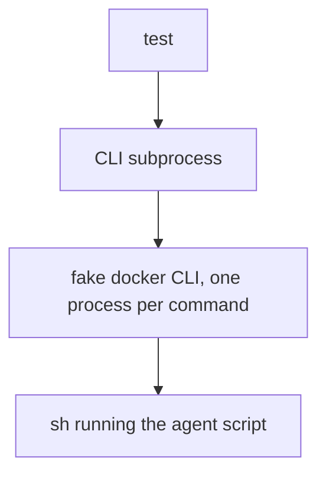
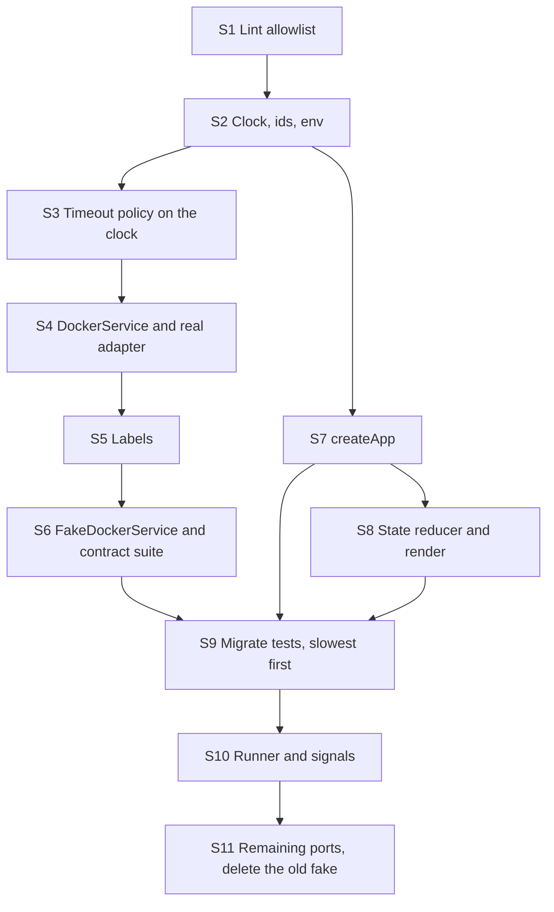

<!--
🤖
This file was created with AI

Harness: Claude Code
Model: Fable 5.2 (ultracode)
Session Id: e4731406-4185-4add-b67e-073815d49cbe
Supervising engineer: David Johnston

Humans: add your notes here

-->

# Approach: getting to no ambient non-determinism

How to move Thunderjar to the "No Ambient Non-Determinism" spec without a big-bang rewrite.

- Sections are numbered 1 to 7. Steps are S1 to S11, in section 4.
- Reply by number, e.g. "6.2: take the alternative".

Terms:

- **Port**: an interface the core depends on, e.g. `Clock`.
- **Adapter**: a port's real implementation.
- **Composition root**: the one place that builds the adapters and passes them in.

## 1. The target, in one test

```ts
const clock = new FakeClock();
const docker = new FakeDockerService({ clock, images: ["thunderjar-prerun:ded54607"] });
docker.onExec("fake-sleeper", ({ clock, signal }) => clock.sleep(Infinity, { signal }));
docker.onExec("fake-crasher", async () => ({ exitCode: 1 }));

const app = testApp({ scenario: "0204", clock, docker });
const exit = app.cli(["run", "misbehaving"]);

await docker.started("fake-sleeper");     // wait for the app, not for time: see 5.1
await clock.advance(2_000);

const sleeper = app.state().containers.find((c) => c.harness === "fake-sleeper");
expect(sleeper).toMatchObject({ status: "timedOut", timeoutSeconds: 2 });
expect(docker.killed).toEqual(["fake-sleeper"]);
expect(await exit).toBe(1);
expect(docker.runningContainers()).toEqual([]);
```

- One process, no real waiting.
- Asserts on state. Turning state into stdout is tested separately.
- With no handler, a fake container starts at once and exits 0.
- `testApp` is `createApp` with every fake filled in. It replaces the `fs` of your sketch: see 3.5.
- Kept from today:
  - Declaring the images Docker already has.
  - Real argv arrays against a scenario ID.

## 2. Where we are

### 2.1 Why the tests are slow

A fake run is four processes deep, so no fake clock can reach it.



- The fake Docker is an executable, chosen with `THUNDERJAR_DOCKER`. Its state is a folder of files.
- It runs agent scripts with a real shell, so `fake-sleeper` really runs `sleep 300` and is really killed.
- With a remote runner there are two more levels: the fake spawns a real runner process, which calls the fake again.
- The fake sleeps on its own too: one second for a `slow` build, and the `slowStart` option.

### 2.2 Where the timing logic lives

- **The agent timeout is inside the Docker module.**
  - `runContainer` owns three timers and a retry:
    - the agent timeout,
    - the start timeout,
    - up to 5s reading the container's output after it exits,
    - `docker kill` retries, 2s apart.
  - The secret search uses the same function, with its own timeout.
  - This is the main obstacle. See 3.2.
- **Two clocks feed one record.**
  - The agent's start and finish times come from `date` inside the container, written to `run.json`.
  - The kill time comes from the host.
- **Other real waits**
  - Runner reconnect: 3s between attempts. 40 attempts if the runtime can't be reached, unbounded while the runner is still running.
  - Submission poll: every 100ms, for up to 120s.
  - Ctrl-C settle: 15s, on the host and again in the runner.
  - Measurement session close: 30s.
  - Postgres retry backoff.
  - The display's one-second tick, defined twice.

### 2.3 What already exists

- **Functions that already take time as a parameter.**
  - About a dozen, e.g. `ulid(now, random)`, `timings(now)`, the display's `ticker`.
  - Only unit tests pass them. Nothing threads them from the top.
  - They come in three shapes: a number, `() => number`, and `() => Date`.
- **A de-facto Docker seam.**
  - Nearly every Docker call goes through one module of free functions, most taking a `runtime` value.
  - One leak: `checkout` builds its own Docker argv.
  - `sampleRepoImage.ts` hard-codes `docker` too, but only real-Docker tests and scripts use it. It is test support, not a leak.
- **An event log of a run.**
  - `RunnerEvent` already describes a run as serialisable events.
- **One real port.**
  - `RunDataStore` is an interface passed into `runExecution`.

### 2.4 What is missing

- **A composition root.**
  - `createProgram()` takes no arguments. Commands reach everything by import.
- **An in-process entry.** Blockers:
  - `process.exitCode`, set in 13 files.
  - `process.exit` in signal handlers.
  - Promises that never resolve, after an interrupt and after a detach.
  - Module-global output stream and logger.
  - Commander reads `process.argv` and the environment, writes help and errors itself, and exits.
  - The current directory is read in every command.
- **A state object.**
  - A run's live state is closure locals plus the display's rendered strings.

### 2.5 Size

| Ambient input | Hits outside tests | Files |
|---|---|---|
| Time, timers, sleeps, ids | ~70 | ~26 |
| Environment | ~35 | ~20 |
| Shell and spawn | ~55 | ~20 |
| Files | ~60 | ~22 |
| Current directory | 26 | ~19 |
| Exit codes and signals | ~35 | 13 |

- Tests on the fake Docker: 14 files, about 170 tests.
- Tests that wait on real time: about 20, almost all in the `run` tests and the Docker module's tests.

## 3. Design decisions

### 3.1 `DockerService`: one instance per runtime

- The `runtime` value that is threaded everywhere becomes the object.
  - e.g. `dockerFor(runtime).build(...)` in place of `buildImage(..., runtime)`.
- A runtime is a command plus a pull policy, so `dockerFor` keys on both.
- The composition root provides `dockerFor`. Tests provide a `FakeDockerService`.

Proposed functions, per runtime:

| # | Function | Replaces | Notes |
|---|---|---|---|
| 1 | `build(context, image, { secrets, ssh })` | `buildImage` | |
| 2 | `images(repository)` | `imagesIn` | |
| 3 | `push(image, reference)` | `pushImage` | Tag, then push. |
| 4 | `pull(reference)` | `pullImage` | |
| 5 | `start(spec)` | `runContainer` | Returns a handle. See 3.2. |
| 6 | `startDetached(image, name, runOptions)` | `startDetached` | The runner. |
| 7 | `readFile(container, path)` | `readContainerFile` | |
| 8 | `writeFile(container, path, text)` | `writeContainerFile` | |
| 9 | `imageConfig(image)` | first half of `commitContainer` | |
| 10 | `envNames(container)` | second half of `commitContainer` | |
| 11 | `commit(container, image, changes)` | the `docker commit` itself | Env scrubbing stays in our code, under test. |
| 12 | `remove(container)` | `removeContainer` | |
| 13 | `removeNamed(prefix)` | `removeContainersNamed` | |
| 14 | `stop(container, graceSeconds)` | `stopContainer` | |
| 15 | `state(container)` | `containerState` | |
| 16 | `followLogs(container, onLine, signal)` | `followLogs` | |
| 17 | `stderrTail(container, lines)` | `stderrTail` | |
| 18 | `openSession(image, name, env)` | `openShellSession` | Returns a session. See 3.4. |
| 19 | `runOnce(image, script, env)` | `checkout`'s bundle call | Returns exit code and stdout bytes. |
| 20 | `attachShell(image)` | `checkout`'s interactive shell | Opaque: returns an exit code. |
| 21 | `diskUsage()` | `diskUsage` | |

Always on the local Docker, whatever the runtime. Today these take no runtime, so they go on a second small port, e.g. `localDocker`:

| # | Function | Replaces |
|---|---|---|
| 22 | `inRegistry(reference)` | `inRegistry` |
| 23 | `checkLogin(host)` | `checkLogin` |
| 24 | `login(host, username, password)` | `login` |
| 25 | `removeImage(image)` | `removeLocalImage` |

- Dropped: `daemonId`, which has no caller.
- Errors stay typed (`DockerBuildError`, `DockerPullError` and so on). The fake throws the same types.
- The registry HTTP client stays a separate port.
  - Today only its credentials are injectable, and its fake is a localhost server. It needs `fetch` injected, or a lint exemption.

### 3.2 The timeout moves out of the Docker adapter

`start(spec)` returns a handle. One policy function in the execution layer runs the timers on the injected clock, for both the agent run and the secret search.

```ts
interface RunningContainer {
  started: Promise<void>;       // the agent's script has begun; at once if the spec has no start phase
  exited: Promise<{ exitCode: number }>;
  stderr: Promise<string>;      // settles separately, so the 5s wait for output is a clock race
  kill(): Promise<"killed" | "notRunning" | "noSuchContainer">;
  abandon(): void;              // stop waiting on the docker client, when kill can't
}
```

- ✅ **Do** cut the port below the timeout policy.
  - Start timeout, agent timeout, kill retries and the wait for output become ordinary code on `Clock`.
  - A fake-clock test then exercises the real policy.
- ❌ **Don't** cut the port at today's `runContainer`.
  - The fake would have to reimplement the timeout, and the real one would only be covered by slow tests.

**Why:** the timeout is the behaviour that made the tests slow. It has to sit where a fake clock reaches it.

Consequences:

- The real adapter turns the line the run script prints when the agent begins into `started`.
- A container that never starts is removed with `remove`, then `abandon()`.
- `FakeDockerService` stays generic: containers, in-memory files, handlers.
  - It can't know about `run.json`. That format belongs to the execution layer, which sits above Docker.
  - A helper beside the run script, e.g. `fakeAgentRun(clock, handler)`, writes the start time, resolves `started`, runs the handler, then writes the finish time and exit code. `testApp` installs it.
  - A test ties the helper to the real parser.
- The fake clock starts at a realistic date and stays on whole milliseconds. The parser accepts only integer times from September 2001.

### 3.3 Telling the fake which agent is running

- Today a container shows only an image hash, a name and a script. The harness name is in none of them.
- `docker.onExec("fake-sleeper", ...)` needs a key.
- Proposal: `spec.labels`, e.g. `{ kind: "agent", harness: "fake-sleeper", task: "is-prime", iteration: 1 }`.
  - `kind` is one of agent, secret search, measure, runner. The fake has a default for each.
  - The real adapter passes them as `--label`, which also helps when debugging real runs.
  - A string key matches the harness. An object matches several labels.
  - `docker.killed` lists the harness.
- Cost: one test asserts the exact `docker run` line and changes.
- To check on real Docker: whether labels carry into the committed postrun image, and whether we want that.

### 3.4 Measurements: the session answers file calls

- Instruments already call four functions: `exec`, `readFile`, `writeFile`, `glob`.
- Today the execution layer turns the last three into shell text (`cat`, `find`) over the session's single `run`.
- Proposal: the session port takes over those four, plus `workdir` and `close`.
  - The real adapter builds the shell text.
  - The fake answers file calls from the container's in-memory files, which the `onExec` handler wrote.
- Instruments that run a real command need a handler: commits, files changed, shell, and the Bun test file.
  - e.g. `docker.onSessionExec(/bun test/, ({ files }) => ({ exitCode: 0 }))`
  - An unhandled command fails the test loudly.
- `onMeasure("isPrimeTsExists", ...)` from your sketch can be a shorthand over this.

### 3.5 Project config stays on the real disk ⚠️

This departs from the sketch's `InMemoryFs(scenario("0204").files)`.

- Config is loaded with a dynamic `import()` of TypeScript files.
  - Bun's module loader reads the real disk. A filesystem service can't stand in for it.
  - Declarations are code, with functions in them. They can't be read as data.
- Proposal:
  - **Reads** of a scenario come from the real, checked-in fixture, which never changes.
  - **Writes** go through ports with in-memory fakes: the store, build contexts, logs.
  - Commands whose point is writing files (`init`, `generate`) keep running in a temp copy.
- Two catches:
  - `import()` caches by path for the life of the process. Tests that patch a scenario copy already use a fresh path, so they are unaffected.
  - A declaration can read ambient state when imported. Scenario 0211's config reads `THUNDERJAR_DOCKER` from the environment. It gets a literal command in S4.

### 3.6 `app.state()` is a reducer over events

- Extend the existing run events with what they lack:
  - build started and finished,
  - execution started and finished, for local runs,
  - which step a failure happened in.
- Add a pure reducer in the execution layer: events in, `ExecutionState` out.
  - e.g.
    ```ts
    type ContainerStatus = "starting" | "running" | "exited" | "timedOut" | "measuring" | "done";
    interface ExecutionState {
      status: "running" | "complete" | "failed";
      images: { image: string; status: "building" | "built" | "present" }[];
      containers: { harness: string; iteration: number; status: ContainerStatus; exitCode?: number; measurements?: Record<string, unknown> }[];
    }
    ```
- The display becomes `render(state, now)` plus a thin writer on a clock tick.
- For other commands, state is the result object they already compute for `--json`.
  - 10 of 15 commands have one.
  - `show` and `checkout` need one added. `init` and `generate` are asserted on files.

### 3.7 Where things live

- **A new lowest layer**, e.g. `platform`
  - `Clock`, `Random`, `IdGenerator`, `Env`, their real implementations, and `FakeClock`.
  - e.g.
    ```ts
    interface Clock {
      now(): number;
      sleep(ms: number, options?: { signal?: AbortSignal }): Promise<void>;
      setTimeout(fn: () => void, ms: number): TimerHandle;
      setInterval(fn: () => void, ms: number): TimerHandle;
      clear(handle: TimerHandle): void;
    }
    ```
  - `IdGenerator` builds ULIDs from the clock and `Random`. Fake ids stay time-ordered, which the store's ordering relies on. Temp folder names use it too.
- **The Docker layer**
  - The ports, the real adapter, `FakeDockerService`, and the contract suite.
  - The fake can't live in the testing layer, which sits below Docker.
- **The CLI layer**
  - `createApp(deps)`, the composition root. `index.ts` becomes `main`, which builds the real deps.
  - `testApp`, in a subfolder. Not a layer above CLI: the layer rule binds test files too, so command tests couldn't import it.
- **Lint exemptions** are per folder: real adapters, `main`, and the Docker and agent test files and their support.
- **Folded in, or not needed**
  - Formatter: not needed. Output is already fixed-locale and UTC. The one exception is log timestamps, in local time.
  - SystemInfo: the current directory, temp directory and terminal facts (TTY, columns, colour) are fields of the app's deps. Nothing reads hostname, CPU or OS.
  - Logger: takes its timestamps and file name from the clock. Its sink becomes per-app: see 6.5.

### 3.8 Lint, with a shrinking allowlist

- oxlint supports the three rules the spec names, with per-file overrides. I tried them on the installed version.
  - Imports: `import { $, sleep, file } from "bun"`.
  - Properties: `Bun.sleep`, `Bun.env`, `Bun.spawn`, `Bun.file`, `process.env`, `process.cwd`, `Date.now`, `Math.random`, `crypto.randomUUID`.
  - Globals: bare `setTimeout`, `setInterval`.
- Each message names the replacement.
  - e.g. "`Date.now` is ambient: take a `Clock`".
- Gaps:
  - `new Date()` with no arguments. oxlint has no `no-restricted-syntax`. Use a small script, as the snapshot ban does. It scans fixture configs too.
  - The globals rule also fires on `typeof setTimeout` in a type. Use the clock's handle type.
  - Overrides replace rather than merge, so the layer generator has to emit the exemptions.
- Turn the rules on in the first PR, with a generated list of the files that break them today.
  - New files are held to the rule at once.
  - A file leaves the list when it is migrated. The list may never grow.
  - The work is done when the list is empty.

## 4. Steps

Each step is one PR, or a short run of them. The suite stays green throughout: the fake Docker CLI keeps working until S11.



1. **S1: Lint allowlist** (3.8)
   - The rules, the `new Date()` script, the generated list.
   - AGENTS.md states the rule.
2. **S2: Clock, ids, env**
   - `Clock`, `FakeClock`, `Random`, `IdGenerator`, `Env`.
   - Replace the three `now` shapes and the display's `ticker` with `Clock`.
   - `runSubmission` takes an `Env` instead of writing to the global one. S10 needs this.
3. **S3: Timeout policy on the clock** (3.2)
   1. First, add tests through the CLI for what is untested today: `docker kill` failing three times, kill on a finished container, kill on a missing one.
   2. Inside the Docker module, split `runContainer` into `start()`, returning the handle, and a policy function taking a clock. `runContainer` stays as the two composed, so every existing test passes untouched.
   3. Move the policy function to the execution layer. Unit-test it with a hand-written handle and `FakeClock`.
   - First win: the whole timeout policy has millisecond tests, before any fake Docker exists.
4. **S4: `DockerService` and the real adapter** (3.1)
   - The free functions become methods. The old exports stay as one-line wrappers until S11, so tests that call them need no change.
   - Callers receive the service. `checkout` goes through it.
   - The real adapter still honours `THUNDERJAR_DOCKER`, so the fake CLI keeps working.
5. **S5: Labels** (3.3)
6. **S6: `FakeDockerService` and the contract suite**
   - In memory: images, containers, files per container, what ran, what was killed, what is running.
   - Options, as today: `images`, `failing`, `loggedIn`, `stored`, `pullDenied`, `unreachable`, `env`.
   - `slow` and `slowStart` go. Handlers replace them: `onBuild`, `onStart`, `onExec`, `onSessionExec`.
   - One contract suite runs against the fake in the normal tests, and against real Docker in the Docker tests.
7. **S7: `createApp`**. Can run alongside S3 to S6.
   1. Commands return an exit code instead of setting `process.exitCode`.
   2. Output becomes a per-app object.
   3. `createApp(deps).cli(argv)` resolves to the exit code.
      - Commander gets its argv passed in, and no longer exits, writes, or reads the environment on its own.
      - The current directory is in deps.
   - The subprocess `thunderjar()` helper still works: it runs `main`.
8. **S8: State reducer and render** (3.6)
   - Render tests use hand-built states. One wiring test checks a tick produces a frame.
9. **S9: Migrate tests, slowest first**
   1. The scenario 0204 timeout tests, and the Docker module's timeout tests.
      - Needs S6 and S7 only: these can assert on an in-memory store until S8 lands.
      - Delete the fixture's `sleep 300` here. See 6.4.
   2. Concurrency and ordering tests. A handler holds a build or run open until the test releases it.
   3. The rest of `run` and `build`.
   4. The other commands.
   - Each migrated test asserts on state, with exact ids and durations. Its stdout assertion moves to a render test, or goes.
10. **S10: Runner and signals**
    - Runner: when the fake starts a runner image, `testApp` calls `runSubmission` in-process, on the same clock and fake, with a child `Env`. Its events feed `followLogs` directly.
    - The submission poll gets its own clock-driven unit test.
    - Signals: `app.interrupt("SIGINT")` replaces sending a real signal. Handlers return an exit code, not `process.exit`.
11. **S11: Remaining ports, then delete**
    - Git, host shell (hooks, a parameter's `exec`), filesystem writes, an in-memory store.
    - Delete the fake Docker CLI, the old wrappers, and the `<ULID>` and `<duration>` placeholders.
    - The allowlist is empty.

### 4.1 What gets faster, and when

- After S3: the timeout policy is covered in milliseconds. Slow variants of it can go.
- After S9.1: no test waits out a real timeout. About 25s of waiting goes.
- After S9: no process spawning in the `run` and `build` tests.
- After S10: no real waiting outside the Docker and agent tests.

## 5. Risks

1. **`advance()` can't see real I/O.**
   - `app.cli()` returns at its first real await. The timeout is armed only after config import, file hashing and Docker calls.
   - Advancing before then fires nothing, and the test hangs. Your sketch's `advance(0)` has this problem.
   - Mitigation: wait for the app before advancing time, e.g. `await docker.started("fake-sleeper")`.
   - Once every port is in-memory (S11), `advance()` could wait for the app to go idle by itself.
2. **Fake drift.**
   - Today's fake is high fidelity: real Dockerfiles, real build contexts, Docker's own error strings.
   - Mitigation: the contract suite, and a handful of real-Docker smoke tests.
3. **S3 changes production timeout behaviour.**
   - Mitigation: S3.1's new tests, and the existing CLI-level timeout tests, stay in place until S9.
4. **A long tail.**
   - S1 to S9 fix the tests that hurt. S11 touches about 60 files for less benefit.
   - The allowlist makes stopping part-way safe: it records exactly what is left.

## 6. Decisions I need from you

1. **Timeout above the port** (3.2).
   - Recommended. The alternative is simpler, but leaves the real timeout untested by fast tests.
2. **Labels on containers** (3.3).
   - Recommended.
   - Alternative: the fake keys on the container name, which already carries permutation and iteration. The test then maps harness to permutation.
3. **Config on the real disk** (3.5).
   - Recommended. A true in-memory project would need config to stop being imported code.
4. **The real-Docker timeout smoke test** ⚠️
   - It needs an agent that hangs. Keeping it departs from "fake agents never sleep".
   - Recommended: keep exactly one, in the Docker tests, with its own scenario so no ordinary test can reach it.
   - Alternative: drop it and rely on the contract suite.
5. **Logging.** The spec scopes a test's log sink with `AsyncLocalStorage`, a `node:` import, which is banned here.
   - Recommended: exempt that one import, in the logger only.
   - Alternative: pass a logger through `createApp`.
   - Until decided, in-process tests share one log.
6. **Build contexts.** Pass a directory (simple, needs a temp dir in tests), or pass contents (no disk, bigger change)?
   - Recommended: a directory until S11.
7. **Stdout tests.** After S9, command tests assert on state. How much exact-stdout coverage do you want kept per command, beyond the render tests?
8. **`THUNDERJAR_DOCKER`.** Delete it in S11, or keep it as a real feature?

## 7. Files this will touch 🔔📄

### 7.1 Human files

- `plan.humans.test.ts`
  - Uses the subprocess `thunderjar()` helper and `fakeDocker()`.
- `run.humans.test.ts`
  - Uses `thunderjar()` and `<ULID>` placeholders.
- Both keep passing until S11. After that, either the old helpers stay for them alone, or you port them.
- The two humans tests in fixture 0201 are type tests, and are not touched.
- HUMANS.md needs no edit.

### 7.2 Agent instructions

- AGENTS.md
  - "Use Bun": `$` and `Bun.file` become adapter-only.
  - "Test types": gains in-process app tests.
  - "Output and logging", and the layers example.
- The fixtures' AGENTS.md
  - The harness and placeholders sections, and the entries for scenarios 0204 and 0211.
