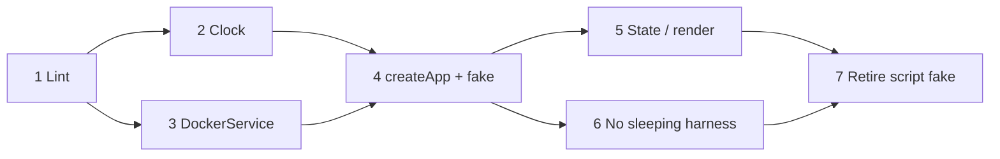

<!-- AI-generated: drafted by Claude Code from the "No Ambient Non-Determinism" spec. -->

# Migrating to no ambient non-determinism

How we get from today's test setup to the spec: Docker behind a service, an injected clock, fake agents that never sleep, and CLI tests that assert on state.

## Where we are

- `src/docker/docker.ts` is ~25 free functions, each shelling out through `Bun.$` to `runtime.command`.
- `src/testing/fakeDocker.ts` is a separate script, a stand-in `docker` binary (~660 lines). It keeps state in a folder and really runs container scripts on the host.
- `thunderjar()` in `src/testing/cli.ts` spawns the real CLI as a subprocess, with `THUNDERJAR_DOCKER` pointing at the fake.
- Time is read ambiently: `Date.now()` in `runExecution.ts` and `runner.ts`, `Bun.sleep` in `run.ts` and `runner.ts`, `setInterval` in `liveRows.ts`.
- Fixture `0204` has `fake-sleeper` running `sleep 300`. Timeout tests wait out real seconds, because fake timers can't reach the subprocess.
- 22 non-test files read `process.env` / `Bun.env`.

## What we keep

- **Pre-seeded images.** `fakeDocker({ images: [...] })` stays, as a constructor option of `FakeDockerService`.
- **CLI-shaped arguments.** Tests still call `["build", "is-prime-baseline"]`. They go to an in-process `app.cli(args)` rather than a subprocess.

## Target shape

```ts
const clock = new FakeClock();
const docker = new FakeDockerService({ clock, images: ["thunderjar-prerun:ded54607"] });
const app = createApp({ clock, docker, env: {}, stdout: new CapturedOutput() });

const exit = app.cli(["run", "misbehaving"]);
await clock.advance(2_000);
expect(app.state().containers[0]).toMatchObject({ status: "timedOut" });
```

- `createApp(services)` is the only composition root. `src/cli/index.ts` builds the real services and calls it.
- `app.state()` returns the command's state model. Commands write state, a renderer turns state into stdout.

## The `DockerService` interface

Proposed from the free functions in `docker.ts`, grouped. A runtime is bound when the service is built (`dockerService(runtime)`), so no method takes a `runtime` argument.

```ts
interface DockerService {
  // Daemon
  daemonId(): Promise<string | undefined>;
  diskUsage(): Promise<string[]>;

  // Images
  build(contextDir: string, image: string, options?: BuildOptions): Promise<void>;
  imagesIn(repository: string): Promise<Set<string>>;
  imageEnv(image: string): Promise<string[]>;
  tag(image: string, reference: string): Promise<void>;
  removeImage(image: string): Promise<LocalRemoval>;

  // Registry
  login(host: string, username: string, password: string): Promise<void>;
  checkLogin(host: string): Promise<void>;
  push(image: string, reference: string): Promise<void>;
  pull(reference: string): Promise<void>;
  inRegistry(reference: string): Promise<boolean>;

  // Containers
  run(spec: RunSpec, signal?: AbortSignal): Promise<RunResult>;      // attached, until exit or abort
  startDetached(image: string, name: string, options: string[]): Promise<void>;
  exec(name: string, command: string[], signal?: AbortSignal): Promise<{ exitCode: number }>;
  state(name: string): Promise<ContainerState | undefined>;
  stop(name: string, graceSeconds: number): Promise<void>;
  kill(name: string): Promise<void>;
  remove(name: string): Promise<void>;
  removeNamed(prefix: string): Promise<string[]>;
  commit(name: string, image: string, changes: string[]): Promise<void>;

  // Container files and output
  readFile(name: string, path: string): Promise<string | undefined>;
  writeFile(name: string, path: string, text: string): Promise<void>;
  followLogs(name: string, onLine: (line: string) => void, signal?: AbortSignal): Promise<number>;
  stderrTail(name: string, lines?: number): Promise<string>;

  // Interactive
  openShell(image: string, name: string, env?: string[]): Promise<ShellSession>;
}
```

Notes:

- `kill` is new. Today a timeout is `rm --force`. Splitting it lets the fake record `docker.killed` separately from removal.
- `RunSpec` collects what `runContainer` takes today as positional arguments.
- Pure helpers (`reasonOf`, `buildFailureReason`, `scrubbedEnvChanges`, `locate`, `splitReference`) stay free functions. They read nothing ambient.

### `FakeDockerService`

In-memory, no subprocess, driven by the clock it's given.

- Images and containers in maps. Container filesystems are a `Map<path, string>`, seeded from the image's `COPY <<'EOF'` heredocs, as the script fake does today.
- Scripted behaviour per harness image, all on the fake clock:
  - `onStart(image, fn)`: delay or fail container start.
  - `onExec(image, fn)`: the agent. Default resolves `{ exitCode: 0 }` at once.
  - `onMeasure(name, fn)`: a measurement's result.
- `kill` aborts the `signal` passed to the pending `onExec`.
- Records: `commands`, `killed`, `pushed`, `runningContainers()`.

## The `Clock` and `FakeClock`

As the spec's interface, plus `sleep(ms, { signal })` so a hung agent can be cancelled. `FakeClock.advance(ms)` fires due timers in order and drains microtasks between each.

## Fake agents never sleep

Delays move out of fixtures into tests.

| Today | After |
| --- | --- |
| `fake-sleeper` harness runs `sleep 300` | The harness is a no-op. The test says `onExec("fake-sleeper", ({ clock, signal }) => clock.sleep(Infinity, { signal }))` |
| `slow-start` file in the fake's state folder | `onStart("fake-silent", ({ clock }) => clock.sleep(3_000))` |
| `slow` builds take a real second | `onBuild(image, fn)` on the fake clock |

A lint check over `fixtures/**/harnessModels/**` bans `sleep` in a harness's command.

## Phases

Each phase lands green, on its own PR.

### 1. Lint first

Add `no-restricted-globals` / `no-restricted-properties` rules for every banned API, each message naming its replacement. Generate a per-file allowlist of today's offenders into `.oxlintrc.json`, so the rule passes now and the list only shrinks.

✅ New code can't add ambient reads from day one.

### 2. `Clock`

- Add `src/time/clock.ts` (`Clock`, `systemClock`) and `src/testing/fakeClock.ts`, with `FakeClock`'s own unit tests.
- Thread a clock through `runExecution`, `runner.ts`, `run.ts` and `liveRows.ts`. `liveRows` already takes `now`, so it's the template.
- Logger timestamps come from the clock.

### 3. `DockerService` over the real CLI

- Define the interface. Turn `docker.ts` into `cliDockerService(runtime)`, the methods wrapping today's functions unchanged.
- Callers take a `DockerService` parameter instead of importing free functions. Mechanical, file by file.
- Nothing about tests changes yet. The subprocess fake still sits behind `THUNDERJAR_DOCKER`.

### 4. `createApp` and in-process tests

- Add `createApp({ clock, docker, env, fs?, stdout })`. `src/cli/index.ts` becomes the composition root and the only reader of `process.env`.
- Add `FakeDockerService`. Add a contract suite, `docker.contract.ts`, run against the fake in `bun test` and against real Docker in `*.docker.test.ts`.
- Give `thunderjar()` an in-process mode that uses `createApp`. Move command tests over one command at a time, starting with `build`, then `run`.

### 5. State, then rendering

- Per command, extract a state model (`app.state()`), and a pure `render(state, now)`.
- Command tests assert on state. A separate `*.render.test.ts` per command asserts on stdout from hand-built states.
- Start with `run`, where the timeline matters most.

### 6. Remove the sleeping harness

- Rewrite the `0204` timeout tests as timeline tests, like the spec's example.
- Make `fake-sleeper` a no-op and add the fixture lint.
- Remove `slow`, `slow-start` and real-time waiting from the script fake.

### 7. Retire the subprocess fake

Once no test uses it, delete `src/testing/fakeDocker.ts` and `THUNDERJAR_DOCKER`. Real-Docker coverage stays in `*.docker.test.ts` and the contract suite.

## Order and risk



- **Biggest change:** phase 3, touching every Docker caller. It's mechanical and needs no test changes, so do it in one sweep.
- **Biggest risk:** the in-memory fake drifting from real Docker. The contract suite is the guard, so it lands with the fake, not after.
- **Quick win:** phase 6 can come straight after `run` moves in-process. That removes the slow, flaky timeout tests first.

## Open questions

- **Filesystem.** The spec bans direct `Bun.file`. Today's file-creating tests copy scenarios to `fixtures/.tmp`, and that works. Proposal: leave the filesystem real for now, and revisit after phase 7.
- **`git` and other subprocesses.** `src/capture/git.ts`, `prerunBuilds.ts` and others call `Bun.$` for things other than Docker. Proposal: a `GitService` later, following the same pattern.
- **Remote runtimes.** Should `--context` runtimes be separate `DockerService` instances, or one service holding several? Proposal: one instance per runtime, built at the composition root.
