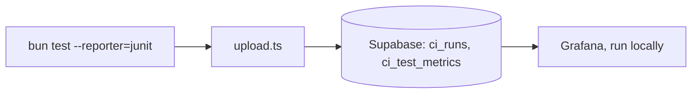

<!--
🤖 This file was created with AI (Claude Code, session_01LCLeLhdFSg6pjhA6B8LSGh).
Humans: add your notes here
-->

# CI timing metrics

Tracks CI job time and each test's duration over time, to catch slow creep before it slows down agents' feedback loops.



## What's recorded

- `ci_runs`
  - One row per CI job run: the `check` job (`bun run test`) and the `docker` job (`test:docker:parallel`).
  - Job wall-clock time, test runner time, test counts, branch, commit, PR, outcome.
- `ci_test_metrics`
  - One row per test per job run: file, describe path and name, status, duration.

The upload step runs last in each job, even when tests fail, and never fails the job. Without the `CI_METRICS_DB_URL` secret, e.g. on a fork's PR, it skips.

## Set up

1. Add the repository secret `CI_METRICS_DB_URL`
   - Supabase's session pooler URL. The direct host is IPv6 only, which GitHub's runners can't reach.
   - e.g.
     ```
     postgresql://postgres.oojmoxinrsflssiecitj:<password>@aws-0-ap-southeast-2.pooler.supabase.com:5432/postgres
     ```
2. That's it: the upload creates the tables on its first run.

## View the dashboard

```sh
CI_METRICS_DB_PASSWORD=<password> docker compose -f scripts/ci-metrics/grafana/docker-compose.yml up
```

Then open http://localhost:3000.

- **Job wall-clock time per run**, with a 10-run average to show the trend.
- **Tests getting slower**: median of the last 7 days against the 30 days before.
- **Slowest tests**, and the **duration of the 10 slowest per run**. The Test filter narrows these, e.g. `src/cli/commands/run`.

The dashboard is provisioned from `grafana/provisioning/dashboards/ci-timings.json`. Edits made in Grafana's UI are lost on restart: export the JSON into that file to keep them.

## Files

- `junit.ts`
  - Reads Bun's JUnit report.
- `store.ts`, `schema.sql`
  - Creates the tables and records a run.
- `upload.ts`
  - The CI step.
