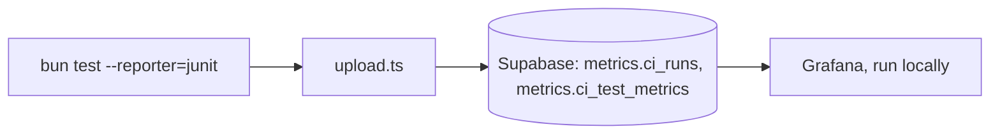

<!--
🤖 This file was created with AI (Claude Code, session_01LCLeLhdFSg6pjhA6B8LSGh).
Humans: add your notes here
-->

# CI timing metrics

Tracks CI job time, each step's time (e.g. lint, typecheck) and each test's duration over time, to catch slow creep before it slows down agents' feedback loops.



## What's recorded

All three tables are in the `metrics` schema.

- `ci_runs`
  - One row per CI job run: the `check` job (`bun run test`) and the `docker` job (`test:docker:parallel`).
  - Job wall-clock time, test runner time, test counts, branch, commit, PR, outcome.
- `ci_test_metrics`
  - One row per test per job run: file, describe path and name, status, duration.
- `ci_step_metrics`
  - One row per finished step per job run, e.g. lint or typecheck: name, position, conclusion, time.
  - Read from GitHub's API with the job's `GITHUB_TOKEN`, which needs `actions: read`. If that fails, the upload records the run without its steps.

The upload step runs last in each job, even when tests fail, and never fails the job. Without the `CI_METRICS_DB_URL` secret, e.g. on a fork's PR, it skips.

## Set up

Three logins, each with only what it needs:

| Login | Can | Used by |
|---|---|---|
| A member of `metrics_owner`, e.g. `david_admin` | Create and change the tables | `create-tables.ts`, by hand |
| `ci_metrics_writer` | Insert rows, nothing else | CI's upload |
| `metrics_dashboard` | Read the tables | Grafana |

1. Create the tables, once:
   ```sh
   CI_METRICS_DB_URL_ADMIN=<david_admin's URL> bun scripts/ci-metrics/create-tables.ts
   ```
   - Run it again after a table is added, e.g. `ci_step_metrics`.
   - Safe to run again. If `metrics.ci_test_metrics` already exists with another shape, it stops and changes nothing: drop or rename that table yourself, then run it again.
2. Add the repository secret `CI_METRICS_DB_URL`: `ci_metrics_writer`'s pooler URL.
   - e.g.
     ```
     postgresql://ci_metrics_writer.oojmoxinrsflssiecitj:<password>@aws-0-ap-southeast-2.pooler.supabase.com:6543/postgres
     ```
   - The upload only inserts. A second upload of the same run attempt and job is refused, by `ci_runs`' unique key.

## View the dashboard

```sh
bun run ci-metrics:grafana
```

- Runs Grafana in Docker, at http://localhost:3000.
- Logs in as `metrics_dashboard`, with its password from `CI_METRICS_DB_PASSWORD`.
- Checks that login first, and stops before starting Docker if it fails, e.g. `metrics_dashboard's password was rejected`.

- **Job wall-clock time per run**, with a 10-run average to show the trend.
- **Tests getting slower**: median of the last 7 days against the 30 days before.
- **Slowest tests**, and the **duration of the 10 slowest per run**. The Test filter narrows these, e.g. `src/cli/commands/run`.
- **Top test failures**: the tests that failed most often, with their failure rate and when they last failed. The Test kind and Test filters narrow it.
- **Step times** and **step time per run**: lint, typecheck, install and every other step, per job.
- **Test time per run, docker vs regular tests**: a `.docker.test.ts` file is a docker test, any other is regular. The Test kind filter narrows every per-test panel to one kind, and the Slowest tests table shows each test's kind.

The dashboard is provisioned from `grafana/provisioning/dashboards/ci-timings.json`. Edits made in Grafana's UI are lost on restart: export the JSON into that file to keep them.

## Files

- `junit.ts`
  - Reads Bun's JUnit report.
- `store.ts`
  - The tables, and recording a run.
- `create-tables.ts`
  - Creates the tables. Run by hand.
- `upload.ts`
  - The CI step.
- `grafana-start.ts` and `login.ts`
  - Check the dashboard login, then start Grafana.
