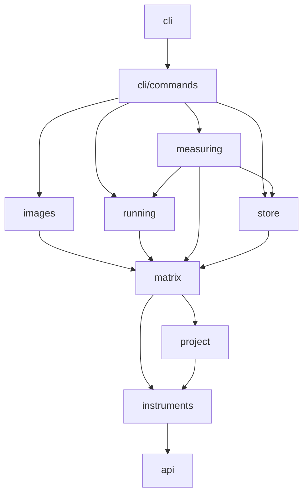

# src/

Thunderjar's source, in layers. Each layer imports only from the layers below it, and the lint enforces it: `scripts/layout.ts` lists the layers in order, and `bun run lint` fails an import that points upward or a file in a folder the layout doesn't know.

## Layers



The diagram shows the imports that exist today. What the lint allows is any layer lower in this order, lowest first:

```
api → instruments → project → matrix → store → running → images → measuring → cli/commands → cli
```

Every layer may also import `platform`, `adapters/docker` and `testing`.

## Folders

```
src/
  index.ts          the `thunderjar` package: re-exports api/
  api/
  instruments/
  project/
  matrix/
  store/
  running/
  images/
  measuring/
  cli/
    index.ts
    program.ts
    commands/
      format.ts
      <command>/
  platform/
  adapters/docker/
  testing/
```

- `index.ts`
  - The package entry users import `thunderjar` from. It only re-exports `api/`.
- `api/`
  - What users' configuration files import.
  - `declarations.ts`: the `declareX()` functions. At runtime each returns its argument; the types give `config` and `ctx` their shape.
  - `fragments.ts`: ready-made Dockerfile fragments for `applyParameter`, such as `checkoutCommit`.
  - `parameter-names.d.ts`: fallback types for parameter names. A real project sees its `_generated/` file instead.
- `instruments/`
  - The built-in measuring instruments (`fileCreated`, `grep`, `templateTest`), and the aggregate methods that fit each one's values.
- `project/`
  - `config.ts`: finds `.thunderjar/`, and loads and checks a test case and its measurements against the files on disk. Configuration errors come from here.
- `matrix/`
  - Working out what to run. Nothing here runs anything.
  - `permutations.ts`: a test case's cross product, in a stable order.
  - `hashing.ts`: parameter and permutation hashes, from content, never names.
  - `resolve.ts`: every permutation of a test case, with its hash.
  - `execution.ts`: one execution laid out, with each container run's tags and harness command.
  - `tags.ts`: prerun and postrun image tags. `ulid.ts`: execution IDs.
- `store/`
  - `run-data-store.ts`: where executions, container runs and aggregation results are kept. It's an interface; for now the only store is a JSON file.
- `running/`
  - `runner.ts`: runs one container run in a container from its prerun image, committing it into its postrun image, and opens the measurement context that instruments read a run through. A host runner stands in for Docker in tests of `run`.
- `images/`
  - `prerun.ts`: renders a permutation's prerun Dockerfile from its parameters' fragments, checks the commits it reads, and writes its build context.
  - `prerun-builds.ts`: builds a test case's missing prerun images, for both `build` and `run`, after checking everything the builds need.
  - `repository.ts`: read-only access to the user's git repository.
- `measuring/`
  - `measure.ts`: applies a task's measurements to one container run.
  - `aggregate.ts`: combines a permutation's iterations into its aggregation result.
  - `remeasure.ts`: for a backfill, whether a stored measure is missing, stale or current, which measurements each container run needs, and each execution's measurement statuses and deleted names.
  - `remeasure-templates/`: two versions of a bundled template, static test data for `remeasure.test.ts`.
- `cli/commands/`
  - One folder per command, holding the command and its tests, e.g.
    ```
    cli/commands/build/
      build.ts
      build.test.ts
      build.docker.test.ts
    ```
  - `<command>.ts` exports the command's function, e.g. `build()`, and `createBuildCommand()`, which declares its arguments and options as a Commander `Command` and calls that function.
  - A command's tests drive the CLI against a checked-in `fixtureTests/` scenario, unchanged, and assert only on what the command produced. Every expected result lives in the test. See "Fixture tests" in the root `AGENTS.md`.
  - `format.ts`: how commands print what they share, such as counts and durations.
  - Tests that cut across commands sit directly in `cli/commands/`: configuration errors (`validation.test.ts`) and typed parameter names (`declarations.typecheck.test.ts`).
- `cli/`
  - `program.ts`: `createProgram()`, the Commander program, which adds every command's `createXCommand()`.
  - `index.ts`: the `thunderjar` entry point. It parses the arguments with `createProgram()`.
- `platform/`
  - Stands in for `node:path`, `node:fs` and `node:os`, which this repository doesn't use (see "Use Bun" in the root `AGENTS.md`). It imports nothing else from `src/`.
  - `path.ts`: POSIX path functions, such as `join`, `resolve` and `relative`.
  - `fs.ts`: file helpers on Bun's APIs and shell, such as `makeTempDir`, `remove` and `listEntries`. To read or write a file, use `Bun.file` and `Bun.write` directly.
- `adapters/docker/`
  - The real Docker, behind the seam tests swap out. It imports nothing else from `src/` but `platform/`.
- `testing/`
  - Test helpers, shared by tests in every layer.
  - `cli.ts`: runs the CLI in a `fixtureTests/` scenario, the way `bun run fixture` does. `scenario()` names a scenario's project; `copyOfFixtures()` copies it for `init` only, the one command that writes into the project; a real `run` passes `--data-dir` instead.
  - `fake-docker.ts`: the recording fake Docker, so a test can say which images exist, and which postrun images' saved files `docker create` and `docker cp` read. It never runs a container.
  - `measurement-context.ts`: the host measurement context, for instrument tests.
  - `test-setup.ts`, which every `bun test` preloads.
  - NOT ENDORSED: `fixture-project.ts` and `seed-repo.ts` generate throwaway projects. Older tests still use them while they move to scenarios; new tests don't.

## Rules

### Never import upward

✅ **Do** import only from a layer below, or from `platform`, `adapters/docker` or `testing`.

❌ **Don't** import from a layer above, even for one function. Move the function down instead.

**Why:** the layers are what keep each part testable on its own, and readable without the parts above it. One upward import makes two layers depend on each other.

e.g. `config.ts` checks a measurement's aggregate methods. It used to import them from `measuring/aggregate.ts`, above it, so the list moved down into `instruments/`, which both use.

### Put a new module in the lowest layer that can hold it

✅ **Do** pick the layer by what the module needs to import: the lowest layer whose imports suffice.

❌ **Don't** put it in `cli/commands/` because a command is its first user.

**Why:** a module placed too high can't be used by the layers that will later need it, and the next person moves it.

### Keep tests beside their code

✅ **Do** put `<module>.test.ts` in the same folder as `<module>.ts`, and real-Docker tests in `<module>.docker.test.ts`.

❌ **Don't** gather tests in a separate tree.

**Why:** a module and its tests change together, and the folder shows at a glance what is tested.

A test of a lower layer that needs something from a higher one gets it through `testing/`, e.g. `instruments.test.ts` gets the host measurement context from `testing/measurement-context.ts`. That keeps `testing/` the one place where tests reach across layers.

### Share between commands through format.ts

✅ **Do** put anything two commands print alike in `cli/commands/format.ts`, or lower if it isn't about printing.

❌ **Don't** import one command from another in a command's own code.

**Why:** commands are siblings. If one imports another, changing how `run` prints breaks `show`.

The lint can't tell a command's code from its tests, so it allows command folders to import each other. A test shouldn't need to: one that needs, say, a recorded execution to `show` starts from a scenario with a checked-in run data store instead of running `run`.

### Adding a layer or a command

- A command: add a folder under `cli/commands/` whose `<command>.ts` exports `createXCommand()`, add its name to `COMMANDS` in `scripts/layout.ts`, and add the command to `createProgram()` in `cli/program.ts`.
- A layer: add it to `LAYERS` in `scripts/layout.ts`, in order, then update the diagram and this file.
- Then run `bun run lint`, which regenerates the rules in `.oxlintrc.json`.
