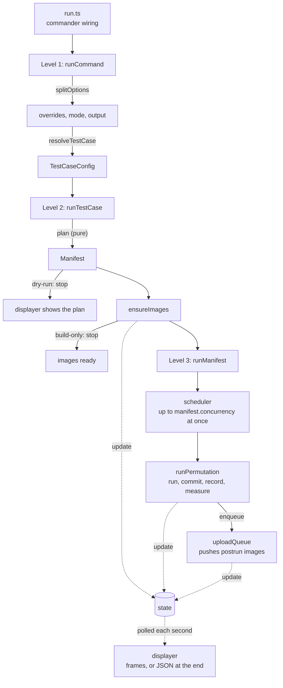

@HUMANS.md

<!--
🤖
This file was created with AI

Harness: Claude Code
Model: claude-fable-5-2
Session Id: session_01LCLeLiApELUXheYNb6d7F3
Supervising engineer: David Johnston

Humans: add your notes here
-->

# The architecture of `run`

Everything `thunderjar run <test case>` does is in this folder. The command file in `src/cli` only wires commander to `runCommand`.

- The plan this was built from: [architecture-plan.md](../../../project-md/human-safe-space/refactor-work/architecture-plan.md). Human-maintained: never edit it.
- Where the code departs from it: [below](#where-the-code-departs-from-the-plan).
- Every shared type is in [types.ts](types.ts). Read it first.

## The three levels

| Level | Function | Given | Owns |
|---|---|---|---|
| 1 | `runCommand` | the test case's name, `RunOptions`, every dependency | The displayer, the interrupt handler, turning errors into the state's `failure`, the exit code |
| 2 | `runTestCase` | a `TestCaseConfig`, a `RunMode` | The manifest, how far the mode goes, the runtime's hooks, the phase |
| 3 | `runManifest` | a `Manifest` whose images are ready | The scheduler, the upload queue, the execution record, removing containers on a stop |

- Options split three ways at level 1, in `splitOptions`, and none goes to two:
  - **Overrides** are merged into the `TestCaseConfig`, e.g. `--iterations`, `--image-prefix`.
  - **Mode** is passed to level 2: `full`, `dry-run` or `build-only`.
  - **Output** sets the displayer's mode: `interactive` or `json`.
- A dry run stops once the manifest is in the state. `--build-only` stops after `ensureImages`.
- Only a full run runs the hooks: `beforeExecution` before anything is built, `afterExecution` however it ended.
- Only a full run opens the run data store. `runTestCase` opens and checks it before `beforeExecution`, and hands it to `runManifest`.
- `--build-only` needs the build secrets set, not the variables a harness needs: `runCommand` tells `resolveTestCase` so with `forRuns: false`.

## The flow



## Module map

Each file has its test beside it, `<name>.test.ts`.

| File | What it is |
|---|---|
| `types.ts` | Every shared type: `RunOptions`, `TestCaseConfig`, `Manifest`, `RunRecord`, `Dependencies`. |
| `runCommand.ts` | Level 1. Returns the exit code. Never throws, prints or exits. |
| `splitOptions.ts` | `RunOptions` into overrides, mode and output. |
| `resolveTestCase.ts` | Loads the project config, the test case and its declarations into a `TestCaseConfig`. The only step that reads the project's files. |
| `runTestCase.ts` | Level 2. Also `RuntimeHookError` and `hookEnv`. |
| `plan.ts` | `TestCaseConfig` to `Manifest`. Pure and synchronous. |
| `ensureImages.ts` | Builds, pushes or pulls each prerun image, so every run can start. |
| `runManifest.ts` | Level 3. Also `openAndCheck`, which opens the run data store. |
| `runControl.ts` | `RunControl`, how level 1 asks the levels below to stop, and `settled`, which bounds the wait. |
| `scheduler.ts` | Runs a list through a task, a fixed number at once, with cache warm-up and backpressure. Knows nothing of Docker. |
| `runPermutation.ts` | One run, start to finish. Returns a `RunRecord`. |
| `uploadQueue.ts` | Pushes committed postrun images behind the runs. |
| `parseExecution.ts` | Reads how the agent ended from the file its run script left. |
| `measurer.ts` | The real `Measurer`: loads the harness's collectors and the task's measurements from the project. |
| `FakeMeasurer.ts` | Its fake. |
| `timed.ts` | Adds how long a job took to the state's timings. |
| `render.ts` | `renderRunState`, the frame, and `runJson`, what `--json` prints. Both pure. |
| `describeFailure.ts` | An error to the message the user reads. Pure. |
| `testSupport.ts` | For tests only: `fakeDependencies()`, `fakeAgent()`, `aManifest()`, `aTestCaseConfig()`. |

## Rules

### Lower levels write to the state, and never print

✅ **Do** report progress by updating the state.

```ts
// 👍 Good
deps.state.update(updateRun((run) => patchRun(run, runId, { status: "committing" })));
```

❌ **Don't** write to stdout or stderr, import `src/cli/output.ts`, or call the displayer below level 1.

```ts
// 👎 Bad
deps.io.stdout.write(`committing ${runId}\n`);
```

**Why:** the displayer redraws one frame from the state each second, and `--json` must leave stdout as JSON alone. Tests assert on the state, which needs no terminal.

### Errors become the state's `failure`

✅ **Do** throw from levels 2 and 3. `runCommand` catches it, and `describeFailure` gives it a message.

❌ **Don't** call `process.exit`, set `process.exitCode`, or print `Error:` yourself. The displayer prints `Error: <failure>` at `stop()`.

**Why:** one place decides the exit code and the wording, so every failure still runs `afterExecution` and leaves the terminal tidy.

A new error class needs a line in `describeFailure`. Without one, the user sees its bare message.

### Only `src/cli/index.ts` builds real services

✅ **Do** take every source of non-determinism from `deps`: `clock`, `random`, `env`, `fs`, `io`, `commands`.

❌ **Don't** use `Date.now()`, `new Date()` with no argument, `Math.random`, `crypto.randomUUID`, `Bun.env`, `process.env`, `process.cwd()`, `Bun.sleep`, `setTimeout` or `Bun.spawn` here.

```ts
// 👍 Good
const startedAt = new Date(deps.clock.now()).toISOString();

// 👎 Bad
const startedAt = new Date().toISOString();
```

**Why:** a test moves a `FakeClock` by hand. Code on the real clock makes that test slow or flaky.

The logger is the one exception: import `moduleLogger` directly.

### A function takes a `Pick` of `Dependencies`

✅ **Do** name the slice you use.

```ts
// 👍 Good
export async function timed<T>(deps: Pick<Dependencies, "clock" | "state">, phase: string, job: () => Promise<T>): Promise<T>
```

❌ **Don't** take the whole `Dependencies` below `runCommand`.

**Why:** the signature then says what the function can touch, and a test builds only that.

### `plan` is pure

✅ **Do** load anything new in `resolveTestCase`, and pass it to `plan` in the `TestCaseConfig`.

❌ **Don't** give `plan` a filesystem, a clock, Docker or `deps`. The execution ID is made in `resolveTestCase` for this reason.

**Why:** the same config always gives the same manifest, so `--dry-run` shows exactly what a run would do, without Docker.

Whether an image needs building is not in the manifest: `ensureImages` works that out.

### `runPermutation` never throws

✅ **Do** let a failure become a `RunRecord` with status `crashed` and its `error`.

❌ **Don't** add a step outside its `try`, or rethrow from its `catch`.

**Why:** the scheduler awaits each task. A throw would stop new runs while containers nobody waits for keep running.

- An agent that exits non-zero, or times out, is a result: status `finished` or `timedOut`, committed and measured like any other.
- `runManifest` decides whether the execution is `failed`.

### Asked to stop, everything winds down within a bound

`runCommand` makes one `RunControl` and passes it down. The first Ctrl-C or SIGTERM calls `stop()`, a second `force()`.

| Who | On `stop()` |
|---|---|
| `ensureImages` | Starts no other image. The one under way finishes. |
| The scheduler | Starts no other run. Each not started is `cancelled`. |
| `runManifest` | Removes the execution's containers, then again each second. Cancels the uploads still waiting. Records the execution as `failed`. |
| `runPermutation` | Goes no further than the step it is on. The run is `crashed`, with `STOPPED` as why. |
| `runTestCase` | Still runs `afterExecution`. |

✅ **Do** wrap a wait that a stop should cut short in `settled(work, control, clock)`.

```ts
// 👍 Good
await settled(ensureImages(manifest, deps, control), control, deps.clock);
```

❌ **Don't** await a build, a push or the scheduler bare where a stop can arrive.

```ts
// 👎 Bad
await uploads.drain();
```

**Why:** whoever stops a command kills it outright if it lingers, e.g. a CI runner after its grace period. Then `afterExecution` never runs, and a rented runtime is left up.

- `settled` waits `STOP_SETTLE_MS`, 15 seconds, after a stop, and not at all once forced. Then it gives `ABANDONED`.
- What was given up on goes on unawaited. `run.ts` calls `process.exit` after an interrupt for that reason.
- A new step that starts something on the runtime needs a `control.shouldStop()` check before it.
- The hooks themselves are never cut short.

### A store that can't record stops the runs

`runManifest` wraps the store it gives `runPermutation`. Once a `recordContainerRun` fails, no other run starts: each is `cancelled`.

**Why:** an agent whose run can't be recorded costs the same and leaves nothing.

A `RunRecord`'s `record` is only ever what the store took.

### Uploads go through the queue

✅ **Do** hand a committed postrun image to `uploads.enqueue`.

❌ **Don't** call `docker.push` in `runPermutation`.

**Why:** the run's slot frees at once. The scheduler holds new runs back while the backlog is over `env.uploadBacklogCap`, so the runtime's disk doesn't fill.

### Host Docker checks, runtime Docker does the work

| Operation | Method | `hostDocker` | `runtimeDocker` |
|---|---|---|---|
| Check the login for the image store's registry | `checkLogin` | ✓ | |
| Ask whether the store has a prerun image | `inRegistry` | ✓ | |
| List the images already on the runtime | `imagesIn` | | ✓ |
| Build a prerun image | `build` | | ✓ |
| Push or pull a prerun image | `push`, `pull` | | ✓ |
| Run the agent's container, read its files | `run`, `readFile` | | ✓ |
| Commit the postrun image | `commit` | | ✓ |
| Search the postrun image for secrets, take measurements | `openShellSession` | | ✓ |
| Push the postrun image | `push`, from the upload queue | | ✓ |
| Remove containers | `removeContainer`, `removeContainersNamed` | | ✓ |

- With no `runtime` in the project config, both are the same object.
- In tests they are two `FakeDocker`s over one `FakeRegistry`, so a test can check which one a call went to.

## Testing

Tests here pass fakes and assert on the state, the records and the fakes' call logs. Nothing reaches Docker.

```ts
// 👍 Good
const fakes = fakeDependencies();
const manifest = aManifest();
for (const { image } of manifest.images) fakes.runtimeDocker.addImage(image);
fakes.runtimeDocker.on("", fakeAgent({ exitCode: 2, stderr: "out of credit" }));

const running = runManifest(manifest, fakes.deps);
await fakes.clock.advance(120_000);
const result = await running;

expect(result.execution.status).toBe("failed");
expect(fakes.state.get().run.runs[manifest.runs[0]!.runId]?.outcome).toBe("exited 2");
expect(fakes.hostDocker.calls).toEqual([]);
```

- **`fakeDependencies()`**
  - A whole `Dependencies` of fakes, and each fake by name for assertions.
- **`fakeAgent()`**
  - A container script for `FakeDocker` that behaves as the real run script does.
  - Register it with `runtimeDocker.on("", fakeAgent())` for every container, or `on("-1-1", …)` for one.
- **`aManifest()`, `aTestCaseConfig()`**
  - Small plain values: test case `example`, two permutations, two iterations.
- **`createRunControl()`**
  - Pass it as the control, then call `stop()` or `force()` where the test wants the signal.
- **The clock only moves when the test moves it.**
  - Start the function, `await clock.advance(ms)`, then await the result.
  - An agent, a warm-up, a timeout and an upload each wait on the clock.

✅ **Do** assert on specific lines of a frame, with `toContain` or `toBe`.

❌ **Don't** use snapshots, or assert on the whole frame.

**Why:** snapshots are for `*.humans.*` files only, and `bun run lint` fails on one elsewhere.

✅ **Do** use plain examples, e.g. "jobs", in tests of `scheduler` and `uploadQueue`.

❌ **Don't** build a manifest to test them.

**Why:** they are general-purpose, and domain words hide what the test is about.

### Things that will trip you

- **Start the clock at `START_TIME`.**
  - `parseExecution` rejects times that don't look like epoch ms, so a `FakeClock()` at 0 makes every run `crashed`.
- **A container with no script leaves no result.**
  - Its run is `crashed`.
- **The image must be on the runtime.**
  - `addImage` it, or let `ensureImages` build it. Otherwise the run is `crashed`: the container never started.
- **Secrets start another container.**
  - With an env value of 12 characters or more, the secret search runs in a container whose name ends `-secrets`. Register `on("-secrets", …)` before `on("", …)`.
- **`FakeDocker.run` throws on a non-zero exit, as the real one does.**
  - The agent's exit code goes in the run file, and the container exits 0. `fakeAgent` does this.

### When a fixture scenario is the right tool

Only where the code reads a real `.thunderjar/` folder.

| Test | Why it needs one |
|---|---|
| `resolveTestCase.test.ts` | The loaders import the project's own files. |
| `measurer.test.ts` | The real measurer loads declarations. |
| `runCommand.test.ts` | End to end from a name, with every Docker call faked. |
| `src/cli/commands/run/run.test.ts` | The real CLI: `--dry-run`, `--build-only`, and one full run through the fake `docker` binary. |

`runCommand.test.ts` advances the clock a second at a time until the command settles, because reading the project takes real time.

## How to add things

### A run option

1. Add the flag in `src/cli/commands/run/run.ts`.
2. Add the field to `RunOptions`.
3. Put it in exactly one kind in `splitOptions`.
   1. An override: add it to `RunOverrides`, copy it into the `TestCaseConfig` in `resolveTestCase`, and into the manifest in `plan` if a lower level reads it.
   2. A mode: add it to `RunMode`, and say where `runTestCase` stops.
   3. An output: add it to `OutputFormat`, in the Displayer service.
4. Test `splitOptions`, and the level that reads it.

A flag that replaces a field of the test case is different: add it to `OVERRIDES` in `src/config/overrides.ts`. The flag, its type and the split follow from that.

### A field in the manifest

1. Add it to `Manifest`, or `PlannedRun`, `PlannedPermutation`, `PlannedImage`.
2. If it comes from the project, load it in `resolveTestCase` into the `TestCaseConfig`.
3. Fill it in `plan`.
   - Leave an optional key out, never set it to `undefined`: `--dry-run --json` prints the manifest as it is.
4. Show it in `render.ts` if a dry run should.

The manifest is public: `--dry-run --json` prints it. Removing or renaming a field is a breaking change.

### A status in the state

1. Add it to `RunStatus` in the ApplicationState service.
2. Add it to both `STATUS_ORDER` lists: in the Displayer service and in `render.ts`.
3. Write it from the step that owns it, with `patchRun`.
4. Check `SHOWS_UPLOAD` and `didntSucceed` in `runManifest.ts`, and `anyStarted` in `runCommand.ts`: each decides by status.
   - `runManifest` also reads `queued` to tell a run that never started from one it gave up on.

A status that ends a run also needs adding to `RunRecord`'s.

### A service

1. Make `src/services/<Name>/`, as `src/services/HUMANS.md` lays out: the interface and its `create<Name>Service`, and `Fake<Name>` beside it.
   - A service whose types live in a higher layer goes beside those types. `Measurer` and `Stores` are the two examples.
2. Add it to `Dependencies`.
3. Build the real one in `src/cli/index.ts`.
4. Add the fake to `fakeDependencies()`.
5. Take it through a `Pick` where it is used.

## Where the code departs from the plan

| The plan says | The code does | Why |
|---|---|---|
| `runPermutation(run, deps, uploads)` | It also takes the manifest, and a `store` in its deps. | A `PlannedRun` names its permutation by hash. The store is opened once per execution. |
| `runManifest(manifest, deps)` and `runTestCase(config, deps, mode)` | Each takes a `RunControl`, as do `ensureImages` and `runPermutation`. `runManifest` also takes the opened store. | Level 1 needs a way to say "stop" on Ctrl-C. The store is checked before the hooks. |
| `resolveTestCase(name, overrides, deps)` | It takes a last `{ forRuns }`. | `--build-only` must not need the harness's keys, as `build` didn't. |
| `await uploads.drain()` | The scheduler and the drain are awaited through `settled`. | A stop must not wait for every queued push. |
| `runCommand` returns what level 2 does | It returns the exit code, and never throws. | The command file only sets `process.exitCode`. |
| `Dependencies` holds `logger`, `stdout`, `stderr` | It holds `io`, `commands`, `stores` and `measurer` instead. | The logger is imported directly. Hooks, the store and measurements need faking too. |
| The logger writes to `env.logPath` | There is no such field. The displayer is given `logPath()` from the logger, lazily. | The path is only known once commander has parsed the command line. |
| `resolveTestCase` takes all of `deps` | It takes `env` and `random`. | It touches no Docker: the login check is `ensureImages`'s. |
| `plan` gets `deps.env.concurrency` | It gets `--concurrency`, else the env's, else the runtime's, else 1. | The flag and the runtime's setting were kept. |
| `scheduler.run(manifest, task)` | It takes a third argument, what a skipped run becomes. | Runs not started on an interrupt end as `cancelled`. |
| `createUploadQueue(docker)` | It takes options, and returns a queue with `failures()` and `cancel(reason)`. | A failed push fails the execution, without rejecting `drain()`. A stop drops what is still waiting. |
| Warnings are part of what is shown | The displayer writes each to stderr. They are not in the frame. | They would show twice. |
| On a remote runtime, containers start from the stored image | With no image store, they start from the local name. | There is no stored name to use. |

Smaller choices the plan doesn't cover:

- **A non-zero exit is `finished`.**
  - The exit code is on the record. `timedOut`, `crashed` and `cancelled` are the other three.
- **The run data store is checked in `runTestCase`, before `beforeExecution`.**
  - As the old code did. `runManifest` opens and checks it itself only if it isn't given one.
- **A failing `beforeExecution` skips `afterExecution`.**
- **`--build-only` runs no hooks.**
- **An interrupt is bounded, as in the old code: 15 seconds.**
  - Unlike the old code, the execution is still recorded as `failed` after that.
- **A stop during `beforeExecution` waits for the hook.**
  - A second signal doesn't cut it short either. Then nothing is built, and `afterExecution` runs.
- **An execution asked to stop is `failed`, whatever its runs say.**
- **The loaders and `hashPermutations` are not injected.**
  - They read the real filesystem, and a parameter's `resolve` runs on the host's shell.
- **`render.ts` and `describeFailure.ts` keep their own small formatters.**
  - This layer can't import from `src/cli`, which has its own copies of `displayPath` and `pushFailure`.

## Still open

1. **Warm-up idling.**
   - A worker claims its run in order, then waits if the permutation is warming up. Another free worker takes the following run meanwhile. The plan asks whether a worker should skip ahead itself.
2. **The JSON shape.**
   - Open in the plan. As built: `{ manifest }` for a dry run, `{ manifest, images }` for `--build-only`, else `{ execution, recordedIn, containerRuns }`.
3. **Where the log path lives.**
   - Open in the plan. As built, `src/cli/program.ts` chooses it and the logger holds it.
4. **`DockerService` has no implementation of its own.**
   - Both Dockers are the temporary adapter in `src/docker`.
5. **Unused methods on `DockerService`.**
   - `startDetached`, `stop`, `followLogs` and `stderrTail` served the deleted runner.
6. **Off a terminal, `run` is silent until the end.**
   - It prints one final frame. A long CI run shows nothing meanwhile.
