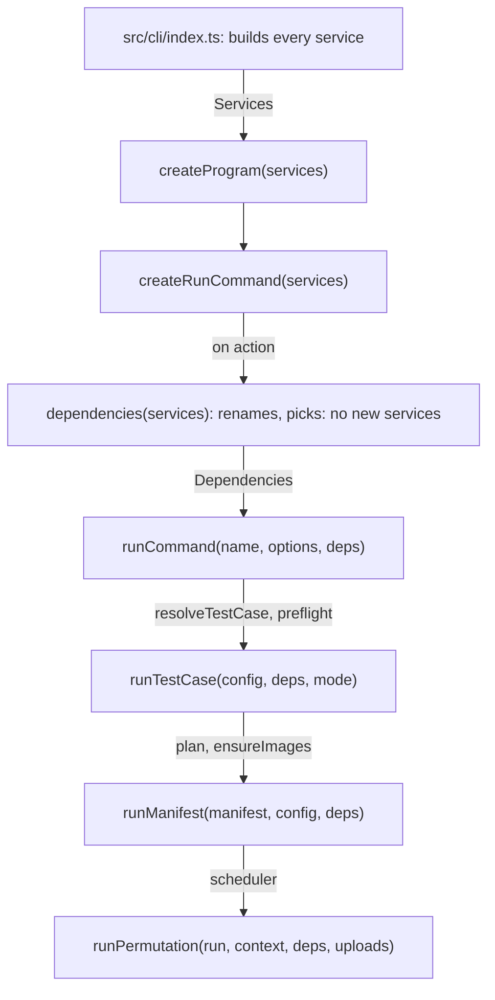

# runNext

What `thunderjar run` runs. See `project-md/human-safe-space/refactor-work/architecture-plan.md`.

## How services reach it

`dependencies()` only maps one shape onto the other:

| `Services` (src/cli/services.ts) | `Dependencies` (types.ts) |
| --- | --- |
| `runSettings` | `settings` |
| `runDataStore` | `runStore` |
| `runDataStoreLocation` | `runStoreLocation` |
| `io.stdout`, `io.stderr`, `io.onStop` | `stdout`, `stderr`, `onStop` |
| everything else | same name |

Never build a service here or in the command: add it to `Services` and build it in `src/cli/index.ts`.

## Where each thing lives

- `runCommand/`
  - Level 1. Splits the options, resolves the test case, checks what must hold before anything is built, drives the displayer, and handles Ctrl-C.
- `runTestCase/`
  - Level 2. Plans, then builds images, then runs, stopping early for `--dry-run` and `--build-only`. Runs the runtime's hooks around it.
- `plan/`
  - Pure. Lays a resolved config out as a `Manifest`.
- `ensureImages/`
  - Pulls or builds each pre-run image the runtime lacks.
- `runManifest/`
  - Level 3. Records the execution, schedules the runs, drains the uploads.
- `scheduler/`
  - One worker per concurrency slot, prompt-cache warm-up, upload backpressure.
- `runPermutation/`
  - One run: agent, commit, record, then upload and measure. Never throws.
- `uploadQueue/`
  - Pushes post-run images with its own concurrency.
- `hooks/`, `timed/`
  - The runtime's hooks, once each per execution; phase timings into the state.

Lower levels never print. They write to the run state, and the displayer draws it with `renderRun` (src/services/Displayer/renderRun/renderRun.ts), or prints it as JSON with `--json`.

## Where it differs from the architecture plan

- `TestCaseConfig` carries everything read from the project.
  - Each permutation hashed, with its harness's functions, and the task's measurements.
  - So `plan` is pure, and nothing below level 1 reads the project, except to build an image.
- `ensureImages` and `runManifest` take the config as well as the manifest.
  - The manifest is data only, so `--dry-run --json` can print it. The Dockerfiles and functions stay in the config.
- `runPermutation` takes a `RunContext`: the manifest and the config.
- `PlannedParameter` has no `apply` source: parameters aren't loaded that way yet.
- `Dependencies` has no `logger`: modules take one with `moduleLogger`, as the rest of `src/` does.
- The settings are `RunSettings`, not on `Env`.

## Settings from the environment

| Variable | What | Default |
| --- | --- | --- |
| `THUNDERJAR_CONCURRENCY` | Containers at once. `--concurrency` wins over it; it wins over the runtime's. | the runtime's, or 1 |
| `THUNDERJAR_UPLOAD_BACKLOG_CAP` | New runs wait while more images than this wait to upload. | 4 |
| `THUNDERJAR_UPLOAD_CONCURRENCY` | Post-run images pushed at once. | 2 |
| `THUNDERJAR_CACHE_WARMUP_MS` | How long a permutation's first run has before its others start. The test harness sets 0. | 5000 |
