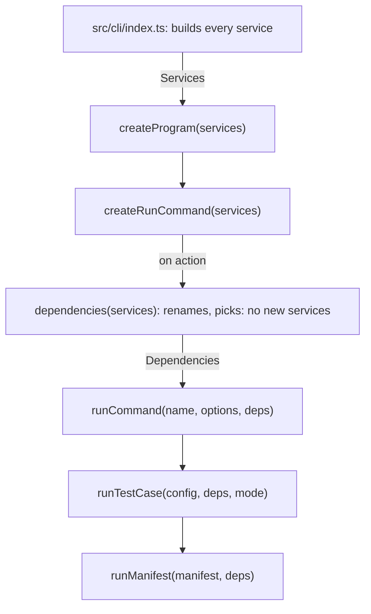

# runNext

How `thunderjar run` runs a test case. See `project-md/human-safe-space/refactor-work/architecture-plan.md`.

One path still bypasses it: a config whose `runtime` has a `runner` runs the old way (`run()` in `src/cli/commands/run/run.ts`, then `src/execution/runExecution.ts` on the runtime).

## How services reach it

`dependencies()` only maps one shape onto the other:

| `Services` (src/cli/services.ts) | `Dependencies` (types.ts) |
| --- | --- |
| `runSettings`, with `--concurrency` over its own | `settings` |
| `runDataStore` | `runStore` |
| `io.stdout`, `io.stderr`, `io.onStop` | `stdout`, `stderr`, `onStop` |
| everything else | same name |

Never build a service here or in the command: add it to `Services` and build it in `src/cli/index.ts`.

## Who does what

| Folder | What it does |
| --- | --- |
| `runCommand/` | Level 1. Splits the options, resolves the test case from the project (`resolveTestCase`), drives the displayer, reports errors on stderr, returns the exit code |
| `runTestCase/` | Level 2. Plans, checks the image store's login and the run data store, runs the runtime's hooks around `ensureImages` and `runManifest` |
| `plan/` | Pure: the manifest, with every image and container name |
| `ensureImages/` | Builds, pushes and pulls the pre-run images |
| `runManifest/` | Level 3. Records the execution, schedules the runs, drains the uploads |
| `runPermutation/` | One run. Never throws |
| `scheduler/`, `uploadQueue/` | Generic: no Thunderjar types beyond `CommittedImage` |
| `state/` | The only way the levels write to the run state: statuses, the event log, timings |
| `display/` | Pure renderers of the run state, given to the displayer in `src/cli/index.ts` |

## The state is the only output

Levels below `runCommand` never print. They write statuses and append `RunEvent`s to `details.log`. The displayer renders that log, so the text a run writes is a pure function of the state: test it with `createRunRenderer` and a hand-built state.

## Where it departs from the old `run`

- Every pre-run image is ready before the first container starts.
- Post-run images are pushed in the background, by the upload queue.
- A run that times out is committed and recorded, not measured.
- A Docker failure in one run is that run's outcome, `crashed`. The rest still run, and the execution is `failed`.
