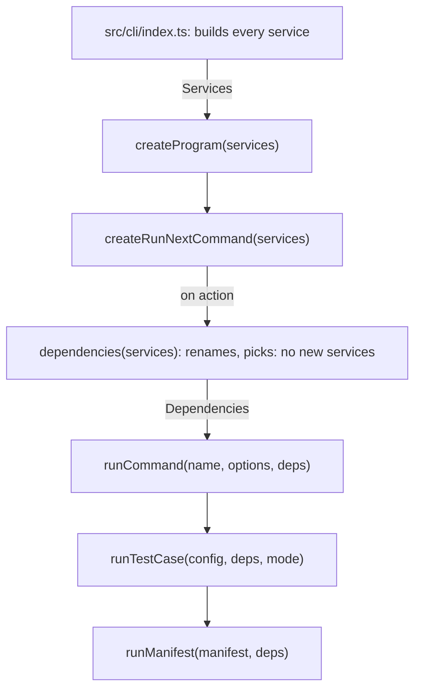

# runNext

The reimplementation of `run`, behind the hidden `run-next` command. See `project-md/human-safe-space/refactor-work/architecture-plan.md`.

## How services reach it

`dependencies()` only maps one shape onto the other:

| `Services` (src/cli/services.ts) | `Dependencies` (types.ts) |
| --- | --- |
| `runSettings` | `settings` |
| `runDataStore` | `runStore` |
| `io.stdout`, `io.stderr` | `stdout`, `stderr` |
| everything else | same name |

Never build a service here or in the command: add it to `Services` and build it in `src/cli/index.ts`.
